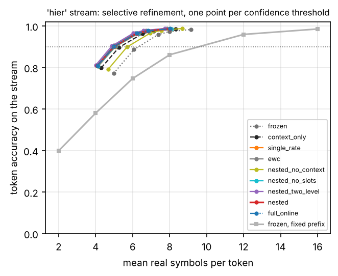
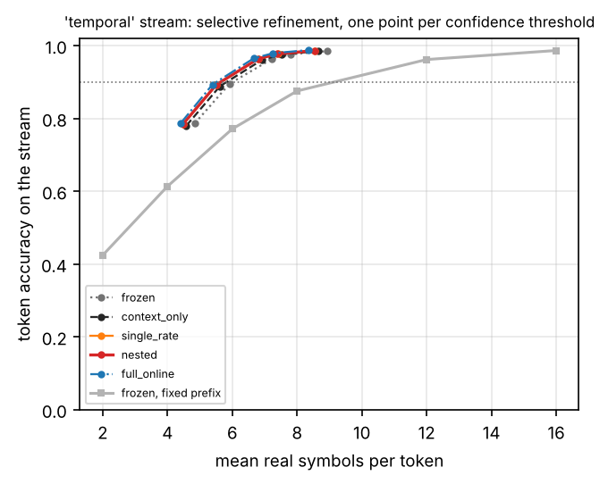
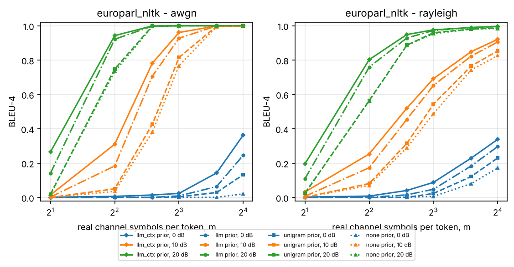
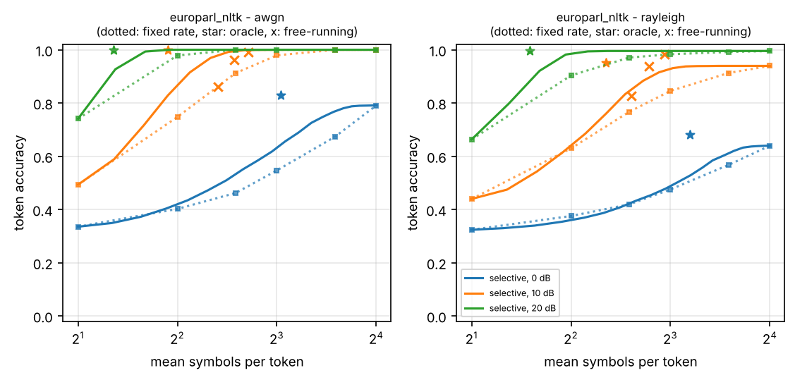
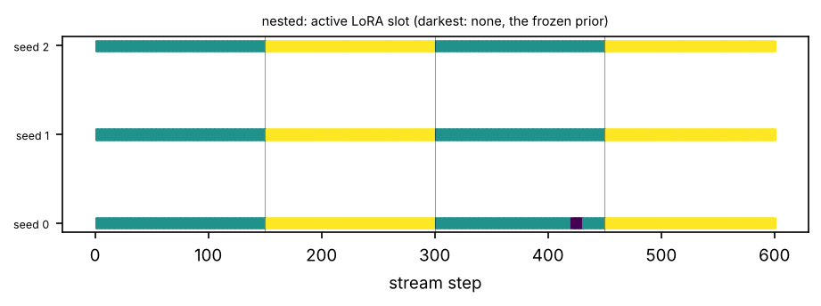
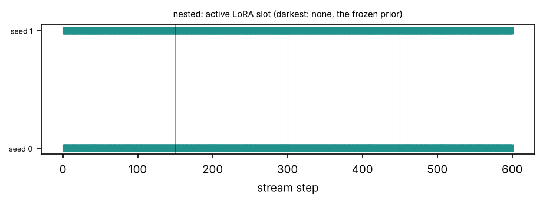
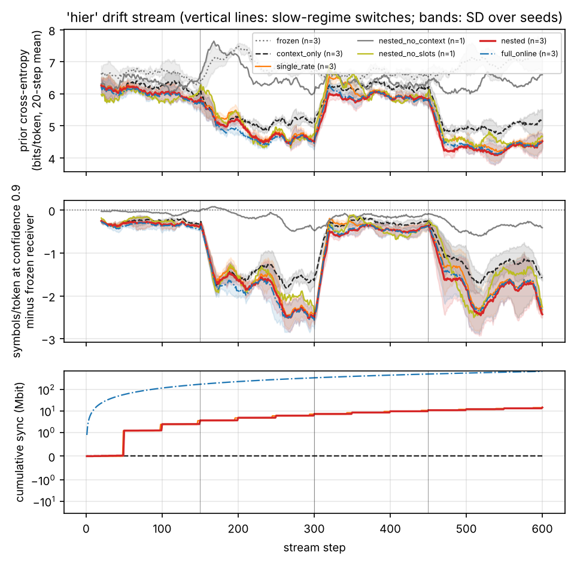
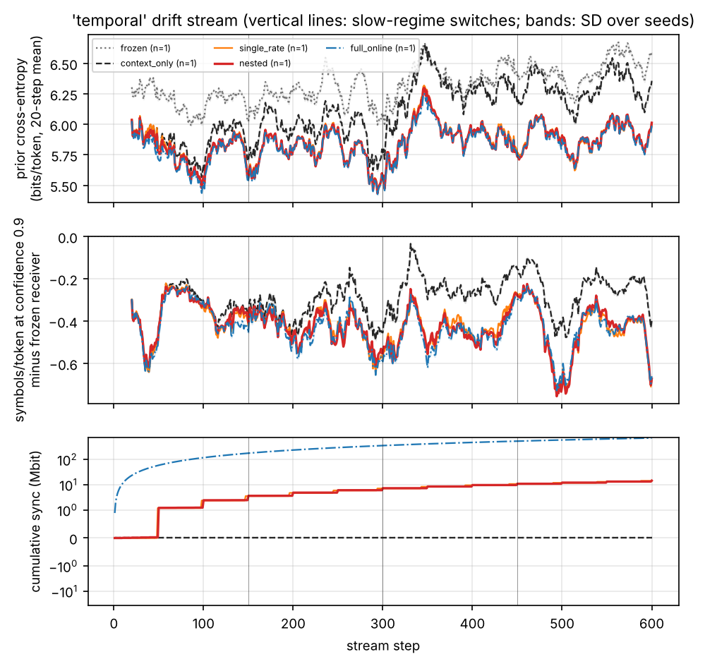

# Tables and figures: gpt2

Generated by `scripts/write_report.py` from the result files; nothing here is typed by hand.

## Headline, hier stream

Real symbols per token needed for 90% token accuracy on the 'hier' stream (mean over seeds; read off each method's measured operating curve).

| Receiver | Seeds | Prior bits/token | Symbols/token | vs. frozen at a fixed rate | vs. frozen with refinement | Sync kbit/step |
| --- | --- | --- | --- | --- | --- | --- |
| frozen, fixed prefix length | 3 | 6.793 | 9.550 | — | — | 0 |
| frozen, selective refinement | 3 | 6.793 | 6.315 | -33.9% | — | 0.00 |
| context_only, selective refinement | 3 | 5.627 | 5.323 | -44.3% | -15.7% | 0.00 |
| single_rate, selective refinement | 3 | 5.362 | 5.077 | -46.8% | -19.6% | 23.73 |
| ewc, selective refinement | 1 | 5.412 | 4.923 | -48.4% | -22.0% | 23.73 |
| nested_no_context, selective refinement | 1 | 6.431 | 5.717 | -40.1% | -9.5% | 24.23 |
| nested_no_slots, selective refinement | 3 | 5.349 | 5.063 | -47.0% | -19.8% | 24.23 |
| nested_two_level, selective refinement | 1 | 5.302 | 4.842 | -49.3% | -23.3% | 29.63 |
| nested, selective refinement | 3 | 5.256 | 4.997 | -47.7% | -20.9% | 24.23 |
| full_online, selective refinement | 3 | 5.251 | 4.977 | -47.9% | -21.2% | 1185.80 |

## Headline, temporal stream

Real symbols per token needed for 90% token accuracy on the 'temporal' stream (mean over seeds; read off each method's measured operating curve).

| Receiver | Seeds | Prior bits/token | Symbols/token | vs. frozen at a fixed rate | vs. frozen with refinement | Sync kbit/step |
| --- | --- | --- | --- | --- | --- | --- |
| frozen, fixed prefix length | 2 | 6.331 | 9.130 | — | — | 0 |
| frozen, selective refinement | 2 | 6.331 | 6.007 | -34.2% | — | 0.00 |
| context_only, selective refinement | 2 | 6.119 | 5.827 | -36.2% | -3.0% | 0.00 |
| single_rate, selective refinement | 2 | 5.857 | 5.651 | -38.1% | -5.9% | 23.73 |
| nested, selective refinement | 2 | 5.852 | 5.642 | -38.2% | -6.1% | 24.23 |
| full_online, selective refinement | 1 | 5.845 | 5.511 | -39.6% | -8.3% | 1185.80 |

## Rate and fidelity on the base corpus

**Semantic codec, bleu4 on europarl_nltk (n=200, 20.4 tokens per sentence) by decoder prior, symbols per token m and SNR**

| channel | prior | m | 0 dB | 10 dB | 20 dB |
| --- | --- | --- | --- | --- | --- |
| awgn | llm | 2 | 0.0 | 0.0027 | 0.1414 |
| awgn | llm | 4 | 0.0008 | 0.1839 | 0.9215 |
| awgn | llm | 6 | 0.0009 | 0.7059 | 0.9979 |
| awgn | llm | 8 | 0.0092 | 0.9273 | 1.0 |
| awgn | llm | 12 | 0.0637 | 0.999 | 1.0 |
| awgn | llm | 16 | 0.2461 | 1.0 | 1.0 |
| awgn | llm_ctx | 2 | 0.0018 | 0.015 | 0.2651 |
| awgn | llm_ctx | 4 | 0.0067 | 0.3103 | 0.9426 |
| awgn | llm_ctx | 6 | 0.0146 | 0.7819 | 0.999 |
| awgn | llm_ctx | 8 | 0.0239 | 0.9607 | 1.0 |
| awgn | llm_ctx | 12 | 0.1429 | 0.999 | 1.0 |
| awgn | llm_ctx | 16 | 0.3637 | 1.0 | 1.0 |
| awgn | none | 2 | 0.0 | 0.0 | 0.021 |
| awgn | none | 4 | 0.0 | 0.0354 | 0.7331 |
| awgn | none | 6 | 0.0 | 0.3813 | 0.9958 |
| awgn | none | 8 | 0.0 | 0.7672 | 1.0 |
| awgn | none | 12 | 0.0012 | 0.9946 | 1.0 |
| awgn | none | 16 | 0.0211 | 1.0 | 1.0 |
| awgn | unigram | 2 | 0.0 | 0.0 | 0.0181 |
| awgn | unigram | 4 | 0.0 | 0.0506 | 0.7487 |
| awgn | unigram | 6 | 0.0 | 0.4261 | 0.9979 |
| awgn | unigram | 8 | 0.0037 | 0.8152 | 1.0 |
| awgn | unigram | 12 | 0.0291 | 0.9971 | 1.0 |
| awgn | unigram | 16 | 0.1328 | 0.9995 | 1.0 |
| rayleigh | llm | 2 | 0.0 | 0.0069 | 0.1094 |
| rayleigh | llm | 4 | 0.0013 | 0.1734 | 0.7592 |
| rayleigh | llm | 6 | 0.0154 | 0.4547 | 0.9287 |
| rayleigh | llm | 8 | 0.0479 | 0.6528 | 0.9727 |
| rayleigh | llm | 12 | 0.1834 | 0.8228 | 0.9894 |
| rayleigh | llm | 16 | 0.2967 | 0.9057 | 0.9954 |
| rayleigh | llm_ctx | 2 | 0.0029 | 0.0322 | 0.196 |
| rayleigh | llm_ctx | 4 | 0.0083 | 0.2534 | 0.8028 |
| rayleigh | llm_ctx | 6 | 0.0409 | 0.5198 | 0.9488 |
| rayleigh | llm_ctx | 8 | 0.0881 | 0.6921 | 0.9761 |
| rayleigh | llm_ctx | 12 | 0.229 | 0.8489 | 0.9897 |
| rayleigh | llm_ctx | 16 | 0.3387 | 0.921 | 0.9968 |
| rayleigh | none | 2 | 0.0 | 0.0007 | 0.0265 |
| rayleigh | none | 4 | 0.0 | 0.0706 | 0.5619 |
| rayleigh | none | 6 | 0.0018 | 0.2894 | 0.886 |
| rayleigh | none | 8 | 0.0066 | 0.4879 | 0.9538 |
| rayleigh | none | 12 | 0.0805 | 0.7425 | 0.9805 |
| rayleigh | none | 16 | 0.1715 | 0.8257 | 0.9844 |
| rayleigh | unigram | 2 | 0.0 | 0.0011 | 0.0236 |
| rayleigh | unigram | 4 | 0.0 | 0.0814 | 0.5646 |
| rayleigh | unigram | 6 | 0.0009 | 0.315 | 0.8869 |
| rayleigh | unigram | 8 | 0.0236 | 0.5432 | 0.9594 |
| rayleigh | unigram | 12 | 0.1218 | 0.7649 | 0.9804 |
| rayleigh | unigram | 16 | 0.2304 | 0.8537 | 0.9877 |

**Semantic codec, gen_tok_acc on europarl_nltk (n=200, 20.4 tokens per sentence) by decoder prior, symbols per token m and SNR**

| channel | prior | m | 0 dB | 10 dB | 20 dB |
| --- | --- | --- | --- | --- | --- |
| awgn | llm | 2 | 0.0204 | 0.1104 | 0.4547 |
| awgn | llm | 4 | 0.0383 | 0.4633 | 0.9639 |
| awgn | llm | 6 | 0.0684 | 0.857 | 0.9993 |
| awgn | llm | 8 | 0.119 | 0.9706 | 1.0 |
| awgn | llm | 12 | 0.2642 | 0.9995 | 1.0 |
| awgn | llm | 16 | 0.517 | 1.0 | 1.0 |
| awgn | llm_ctx | 2 | 0.0381 | 0.1474 | 0.5456 |
| awgn | llm_ctx | 4 | 0.0613 | 0.551 | 0.9737 |
| awgn | llm_ctx | 6 | 0.0984 | 0.893 | 0.9995 |
| awgn | llm_ctx | 8 | 0.1491 | 0.9818 | 1.0 |
| awgn | llm_ctx | 12 | 0.3587 | 0.9995 | 1.0 |
| awgn | llm_ctx | 16 | 0.6012 | 1.0 | 1.0 |
| awgn | none | 2 | 0.0304 | 0.1271 | 0.3777 |
| awgn | none | 4 | 0.0442 | 0.3728 | 0.8823 |
| awgn | none | 6 | 0.0581 | 0.7032 | 0.9985 |
| awgn | none | 8 | 0.0935 | 0.9119 | 1.0 |
| awgn | none | 12 | 0.1835 | 0.998 | 1.0 |
| awgn | none | 16 | 0.337 | 1.0 | 1.0 |
| awgn | unigram | 2 | 0.0611 | 0.1378 | 0.3863 |
| awgn | unigram | 4 | 0.0957 | 0.4081 | 0.8899 |
| awgn | unigram | 6 | 0.1327 | 0.7366 | 0.9993 |
| awgn | unigram | 8 | 0.196 | 0.9291 | 1.0 |
| awgn | unigram | 12 | 0.3436 | 0.9985 | 1.0 |
| awgn | unigram | 16 | 0.5296 | 0.9998 | 1.0 |
| rayleigh | llm | 2 | 0.0265 | 0.102 | 0.366 |
| rayleigh | llm | 4 | 0.041 | 0.3625 | 0.8609 |
| rayleigh | llm | 6 | 0.0878 | 0.6026 | 0.9551 |
| rayleigh | llm | 8 | 0.1464 | 0.7579 | 0.9784 |
| rayleigh | llm | 12 | 0.2904 | 0.8774 | 0.9929 |
| rayleigh | llm | 16 | 0.4013 | 0.9352 | 0.9975 |
| rayleigh | llm_ctx | 2 | 0.0342 | 0.1471 | 0.4482 |
| rayleigh | llm_ctx | 4 | 0.0645 | 0.4209 | 0.8802 |
| rayleigh | llm_ctx | 6 | 0.1262 | 0.6566 | 0.9661 |
| rayleigh | llm_ctx | 8 | 0.1934 | 0.7852 | 0.9815 |
| rayleigh | llm_ctx | 12 | 0.3385 | 0.9006 | 0.9931 |
| rayleigh | llm_ctx | 16 | 0.4494 | 0.9478 | 0.998 |
| rayleigh | none | 2 | 0.0316 | 0.1109 | 0.3149 |
| rayleigh | none | 4 | 0.0417 | 0.3064 | 0.7672 |
| rayleigh | none | 6 | 0.0687 | 0.522 | 0.9355 |
| rayleigh | none | 8 | 0.0996 | 0.6809 | 0.9696 |
| rayleigh | none | 12 | 0.2085 | 0.8327 | 0.9845 |
| rayleigh | none | 16 | 0.3105 | 0.8948 | 0.9902 |
| rayleigh | unigram | 2 | 0.0724 | 0.141 | 0.3319 |
| rayleigh | unigram | 4 | 0.0993 | 0.3461 | 0.7761 |
| rayleigh | unigram | 6 | 0.1391 | 0.5632 | 0.9392 |
| rayleigh | unigram | 8 | 0.1987 | 0.7307 | 0.9747 |
| rayleigh | unigram | 12 | 0.3243 | 0.8597 | 0.9895 |
| rayleigh | unigram | 16 | 0.4388 | 0.9235 | 0.9934 |

**Semantic codec, gen_tok_acc on europarl_nltk (n=200, 20.4 tokens per sentence) by decoder prior, symbols per token m and SNR**

| channel | prior | m | 0 dB | 10 dB | 20 dB |
| --- | --- | --- | --- | --- | --- |
| awgn | llm | 2 | 0.0204 | 0.1104 | 0.4547 |
| awgn | llm | 4 | 0.0383 | 0.4633 | 0.9639 |
| awgn | llm | 6 | 0.0684 | 0.857 | 0.9993 |
| awgn | llm | 8 | 0.119 | 0.9706 | 1.0 |
| awgn | llm | 12 | 0.2642 | 0.9995 | 1.0 |
| awgn | llm | 16 | 0.517 | 1.0 | 1.0 |
| awgn | llm_ctx | 2 | 0.0381 | 0.1474 | 0.5456 |
| awgn | llm_ctx | 4 | 0.0613 | 0.551 | 0.9737 |
| awgn | llm_ctx | 6 | 0.0984 | 0.893 | 0.9995 |
| awgn | llm_ctx | 8 | 0.1491 | 0.9818 | 1.0 |
| awgn | llm_ctx | 12 | 0.3587 | 0.9995 | 1.0 |
| awgn | llm_ctx | 16 | 0.6012 | 1.0 | 1.0 |
| awgn | none | 2 | 0.0304 | 0.1271 | 0.3777 |
| awgn | none | 4 | 0.0442 | 0.3728 | 0.8823 |
| awgn | none | 6 | 0.0581 | 0.7032 | 0.9985 |
| awgn | none | 8 | 0.0935 | 0.9119 | 1.0 |
| awgn | none | 12 | 0.1835 | 0.998 | 1.0 |
| awgn | none | 16 | 0.337 | 1.0 | 1.0 |
| awgn | unigram | 2 | 0.0611 | 0.1378 | 0.3863 |
| awgn | unigram | 4 | 0.0957 | 0.4081 | 0.8899 |
| awgn | unigram | 6 | 0.1327 | 0.7366 | 0.9993 |
| awgn | unigram | 8 | 0.196 | 0.9291 | 1.0 |
| awgn | unigram | 12 | 0.3436 | 0.9985 | 1.0 |
| awgn | unigram | 16 | 0.5296 | 0.9998 | 1.0 |
| rayleigh | llm | 2 | 0.0265 | 0.102 | 0.366 |
| rayleigh | llm | 4 | 0.041 | 0.3625 | 0.8609 |
| rayleigh | llm | 6 | 0.0878 | 0.6026 | 0.9551 |
| rayleigh | llm | 8 | 0.1464 | 0.7579 | 0.9784 |
| rayleigh | llm | 12 | 0.2904 | 0.8774 | 0.9929 |
| rayleigh | llm | 16 | 0.4013 | 0.9352 | 0.9975 |
| rayleigh | llm_ctx | 2 | 0.0342 | 0.1471 | 0.4482 |
| rayleigh | llm_ctx | 4 | 0.0645 | 0.4209 | 0.8802 |
| rayleigh | llm_ctx | 6 | 0.1262 | 0.6566 | 0.9661 |
| rayleigh | llm_ctx | 8 | 0.1934 | 0.7852 | 0.9815 |
| rayleigh | llm_ctx | 12 | 0.3385 | 0.9006 | 0.9931 |
| rayleigh | llm_ctx | 16 | 0.4494 | 0.9478 | 0.998 |
| rayleigh | none | 2 | 0.0316 | 0.1109 | 0.3149 |
| rayleigh | none | 4 | 0.0417 | 0.3064 | 0.7672 |
| rayleigh | none | 6 | 0.0687 | 0.522 | 0.9355 |
| rayleigh | none | 8 | 0.0996 | 0.6809 | 0.9696 |
| rayleigh | none | 12 | 0.2085 | 0.8327 | 0.9845 |
| rayleigh | none | 16 | 0.3105 | 0.8948 | 0.9902 |
| rayleigh | unigram | 2 | 0.0724 | 0.141 | 0.3319 |
| rayleigh | unigram | 4 | 0.0993 | 0.3461 | 0.7761 |
| rayleigh | unigram | 6 | 0.1391 | 0.5632 | 0.9392 |
| rayleigh | unigram | 8 | 0.1987 | 0.7307 | 0.9747 |
| rayleigh | unigram | 12 | 0.3243 | 0.8597 | 0.9895 |
| rayleigh | unigram | 16 | 0.4388 | 0.9235 | 0.9934 |

**Semantic codec, tok_acc on europarl_nltk (n=200, 20.4 tokens per sentence) by decoder prior, symbols per token m and SNR**

| channel | prior | m | 0 dB | 10 dB | 20 dB |
| --- | --- | --- | --- | --- | --- |
| awgn | llm | 2 | 0.3293 | 0.4859 | 0.7157 |
| awgn | llm | 4 | 0.3924 | 0.7264 | 0.9761 |
| awgn | llm | 6 | 0.4502 | 0.9057 | 0.9998 |
| awgn | llm | 8 | 0.5237 | 0.9832 | 1.0 |
| awgn | llm | 12 | 0.653 | 0.9997 | 1.0 |
| awgn | llm | 16 | 0.7855 | 1.0 | 1.0 |
| awgn | llm_ctx | 2 | 0.384 | 0.5415 | 0.775 |
| awgn | llm_ctx | 4 | 0.4443 | 0.7891 | 0.9856 |
| awgn | llm_ctx | 6 | 0.5138 | 0.9288 | 0.9998 |
| awgn | llm_ctx | 8 | 0.5961 | 0.9888 | 1.0 |
| awgn | llm_ctx | 12 | 0.7136 | 1.0 | 1.0 |
| awgn | llm_ctx | 16 | 0.8289 | 1.0 | 1.0 |
| awgn | none | 2 | 0.0322 | 0.1284 | 0.3823 |
| awgn | none | 4 | 0.045 | 0.3819 | 0.8936 |
| awgn | none | 6 | 0.0622 | 0.7077 | 0.9988 |
| awgn | none | 8 | 0.0965 | 0.9168 | 1.0 |
| awgn | none | 12 | 0.1887 | 0.9984 | 1.0 |
| awgn | none | 16 | 0.3608 | 1.0 | 1.0 |
| awgn | unigram | 2 | 0.0713 | 0.1456 | 0.3871 |
| awgn | unigram | 4 | 0.0957 | 0.4105 | 0.8924 |
| awgn | unigram | 6 | 0.1382 | 0.737 | 0.9989 |
| awgn | unigram | 8 | 0.1957 | 0.933 | 1.0 |
| awgn | unigram | 12 | 0.343 | 0.9989 | 1.0 |
| awgn | unigram | 16 | 0.5222 | 1.0 | 1.0 |
| rayleigh | llm | 2 | 0.3324 | 0.4582 | 0.6645 |
| rayleigh | llm | 4 | 0.3825 | 0.6629 | 0.9178 |
| rayleigh | llm | 6 | 0.4398 | 0.797 | 0.9698 |
| rayleigh | llm | 8 | 0.4916 | 0.8755 | 0.9861 |
| rayleigh | llm | 12 | 0.5892 | 0.9356 | 0.9934 |
| rayleigh | llm | 16 | 0.6658 | 0.9558 | 0.9968 |
| rayleigh | llm_ctx | 2 | 0.3797 | 0.5128 | 0.7154 |
| rayleigh | llm_ctx | 4 | 0.4374 | 0.7069 | 0.9371 |
| rayleigh | llm_ctx | 6 | 0.4936 | 0.8288 | 0.9765 |
| rayleigh | llm_ctx | 8 | 0.547 | 0.8899 | 0.9895 |
| rayleigh | llm_ctx | 12 | 0.6439 | 0.9433 | 0.9943 |
| rayleigh | llm_ctx | 16 | 0.7053 | 0.9635 | 0.9976 |
| rayleigh | none | 2 | 0.0262 | 0.1012 | 0.3237 |
| rayleigh | none | 4 | 0.0475 | 0.3233 | 0.7647 |
| rayleigh | none | 6 | 0.0694 | 0.5467 | 0.9235 |
| rayleigh | none | 8 | 0.1055 | 0.7058 | 0.9617 |
| rayleigh | none | 12 | 0.1978 | 0.8363 | 0.9831 |
| rayleigh | none | 16 | 0.3054 | 0.8908 | 0.9903 |
| rayleigh | unigram | 2 | 0.066 | 0.1359 | 0.3456 |
| rayleigh | unigram | 4 | 0.1035 | 0.3692 | 0.778 |
| rayleigh | unigram | 6 | 0.1368 | 0.5918 | 0.9299 |
| rayleigh | unigram | 8 | 0.2044 | 0.7433 | 0.9663 |
| rayleigh | unigram | 12 | 0.3187 | 0.8656 | 0.9861 |
| rayleigh | unigram | 16 | 0.4328 | 0.912 | 0.9936 |

**Derived: fraction of messages an ideal separate source-channel design delivers on europarl_nltk at the same symbol budget**

| system | channel | m | 0 dB | 10 dB | 20 dB |
| --- | --- | --- | --- | --- | --- |
| sep_deflate | awgn | 2 | 0.0 | 0.0 | 0.0 |
| sep_deflate | awgn | 4 | 0.0 | 0.0 | 0.0 |
| sep_deflate | awgn | 6 | 0.0 | 0.0 | 0.0 |
| sep_deflate | awgn | 8 | 0.0 | 0.0 | 0.035 |
| sep_deflate | awgn | 12 | 0.0 | 0.0 | 0.89 |
| sep_deflate | awgn | 16 | 0.0 | 0.06 | 0.995 |
| sep_deflate | rayleigh | 2 | 0.0 | 0.0 | 0.0 |
| sep_deflate | rayleigh | 4 | 0.0 | 0.0 | 0.0 |
| sep_deflate | rayleigh | 6 | 0.0 | 0.0 | 0.0 |
| sep_deflate | rayleigh | 8 | 0.0 | 0.0 | 0.085 |
| sep_deflate | rayleigh | 12 | 0.0 | 0.02 | 0.605 |
| sep_deflate | rayleigh | 16 | 0.0 | 0.155 | 0.85 |
| sep_deflate_fbl | awgn | 2 | 0.0 | 0.0 | 0.0 |
| sep_deflate_fbl | awgn | 4 | 0.0 | 0.0 | 0.0 |
| sep_deflate_fbl | awgn | 6 | 0.0 | 0.0 | 0.0 |
| sep_deflate_fbl | awgn | 8 | 0.0 | 0.0 | 0.015 |
| sep_deflate_fbl | awgn | 12 | 0.0 | 0.0 | 0.775 |
| sep_deflate_fbl | awgn | 16 | 0.0 | 0.015 | 0.99 |
| sep_deflate_fbl | rayleigh | 2 | 0.0 | 0.0 | 0.0 |
| sep_deflate_fbl | rayleigh | 4 | 0.0 | 0.0 | 0.0 |
| sep_deflate_fbl | rayleigh | 6 | 0.0 | 0.0 | 0.0 |
| sep_deflate_fbl | rayleigh | 8 | 0.0 | 0.0 | 0.055 |
| sep_deflate_fbl | rayleigh | 12 | 0.0 | 0.0 | 0.475 |
| sep_deflate_fbl | rayleigh | 16 | 0.0 | 0.09 | 0.805 |
| sep_lm | awgn | 2 | 0.0 | 0.0 | 0.82 |
| sep_lm | awgn | 4 | 0.0 | 0.88 | 1.0 |
| sep_lm | awgn | 6 | 0.0 | 1.0 | 1.0 |
| sep_lm | awgn | 8 | 0.03 | 1.0 | 1.0 |
| sep_lm | awgn | 12 | 0.56 | 1.0 | 1.0 |
| sep_lm | awgn | 16 | 0.96 | 1.0 | 1.0 |
| sep_lm | rayleigh | 2 | 0.0 | 0.015 | 0.515 |
| sep_lm | rayleigh | 4 | 0.0 | 0.5 | 0.94 |
| sep_lm | rayleigh | 6 | 0.065 | 0.775 | 0.975 |
| sep_lm | rayleigh | 8 | 0.135 | 0.87 | 0.985 |
| sep_lm | rayleigh | 12 | 0.355 | 0.925 | 0.985 |
| sep_lm | rayleigh | 16 | 0.52 | 0.94 | 0.99 |
| sep_lm_fbl | awgn | 2 | 0.0 | 0.0 | 0.465 |
| sep_lm_fbl | awgn | 4 | 0.0 | 0.42 | 1.0 |
| sep_lm_fbl | awgn | 6 | 0.0 | 0.965 | 1.0 |
| sep_lm_fbl | awgn | 8 | 0.0 | 1.0 | 1.0 |
| sep_lm_fbl | awgn | 12 | 0.025 | 1.0 | 1.0 |
| sep_lm_fbl | awgn | 16 | 0.49 | 1.0 | 1.0 |
| sep_lm_fbl | rayleigh | 2 | 0.0 | 0.0 | 0.32 |
| sep_lm_fbl | rayleigh | 4 | 0.0 | 0.295 | 0.92 |
| sep_lm_fbl | rayleigh | 6 | 0.01 | 0.62 | 0.955 |
| sep_lm_fbl | rayleigh | 8 | 0.07 | 0.78 | 0.97 |
| sep_lm_fbl | rayleigh | 12 | 0.19 | 0.88 | 0.985 |
| sep_lm_fbl | rayleigh | 16 | 0.32 | 0.92 | 0.985 |

**Average codeword power per symbol on europarl_nltk before block power control (the transmitted power is exactly 1)**

| m | codebook_power |
| --- | --- |
| 2 | 0.8117 |
| 4 | 0.8779 |
| 6 | 0.8811 |
| 8 | 0.8827 |
| 12 | 0.8926 |
| 16 | 0.8886 |

## Selective refinement on the base corpus

**Selective refinement on europarl_nltk, teacher-forced sweep (token accuracy; ECE of token confidence)**

| channel | snr_db | ECE raw | ECE calibrated | best fixed m | fixed acc | selective sym/token | selective acc | saving | max gain vs fixed | oracle sym/token | random control acc |
| --- | --- | --- | --- | --- | --- | --- | --- | --- | --- | --- | --- |
| awgn | 0.0 | 0.017 | 0.008 | 16 | 0.791 | 13.49 | 0.787 | 15.7% | +0.110 @ 10.18 | 8.22 | 0.548 |
| awgn | 10.0 | 0.009 | 0.005 | 16 | 1.000 | 6.41 | 0.999 | 59.9% | +0.138 @ 4.36 | 3.74 | 0.907 |
| awgn | 20.0 | 0.004 | 0.006 | 6 | 1.000 | 3.80 | 1.000 | 36.7% | +0.115 @ 2.60 | 2.56 | 0.960 |
| rayleigh | 0.0 | 0.021 | 0.012 | 16 | 0.639 | 14.06 | 0.637 | 12.1% | +0.046 @ 10.74 | 9.16 | 0.472 |
| rayleigh | 10.0 | 0.014 | 0.012 | 16 | 0.939 | 8.89 | 0.937 | 44.4% | +0.094 @ 7.39 | 5.11 | 0.762 |
| rayleigh | 20.0 | 0.005 | 0.007 | 16 | 0.995 | 4.50 | 0.994 | 71.9% | +0.112 @ 3.21 | 3.00 | 0.923 |

**Selective refinement on europarl_nltk, free-running multi-round decoding**

| channel | snr_db | threshold | sym/token | token acc | BLEU-4 | requests/token |
| --- | --- | --- | --- | --- | --- | --- |
| awgn | 10.0 | 0.500 | 5.32 | 0.860 | 0.677 | 1.640 |
| awgn | 10.0 | 0.700 | 5.94 | 0.962 | 0.893 | 1.929 |
| awgn | 10.0 | 0.900 | 6.57 | 0.991 | 0.978 | 2.202 |
| rayleigh | 10.0 | 0.500 | 6.10 | 0.827 | 0.625 | 1.960 |
| rayleigh | 10.0 | 0.700 | 6.90 | 0.938 | 0.827 | 2.276 |
| rayleigh | 10.0 | 0.900 | 7.68 | 0.982 | 0.955 | 2.581 |

## What each memory could buy (diagnostic with oracle inputs)

**Diagnostic: what each memory could buy with oracle inputs, at m=6 symbols/token and 10 dB (150 adaptation steps; negative Δ bits = better)**

| measured on | memory | n | prior bits/token | Δ prior | posterior bits @m=6 | Δ posterior | token acc | Δ acc |
| --- | --- | --- | --- | --- | --- | --- | --- | --- |
| ag_news | frozen | 64 | 6.923 | - | 1.196 | - | 0.780 | - |
| ag_news | context | 64 | 6.600 | -0.323 | 1.124 | -0.073 | 0.798 | +0.018 |
| ag_news | context+bias (adapted on ag_news) | 64 | 6.410 | -0.513 | 1.053 | -0.143 | 0.806 | +0.026 |
| ag_news | context+bias+lora (adapted on ag_news) | 64 | 6.081 | -0.842 | 0.958 | -0.238 | 0.816 | +0.036 |
| ag_news | context+bias (adapted on teleqna) | 64 | 6.765 | -0.158 | 1.174 | -0.022 | 0.783 | +0.003 |
| ag_news | context+bias+lora (adapted on teleqna) | 64 | 6.979 | +0.056 | 1.255 | +0.059 | 0.765 | -0.015 |
| ag_news | context+bias (adapted on huffpost_gh) | 64 | 6.634 | -0.289 | 1.138 | -0.058 | 0.794 | +0.014 |
| ag_news | context+bias+lora (adapted on huffpost_gh) | 64 | 6.634 | -0.289 | 1.124 | -0.072 | 0.794 | +0.014 |
| europarl_nltk | frozen | 64 | 5.791 | - | 0.385 | - | 0.922 | - |
| europarl_nltk | context | 64 | 5.137 | -0.654 | 0.271 | -0.115 | 0.942 | +0.020 |
| europarl_nltk | context+bias (adapted on ag_news) | 64 | 5.209 | -0.582 | 0.277 | -0.109 | 0.935 | +0.014 |
| europarl_nltk | context+bias+lora (adapted on ag_news) | 64 | 5.197 | -0.594 | 0.280 | -0.105 | 0.938 | +0.016 |
| europarl_nltk | context+bias (adapted on teleqna) | 64 | 5.260 | -0.532 | 0.290 | -0.095 | 0.938 | +0.017 |
| europarl_nltk | context+bias+lora (adapted on teleqna) | 64 | 5.309 | -0.482 | 0.301 | -0.084 | 0.936 | +0.014 |
| europarl_nltk | context+bias (adapted on huffpost_gh) | 64 | 5.171 | -0.621 | 0.278 | -0.107 | 0.941 | +0.019 |
| europarl_nltk | context+bias+lora (adapted on huffpost_gh) | 64 | 5.178 | -0.613 | 0.280 | -0.106 | 0.939 | +0.017 |
| huffpost_gh | frozen | 64 | 6.515 | - | 0.966 | - | 0.803 | - |
| huffpost_gh | context | 64 | 6.334 | -0.181 | 0.867 | -0.099 | 0.827 | +0.024 |
| huffpost_gh | context+bias (adapted on ag_news) | 64 | 6.370 | -0.144 | 0.888 | -0.078 | 0.823 | +0.020 |
| huffpost_gh | context+bias+lora (adapted on ag_news) | 64 | 6.395 | -0.119 | 0.883 | -0.083 | 0.822 | +0.019 |
| huffpost_gh | context+bias (adapted on teleqna) | 64 | 6.493 | -0.021 | 0.930 | -0.035 | 0.832 | +0.029 |
| huffpost_gh | context+bias+lora (adapted on teleqna) | 64 | 6.726 | +0.211 | 1.028 | +0.062 | 0.808 | +0.005 |
| huffpost_gh | context+bias (adapted on huffpost_gh) | 64 | 6.214 | -0.300 | 0.842 | -0.124 | 0.842 | +0.039 |
| huffpost_gh | context+bias+lora (adapted on huffpost_gh) | 64 | 5.940 | -0.575 | 0.761 | -0.205 | 0.853 | +0.049 |
| teleqna | frozen | 64 | 7.269 | - | 1.298 | - | 0.769 | - |
| teleqna | context | 64 | 4.843 | -2.426 | 0.676 | -0.622 | 0.872 | +0.103 |
| teleqna | context+bias (adapted on ag_news) | 64 | 4.916 | -2.353 | 0.698 | -0.601 | 0.868 | +0.100 |
| teleqna | context+bias+lora (adapted on ag_news) | 64 | 4.930 | -2.339 | 0.725 | -0.573 | 0.863 | +0.094 |
| teleqna | context+bias (adapted on teleqna) | 64 | 4.581 | -2.688 | 0.576 | -0.722 | 0.901 | +0.132 |
| teleqna | context+bias+lora (adapted on teleqna) | 64 | 4.024 | -3.245 | 0.493 | -0.806 | 0.903 | +0.134 |
| teleqna | context+bias (adapted on huffpost_gh) | 64 | 4.879 | -2.390 | 0.684 | -0.614 | 0.869 | +0.101 |
| teleqna | context+bias+lora (adapted on huffpost_gh) | 64 | 5.054 | -2.215 | 0.749 | -0.550 | 0.857 | +0.089 |

## Hierarchical drift stream

**Online adaptation on the 'hier' drift stream (mean ± SD over seeds; per-step paired differences to 'nested' with a 95% block-bootstrap interval, * = excludes zero; seed-level sign-flip permutation test, Holm-corrected)**

| method | seeds | tok-acc @m_op | bits/token @m_op | prior bits/token | selective sym/token | selective tok-acc | ECE | retention tok-acc | retention BLEU-4 | slot switches | codebook power | sync kbit/step | net rate (sym/msg) | Δ prior bits (nested − this) | prior bits: this − nested [95% CI] | selective sym/token: this − nested [95% CI] | selective tok-acc: this − nested [95% CI] | p (Holm) |
| --- | --- | --- | --- | --- | --- | --- | --- | --- | --- | --- | --- | --- | --- | --- | --- | --- | --- | --- |
| context_only | 3 | 0.8054 ± 0.0112 | 1.1656 ± 0.0760 | 5.6265 ± 0.0250 | 6.5378 ± 0.2061 | 0.9634 ± 0.0013 | 0.0039 ± 0.0015 | 0.8549 ± 0.0000 | 0.4995 ± 0.0000 | 0.0 | 1.286 | 0.00 | 107.60 | -0.3706 | +0.3706 [+0.3185, +0.4208]* | +0.3069 [+0.2391, +0.3746]* | -0.0010 [-0.0018, -0.0002]* | 1.0000 |
| ewc | 1 | 0.8273 ± 0.0000 | 1.0200 ± 0.0000 | 5.4124 ± 0.0000 | 6.1489 ± 0.0000 | 0.9666 ± 0.0000 | 0.0049 ± 0.0000 | 0.8661 ± 0.0000 | 0.5983 ± 0.0000 | 0.0 | 1.290 | 23.73 | 121.67 | - | +0.1286 [+0.0777, +0.1930]* | +0.1209 [+0.0761, +0.1685]* | +0.0008 [-0.0004, +0.0019] | - |
| frozen | 3 | 0.7470 ± 0.0179 | 1.5412 ± 0.1171 | 6.7934 ± 0.0438 | 7.3920 ± 0.2367 | 0.9591 ± 0.0037 | 0.0063 ± 0.0025 | 0.7998 ± 0.0000 | 0.3508 ± 0.0000 | 0.0 | 1.306 | 0.00 | 107.94 | -1.5375 | +1.5375 [+1.3151, +1.7572]* | +1.1611 [+0.9613, +1.3617]* | -0.0053 [-0.0074, -0.0035]* | 1.0000 |
| full_online | 3 | 0.8236 ± 0.0088 | 1.0474 ± 0.0618 | 5.2509 ± 0.0337 | 6.2271 ± 0.1722 | 0.9647 ± 0.0014 | 0.0041 ± 0.0011 | 0.8716 ± 0.0015 | 0.6130 ± 0.0342 | 0.0 | 1.286 | 1185.80 | 793.14 | +0.0051 | -0.0051 [-0.0306, +0.0190] | -0.0037 [-0.0256, +0.0168] | +0.0003 [-0.0002, +0.0008] | 1.0000 |
| nested | 3 | 0.8230 ± 0.0089 | 1.0514 ± 0.0641 | 5.2560 ± 0.0242 | 6.2309 ± 0.1765 | 0.9644 ± 0.0016 | 0.0038 ± 0.0012 | 0.8736 ± 0.0035 | 0.6093 ± 0.0109 | 3.7 | 1.286 | 24.23 | 121.60 | - | - | - | - | - |
| nested_no_context | 1 | 0.7850 ± 0.0000 | 1.2656 ± 0.0000 | 6.4306 ± 0.0000 | 6.9557 ± 0.0000 | 0.9659 ± 0.0000 | 0.0033 ± 0.0000 | 0.8220 ± 0.0000 | 0.4985 ± 0.0000 | 3.0 | 1.310 | 24.23 | 122.30 | - | +1.1468 [+0.8231, +1.4513]* | +0.9277 [+0.6521, +1.2100]* | +0.0001 [-0.0019, +0.0021] | - |
| nested_no_slots | 3 | 0.8187 ± 0.0089 | 1.0830 ± 0.0614 | 5.3493 ± 0.0261 | 6.3014 ± 0.1732 | 0.9643 ± 0.0017 | 0.0039 ± 0.0016 | 0.8716 ± 0.0015 | 0.6130 ± 0.0342 | 0.0 | 1.286 | 24.23 | 121.60 | -0.0933 | +0.0933 [+0.0624, +0.1287]* | +0.0705 [+0.0486, +0.0955]* | -0.0002 [-0.0008, +0.0004] | 1.0000 |
| nested_two_level | 1 | 0.8323 ± 0.0000 | 0.9852 ± 0.0000 | 5.3019 ± 0.0000 | 6.0395 ± 0.0000 | 0.9656 ± 0.0000 | 0.0056 ± 0.0000 | 0.8753 ± 0.0000 | 0.5980 ± 0.0000 | 5.0 | 1.290 | 29.63 | 125.08 | - | +0.0181 [+0.0107, +0.0263]* | +0.0115 [+0.0039, +0.0198]* | -0.0002 [-0.0006, +0.0003] | - |
| single_rate | 3 | 0.8176 ± 0.0089 | 1.0901 ± 0.0615 | 5.3618 ± 0.0285 | 6.3052 ± 0.1701 | 0.9640 ± 0.0017 | 0.0049 ± 0.0016 | 0.8704 ± 0.0002 | 0.6228 ± 0.0312 | 0.0 | 1.286 | 23.73 | 121.31 | -0.1059 | +0.1059 [+0.0776, +0.1394]* | +0.0744 [+0.0543, +0.0982]* | -0.0004 [-0.0010, +0.0001] | 1.0000 |

**The 'hier' stream by slow regime: prequential metrics while the regime is active, and held-out probes of it at the end of the stream (mean ± SD over seeds)**

| method | regime | seeds | prior bits/token | tok-acc @m_op | selective sym/token | selective tok-acc | held-out prior bits (end) | held-out tok-acc (end) |
| --- | --- | --- | --- | --- | --- | --- | --- | --- |
| context_only | ag_news | 3 | 6.2088 ± 0.0513 | 0.8016 ± 0.0213 | 6.5826 ± 0.2847 | 0.9669 ± 0.0021 | 6.3420 | 0.8316 |
| context_only | teleqna | 3 | 5.0442 ± 0.0753 | 0.8092 ± 0.0234 | 6.4929 ± 0.4104 | 0.9599 ± 0.0042 | 4.8965 | 0.8782 |
| ewc | ag_news | 1 | 6.0879 ± 0.0000 | 0.8190 ± 0.0000 | 6.3428 ± 0.0000 | 0.9674 ± 0.0000 | 6.3976 | 0.8227 |
| ewc | teleqna | 1 | 4.7368 ± 0.0000 | 0.8355 ± 0.0000 | 5.9550 ± 0.0000 | 0.9657 ± 0.0000 | 4.2771 | 0.9096 |
| frozen | ag_news | 3 | 6.5965 ± 0.0351 | 0.7795 ± 0.0220 | 6.8572 ± 0.2951 | 0.9658 ± 0.0009 | 6.6539 | 0.8081 |
| frozen | teleqna | 3 | 6.9904 ± 0.1068 | 0.7144 ± 0.0382 | 7.9268 ± 0.5117 | 0.9525 ± 0.0072 | 7.2270 | 0.7915 |
| full_online | ag_news | 3 | 5.9619 ± 0.0389 | 0.8145 ± 0.0175 | 6.4592 ± 0.2774 | 0.9687 ± 0.0012 | 6.1423 | 0.8375 |
| full_online | teleqna | 3 | 4.5399 ± 0.0541 | 0.8328 ± 0.0192 | 5.9951 ± 0.3168 | 0.9607 ± 0.0038 | 4.1785 | 0.9057 |
| nested | ag_news | 3 | 5.9676 ± 0.0435 | 0.8135 ± 0.0176 | 6.4679 ± 0.2860 | 0.9690 ± 0.0011 | 5.8343 | 0.8372 |
| nested | teleqna | 3 | 4.5443 ± 0.0590 | 0.8325 ± 0.0207 | 5.9938 ± 0.3220 | 0.9599 ± 0.0042 | 4.1202 | 0.9100 |
| nested_no_context | ag_news | 1 | 6.3798 ± 0.0000 | 0.8079 ± 0.0000 | 6.5518 ± 0.0000 | 0.9677 ± 0.0000 | 6.2001 | 0.8135 |
| nested_no_context | teleqna | 1 | 6.4813 ± 0.0000 | 0.7621 ± 0.0000 | 7.3597 ± 0.0000 | 0.9641 ± 0.0000 | 6.4985 | 0.8306 |
| nested_no_slots | ag_news | 3 | 6.0527 ± 0.0257 | 0.8092 ± 0.0172 | 6.5045 ± 0.2780 | 0.9679 ± 0.0012 | 6.1423 | 0.8375 |
| nested_no_slots | teleqna | 3 | 4.6459 ± 0.0499 | 0.8283 ± 0.0202 | 6.0983 ± 0.3158 | 0.9606 ± 0.0044 | 4.1785 | 0.9057 |
| nested_two_level | ag_news | 1 | 5.9853 ± 0.0000 | 0.8244 ± 0.0000 | 6.2756 ± 0.0000 | 0.9685 ± 0.0000 | 5.8469 | 0.8408 |
| nested_two_level | teleqna | 1 | 4.6184 ± 0.0000 | 0.8402 ± 0.0000 | 5.8034 ± 0.0000 | 0.9628 ± 0.0000 | 4.1148 | 0.9099 |
| single_rate | ag_news | 3 | 6.0601 ± 0.0318 | 0.8083 ± 0.0183 | 6.5107 ± 0.2774 | 0.9681 ± 0.0015 | 6.1033 | 0.8370 |
| single_rate | teleqna | 3 | 4.6636 ± 0.0553 | 0.8268 ± 0.0197 | 6.0997 ± 0.3062 | 0.9599 ± 0.0046 | 4.1799 | 0.9038 |

**Operating curves on the 'hier' stream: token accuracy at every fixed prefix length, and (symbols per token / token accuracy) under selective refinement at every confidence threshold**

| method | acc m=2 | acc m=4 | acc m=6 | acc m=8 | acc m=12 | acc m=16 | τ=0.5 | τ=0.7 | τ=0.9 | τ=0.95 | τ=0.99 |
| --- | --- | --- | --- | --- | --- | --- | --- | --- | --- | --- | --- |
| context_only | 0.5017 | 0.6656 | 0.8054 | 0.8954 | 0.9694 | 0.9892 | 4.30 sym / 0.7981 | 5.27 sym / 0.8970 | 6.54 sym / 0.9634 | 7.14 sym / 0.9761 | 8.33 sym / 0.9857 |
| ewc | 0.5309 | 0.6937 | 0.8273 | 0.9103 | 0.9764 | 0.9920 | 4.10 sym / 0.8122 | 4.98 sym / 0.9060 | 6.15 sym / 0.9666 | 6.71 sym / 0.9784 | 7.85 sym / 0.9882 |
| frozen | 0.3988 | 0.5803 | 0.7470 | 0.8614 | 0.9595 | 0.9856 | 4.98 sym / 0.7728 | 6.06 sym / 0.8863 | 7.39 sym / 0.9591 | 8.00 sym / 0.9732 | 9.14 sym / 0.9830 |
| full_online | 0.5355 | 0.6918 | 0.8236 | 0.9065 | 0.9734 | 0.9906 | 4.09 sym / 0.8095 | 5.00 sym / 0.9021 | 6.23 sym / 0.9647 | 6.82 sym / 0.9772 | 8.02 sym / 0.9867 |
| nested | 0.5338 | 0.6912 | 0.8230 | 0.9059 | 0.9732 | 0.9905 | 4.09 sym / 0.8084 | 5.00 sym / 0.9011 | 6.23 sym / 0.9644 | 6.82 sym / 0.9768 | 8.01 sym / 0.9865 |
| nested_no_context | 0.4346 | 0.6209 | 0.7850 | 0.8882 | 0.9695 | 0.9902 | 4.68 sym / 0.7923 | 5.69 sym / 0.8986 | 6.96 sym / 0.9659 | 7.54 sym / 0.9789 | 8.69 sym / 0.9883 |
| nested_no_slots | 0.5288 | 0.6854 | 0.8187 | 0.9030 | 0.9724 | 0.9902 | 4.14 sym / 0.8066 | 5.06 sym / 0.9008 | 6.30 sym / 0.9643 | 6.90 sym / 0.9767 | 8.09 sym / 0.9864 |
| nested_two_level | 0.5399 | 0.7002 | 0.8323 | 0.9134 | 0.9771 | 0.9922 | 4.01 sym / 0.8116 | 4.88 sym / 0.9037 | 6.04 sym / 0.9656 | 6.59 sym / 0.9784 | 7.73 sym / 0.9880 |
| single_rate | 0.5285 | 0.6843 | 0.8176 | 0.9026 | 0.9722 | 0.9901 | 4.14 sym / 0.8063 | 5.07 sym / 0.9003 | 6.31 sym / 0.9640 | 6.90 sym / 0.9765 | 8.09 sym / 0.9862 |

**Derived net semantic rate (real symbols per message, payload at equal fidelity plus amortised synchronisation) on the 'hier' stream as a function of messages carried per adaptation step N, at 10 dB**

| method | sym/token for 90% tok-acc | saving vs frozen | payload (sym/msg) | N=1 | N=10 | N=100 | N=1000 | N=10000 | N=100000 | N* (vs frozen) | N* (vs context_only) |
| --- | --- | --- | --- | --- | --- | --- | --- | --- | --- | --- | --- |
| context_only | 5.323 | +15.7% | 95.5 | 95.5 | 95.5 | 95.5 | 95.5 | 95.5 | 95.5 | - | - |
| ewc | 4.923 | +22.0% | 88.6 | 13805.2 | 1460.2 | 225.7 | 102.3 | 89.9 | 88.7 | 548 | 1906 |
| frozen | 6.315 | +0.0% | 113.6 | 113.6 | 113.6 | 113.6 | 113.6 | 113.6 | 113.6 | - | - |
| full_online | 4.977 | +21.2% | 89.3 | 685633.8 | 68643.7 | 6944.7 | 774.8 | 157.8 | 96.1 | 28562 | 110411 |
| nested | 4.997 | +20.9% | 89.6 | 14095.7 | 1490.2 | 229.7 | 103.6 | 91.0 | 89.8 | 592 | 2394 |
| nested_no_context | 5.717 | +9.5% | 103.2 | 14109.3 | 1503.8 | 243.3 | 117.2 | 104.6 | 103.3 | 1298 | never |
| nested_no_slots | 5.063 | +19.8% | 90.8 | 14096.8 | 1491.4 | 230.8 | 104.8 | 92.2 | 90.9 | 623 | 2996 |
| nested_two_level | 4.842 | +23.3% | 87.1 | 17214.9 | 1799.9 | 258.4 | 104.2 | 88.8 | 87.3 | 646 | 1977 |
| single_rate | 5.077 | +19.6% | 91.0 | 13807.6 | 1462.7 | 228.2 | 104.8 | 92.4 | 91.2 | 617 | 3101 |

## Temporal drift stream

**Online adaptation on the 'temporal' drift stream (mean ± SD over seeds; per-step paired differences to 'nested' with a 95% block-bootstrap interval, * = excludes zero; seed-level sign-flip permutation test, Holm-corrected)**

| method | seeds | tok-acc @m_op | bits/token @m_op | prior bits/token | selective sym/token | selective tok-acc | ECE | retention tok-acc | retention BLEU-4 | slot switches | codebook power | sync kbit/step | net rate (sym/msg) | Δ prior bits (nested − this) | prior bits: this − nested [95% CI] | selective sym/token: this − nested [95% CI] | selective tok-acc: this − nested [95% CI] | p (Holm) |
| --- | --- | --- | --- | --- | --- | --- | --- | --- | --- | --- | --- | --- | --- | --- | --- | --- | --- | --- |
| context_only | 2 | 0.7885 ± 0.0088 | 1.2652 ± 0.0729 | 6.1190 ± 0.0011 | 6.9304 ± 0.1838 | 0.9615 ± 0.0024 | 0.0037 ± 0.0001 | 0.8082 ± 0.0000 | 0.3761 ± 0.0000 | 0.0 | 1.386 | 0.00 | 93.22 | -0.2673 | +0.2673 [+0.2280, +0.3055]* | +0.1269 [+0.1029, +0.1485]* | -0.0025 [-0.0034, -0.0018]* | 1.0000 |
| frozen | 2 | 0.7711 ± 0.0101 | 1.3647 ± 0.0911 | 6.3314 ± 0.0036 | 7.2211 ± 0.1764 | 0.9632 ± 0.0033 | 0.0033 ± 0.0004 | 0.7930 ± 0.0000 | 0.2892 ± 0.0000 | 0.0 | 1.411 | 0.00 | 93.46 | -0.4798 | +0.4798 [+0.4523, +0.5060]* | +0.4176 [+0.3875, +0.4487]* | -0.0008 [-0.0027, +0.0009] | 1.0000 |
| full_online | 1 | 0.8071 ± 0.0000 | 1.1169 ± 0.0000 | 5.8447 ± 0.0000 | 6.6633 ± 0.0000 | 0.9650 ± 0.0000 | 0.0034 ± 0.0000 | 0.8140 ± 0.0000 | 0.4501 ± 0.0000 | 0.0 | 1.388 | 1185.80 | 777.67 | - | -0.0140 [-0.0208, -0.0078]* | -0.0086 [-0.0189, +0.0021] | -0.0001 [-0.0006, +0.0003] | - |
| nested | 2 | 0.8006 ± 0.0085 | 1.1758 ± 0.0769 | 5.8516 ± 0.0101 | 6.8035 ± 0.1861 | 0.9640 ± 0.0016 | 0.0035 ± 0.0008 | 0.8163 ± 0.0039 | 0.4373 ± 0.0127 | 0.0 | 1.386 | 24.23 | 107.22 | - | - | - | - | - |
| single_rate | 2 | 0.8001 ± 0.0080 | 1.1782 ± 0.0765 | 5.8568 ± 0.0107 | 6.8062 ± 0.1888 | 0.9638 ± 0.0017 | 0.0026 ± 0.0006 | 0.8166 ± 0.0020 | 0.4321 ± 0.0257 | 0.0 | 1.386 | 23.73 | 106.93 | -0.0051 | +0.0051 [+0.0020, +0.0084]* | +0.0027 [-0.0029, +0.0083] | -0.0003 [-0.0006, +0.0001] | 1.0000 |

**The 'temporal' stream by slow regime: prequential metrics while the regime is active, and held-out probes of it at the end of the stream (mean ± SD over seeds)**

| method | regime | seeds | prior bits/token | tok-acc @m_op | selective sym/token | selective tok-acc | held-out prior bits (end) | held-out tok-acc (end) |
| --- | --- | --- | --- | --- | --- | --- | --- | --- |
| context_only | era0 | 2 | 5.8986 ± 0.0326 | 0.8225 ± 0.0630 | 6.3599 ± 0.9375 | 0.9684 ± 0.0052 | 6.1681 | 0.8127 |
| context_only | era1 | 2 | 5.9623 ± 0.0194 | 0.7125 ± 0.0254 | 8.2007 ± 0.5224 | 0.9468 ± 0.0008 | 6.3999 | 0.8119 |
| context_only | era2 | 2 | 6.2924 ± 0.0135 | 0.7775 ± 0.0177 | 7.0198 ± 0.3172 | 0.9663 ± 0.0001 | 6.3379 | 0.7997 |
| context_only | era3 | 2 | 6.3225 ± 0.0047 | 0.8415 ± 0.0357 | 6.1411 ± 0.4074 | 0.9644 ± 0.0052 | 6.4038 | 0.8084 |
| frozen | era0 | 2 | 6.2074 ± 0.0076 | 0.8041 ± 0.0670 | 6.7115 ± 0.9523 | 0.9719 ± 0.0039 | 6.5289 | 0.7936 |
| frozen | era1 | 2 | 6.2466 ± 0.0182 | 0.6874 ± 0.0302 | 8.5510 ± 0.5343 | 0.9474 ± 0.0028 | 6.5974 | 0.8025 |
| frozen | era2 | 2 | 6.3991 ± 0.0034 | 0.7662 ± 0.0211 | 7.2527 ± 0.3031 | 0.9673 ± 0.0013 | 6.5500 | 0.7815 |
| frozen | era3 | 2 | 6.4726 ± 0.0004 | 0.8266 ± 0.0357 | 6.3692 ± 0.4781 | 0.9662 ± 0.0079 | 6.4767 | 0.7944 |
| full_online | era0 | 1 | 5.7656 ± 0.0000 | 0.8698 ± 0.0000 | 5.6656 ± 0.0000 | 0.9732 ± 0.0000 | 6.0097 | 0.8071 |
| full_online | era1 | 1 | 5.7778 ± 0.0000 | 0.7409 ± 0.0000 | 7.7216 ± 0.0000 | 0.9499 ± 0.0000 | 6.1914 | 0.8095 |
| full_online | era2 | 1 | 5.9209 ± 0.0000 | 0.7841 ± 0.0000 | 7.0297 ± 0.0000 | 0.9683 ± 0.0000 | 5.8706 | 0.8129 |
| full_online | era3 | 1 | 5.9147 ± 0.0000 | 0.8336 ± 0.0000 | 6.2364 ± 0.0000 | 0.9687 ± 0.0000 | 5.9821 | 0.8265 |
| nested | era0 | 2 | 5.8013 ± 0.0164 | 0.8271 ± 0.0593 | 6.3336 ± 0.9248 | 0.9713 ± 0.0035 | 5.9958 | 0.8118 |
| nested | era1 | 2 | 5.7670 ± 0.0260 | 0.7244 ± 0.0246 | 8.0923 ± 0.5105 | 0.9503 ± 0.0002 | 6.1753 | 0.8138 |
| nested | era2 | 2 | 5.9239 ± 0.0118 | 0.7948 ± 0.0170 | 6.8262 ± 0.3083 | 0.9685 ± 0.0008 | 5.8858 | 0.8118 |
| nested | era3 | 2 | 5.9144 ± 0.0189 | 0.8563 ± 0.0328 | 5.9619 ± 0.3828 | 0.9660 ± 0.0039 | 5.9923 | 0.8279 |
| single_rate | era0 | 2 | 5.8127 ± 0.0158 | 0.8265 ± 0.0596 | 6.3317 ± 0.9310 | 0.9704 ± 0.0034 | 5.9825 | 0.8111 |
| single_rate | era1 | 2 | 5.7708 ± 0.0256 | 0.7236 ± 0.0240 | 8.0945 ± 0.5102 | 0.9500 ± 0.0009 | 6.1743 | 0.8141 |
| single_rate | era2 | 2 | 5.9319 ± 0.0159 | 0.7948 ± 0.0179 | 6.8445 ± 0.3043 | 0.9688 ± 0.0008 | 5.8838 | 0.8179 |
| single_rate | era3 | 2 | 5.9116 ± 0.0173 | 0.8555 ± 0.0337 | 5.9542 ± 0.3815 | 0.9658 ± 0.0035 | 6.0017 | 0.8233 |

**Operating curves on the 'temporal' stream: token accuracy at every fixed prefix length, and (symbols per token / token accuracy) under selective refinement at every confidence threshold**

| method | acc m=2 | acc m=4 | acc m=6 | acc m=8 | acc m=12 | acc m=16 | τ=0.5 | τ=0.7 | τ=0.9 | τ=0.95 | τ=0.99 |
| --- | --- | --- | --- | --- | --- | --- | --- | --- | --- | --- | --- |
| context_only | 0.4488 | 0.6371 | 0.7885 | 0.8853 | 0.9643 | 0.9872 | 4.58 sym / 0.7798 | 5.62 sym / 0.8885 | 6.93 sym / 0.9615 | 7.53 sym / 0.9756 | 8.67 sym / 0.9852 |
| frozen | 0.4241 | 0.6134 | 0.7711 | 0.8753 | 0.9617 | 0.9866 | 4.85 sym / 0.7876 | 5.92 sym / 0.8953 | 7.22 sym / 0.9632 | 7.81 sym / 0.9762 | 8.94 sym / 0.9849 |
| full_online | 0.4683 | 0.6585 | 0.8071 | 0.8996 | 0.9716 | 0.9902 | 4.40 sym / 0.7856 | 5.39 sym / 0.8933 | 6.66 sym / 0.9650 | 7.25 sym / 0.9788 | 8.37 sym / 0.9879 |
| nested | 0.4645 | 0.6520 | 0.8006 | 0.8929 | 0.9669 | 0.9884 | 4.48 sym / 0.7844 | 5.51 sym / 0.8925 | 6.80 sym / 0.9640 | 7.40 sym / 0.9772 | 8.54 sym / 0.9863 |
| single_rate | 0.4637 | 0.6525 | 0.8001 | 0.8930 | 0.9669 | 0.9883 | 4.48 sym / 0.7843 | 5.51 sym / 0.8922 | 6.81 sym / 0.9638 | 7.40 sym / 0.9771 | 8.54 sym / 0.9862 |

**Derived net semantic rate (real symbols per message, payload at equal fidelity plus amortised synchronisation) on the 'temporal' stream as a function of messages carried per adaptation step N, at 10 dB**

| method | sym/token for 90% tok-acc | saving vs frozen | payload (sym/msg) | N=1 | N=10 | N=100 | N=1000 | N=10000 | N=100000 | N* (vs frozen) | N* (vs context_only) |
| --- | --- | --- | --- | --- | --- | --- | --- | --- | --- | --- | --- |
| context_only | 5.827 | +3.0% | 90.5 | 90.5 | 90.5 | 90.5 | 90.5 | 90.5 | 90.5 | - | - |
| frozen | 6.007 | +0.0% | 93.6 | 93.6 | 93.6 | 93.6 | 93.6 | 93.6 | 93.6 | - | - |
| full_online | 5.511 | +8.3% | 84.6 | 685629.1 | 68639.1 | 6940.1 | 770.2 | 153.2 | 91.5 | 89956 | 141403 |
| nested | 5.642 | +6.1% | 87.7 | 14093.7 | 1488.3 | 227.7 | 101.7 | 89.1 | 87.8 | 2468 | 4879 |
| single_rate | 5.651 | +5.9% | 87.8 | 13804.4 | 1459.4 | 225.0 | 101.5 | 89.2 | 87.9 | 2475 | 5013 |

## Variant runs

**Variant runs (one seed each) next to their reference run on the same stream, messages and noise**

| stream | method | seed | variant | changed | prior bits/token | tok-acc @m_op | selective sym/token | selective tok-acc | sym/token for 90% | sync kbit/step | N* (vs context_only) | slot switches |
| --- | --- | --- | --- | --- | --- | --- | --- | --- | --- | --- | --- | --- |
| hier | context_only | 0 | (reference) | - | 5.6554 | 0.8181 | 6.311 | 0.9648 | 5.114 | 0.00 | - | 0 |
| hier | context_only | 0 | rayleigh | channel.type=rayleigh | 5.8325 | 0.7234 | 8.047 | 0.8905 | 8.617 | 0.00 | - | 0 |
| hier | frozen | 0 | (reference) | - | 6.8430 | 0.7630 | 7.152 | 0.9628 | 6.038 | 0.00 | - | 0 |
| hier | frozen | 0 | rayleigh | channel.type=rayleigh | 6.8430 | 0.6713 | 8.804 | 0.8756 | not reached | 0.00 | - | 0 |
| hier | nested | 0 | (reference) | - | 5.2838 | 0.8330 | 6.028 | 0.9658 | 4.829 | 24.23 | 2735 | 5 |
| hier | nested | 0 | biasonly | nested.lrs.slow=0.0 | 5.5457 | 0.8243 | 6.252 | 0.9659 | 5.031 | 0.63 | 244 | 0 |
| hier | nested | 0 | bits4 | nested.sync.bits=4 | 5.2837 | 0.8330 | 6.028 | 0.9659 | 4.830 | 12.12 | 1374 | 5 |
| hier | nested | 0 | lean | nested.periods.slow=100; nested.sync.bits=4; nested.sync.topk=0.1 | 5.4184 | 0.8277 | 6.167 | 0.9671 | 4.941 | 3.31 | 614 | 2 |
| hier | nested | 0 | lr3x | nested.lrs.medium=0.002; nested.lrs.slow=0.0015 | 5.2832 | 0.8327 | 5.993 | 0.9651 | 4.812 | 24.23 | 2577 | 3 |
| hier | nested | 0 | rayleigh | channel.type=rayleigh | 5.4268 | 0.7444 | 7.681 | 0.8966 | 7.874 | 24.23 | - | 3 |

## Figures

### curves_hier

### curves_temporal

### rate_europarl_nltk

### refine_europarl_nltk

### slots_hier

### slots_temporal

### stream_hier

### stream_temporal

