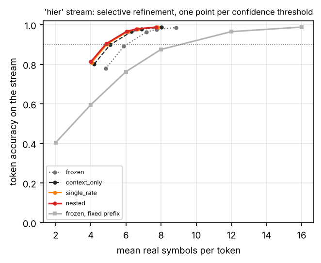
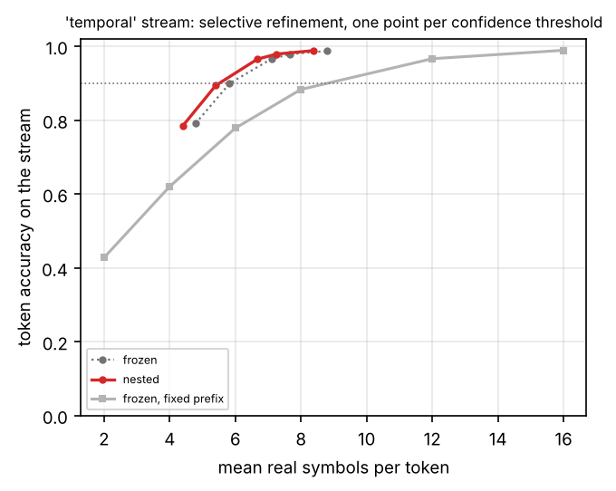
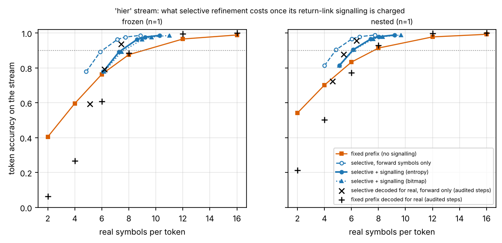
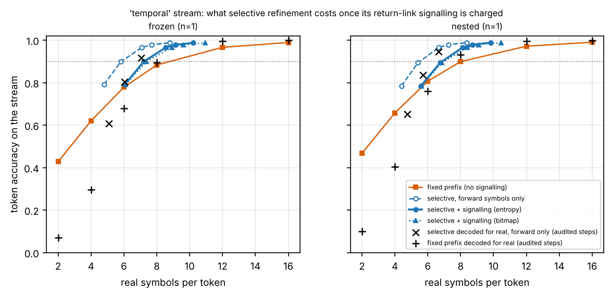
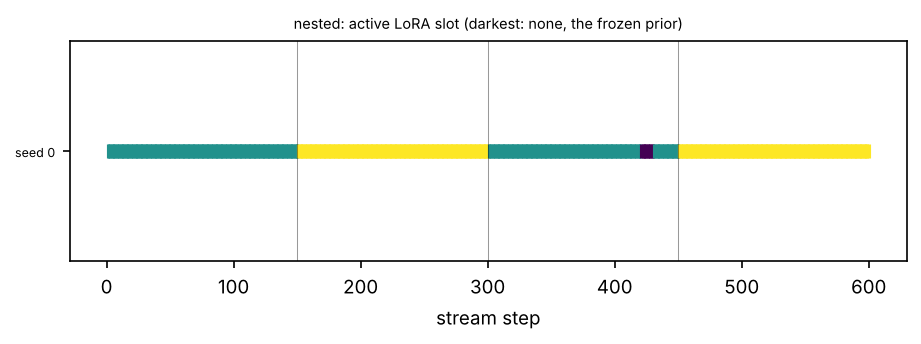
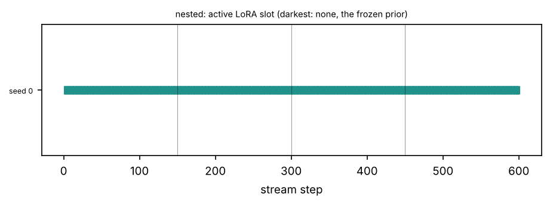
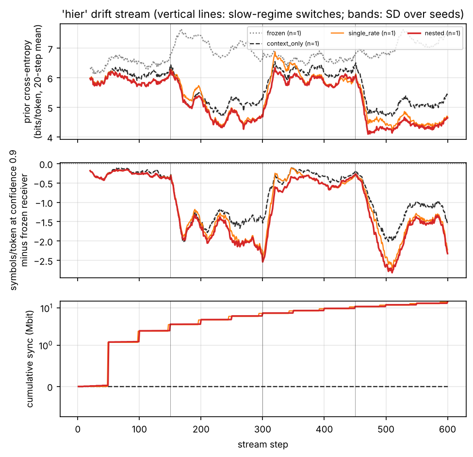
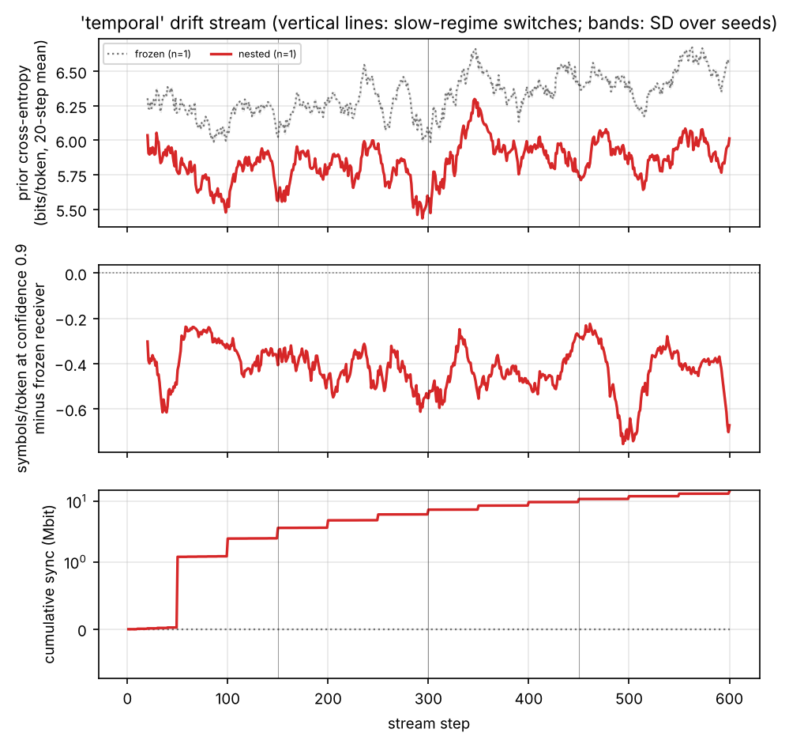

# Tables and figures: gpt2

Generated by `scripts/write_report.py` from the result files; nothing here is typed by hand.

## Headline, hier stream

Real symbols per token needed for 90% token accuracy on the 'hier' stream (mean over seeds; read off each method's measured operating curve).

| Receiver | Seeds | Prior bits/token | Symbols/token | vs. frozen at a fixed rate | vs. frozen with refinement | Sync kbit/step | Symbols/token incl. feedback (entropy) | vs. frozen at a fixed rate, feedback charged |
| --- | --- | --- | --- | --- | --- | --- | --- | --- |
| frozen, fixed prefix length | 1 | 6.843 | 9.089 | — | — | 0 | 9.089 | — |
| frozen, selective refinement | 1 | 6.843 | 6.038 | -33.6% | — | 0.00 | 7.435 | -18.2% |
| context_only, selective refinement | 1 | 5.655 | 5.114 | -43.7% | -15.3% | 0.00 | 6.417 | -29.4% |
| single_rate, selective refinement | 1 | 5.392 | 4.911 | -46.0% | -18.7% | 23.73 | 6.183 | -32.0% |
| nested, selective refinement | 1 | 5.284 | 4.829 | -46.9% | -20.0% | 24.23 | 6.087 | -33.0% |

"Incl. feedback": forward symbols plus the return-link signalling of the refinement requests, charged at its entropy and at the capacity of the mean SNR (derived; see the refinement-cost table for the bitmap variant and the free-running audit). n/a: not recorded by the code version that produced the run, or the target is not reached.

## Headline, temporal stream

Real symbols per token needed for 90% token accuracy on the 'temporal' stream (mean over seeds; read off each method's measured operating curve).

| Receiver | Seeds | Prior bits/token | Symbols/token | vs. frozen at a fixed rate | vs. frozen with refinement | Sync kbit/step | Symbols/token incl. feedback (entropy) | vs. frozen at a fixed rate, feedback charged |
| --- | --- | --- | --- | --- | --- | --- | --- | --- |
| frozen, fixed prefix length | 1 | 6.334 | 8.813 | — | — | 0 | 8.813 | — |
| frozen, selective refinement | 1 | 6.334 | 5.835 | -33.8% | — | 0.00 | 7.224 | -18.0% |
| nested, selective refinement | 1 | 5.859 | 5.514 | -37.4% | -5.5% | 24.23 | 6.869 | -22.1% |

"Incl. feedback": forward symbols plus the return-link signalling of the refinement requests, charged at its entropy and at the capacity of the mean SNR (derived; see the refinement-cost table for the bitmap variant and the free-running audit). n/a: not recorded by the code version that produced the run, or the target is not reached.

## Hierarchical drift stream

**Online adaptation on the 'hier' drift stream (mean ± SD over seeds; per-step paired differences to 'nested' with a 95% block-bootstrap interval, * = excludes zero; exact seed-level sign-flip permutation test on the prior bits, raw and Holm-corrected, with the smallest p-value that number of seeds can give: a seed-level test cannot be significant at 0.05 with fewer than six seeds)**

| method | seeds | tok-acc @m_op | bits/token @m_op | prior bits/token | selective sym/token | selective tok-acc | ECE | retention tok-acc | retention BLEU-4 | slot switches | codebook power | sync kbit/step | net rate (sym/msg) | prior bits: this − nested [95% CI] | selective sym/token: this − nested [95% CI] | selective tok-acc: this − nested [95% CI] |
| --- | --- | --- | --- | --- | --- | --- | --- | --- | --- | --- | --- | --- | --- | --- | --- | --- |
| context_only | 1 | 0.8181 ± 0.0000 | 1.0802 ± 0.0000 | 5.6554 ± 0.0000 | 6.3109 ± 0.0000 | 0.9648 ± 0.0000 | 0.0056 ± 0.0000 | 0.8549 ± 0.0000 | 0.4995 ± 0.0000 | 0.0 | 1.290 | 0.00 | 107.95 | +0.3716 [+0.2824, +0.4589]* | +0.2828 [+0.1829, +0.3922]* | -0.0010 [-0.0023, +0.0005] |
| frozen | 1 | 0.7630 ± 0.0000 | 1.4283 ± 0.0000 | 6.8430 ± 0.0000 | 7.1519 ± 0.0000 | 0.9628 ± 0.0000 | 0.0055 ± 0.0000 | 0.7998 ± 0.0000 | 0.3508 ± 0.0000 | 0.0 | 1.310 | 0.00 | 108.30 | +1.5593 [+1.1597, +1.9501]* | +1.1238 [+0.8012, +1.4570]* | -0.0030 [-0.0057, -0.0006]* |
| nested | 1 | 0.8330 ± 0.0000 | 0.9781 ± 0.0000 | 5.2838 ± 0.0000 | 6.0280 ± 0.0000 | 0.9658 ± 0.0000 | 0.0051 ± 0.0000 | 0.8720 ± 0.0000 | 0.6053 ± 0.0000 | 5.0 | 1.290 | 24.23 | 121.96 | - | - | - |
| single_rate | 1 | 0.8277 ± 0.0000 | 1.0199 ± 0.0000 | 5.3921 ± 0.0000 | 6.1100 ± 0.0000 | 0.9656 ± 0.0000 | 0.0068 ± 0.0000 | 0.8707 ± 0.0000 | 0.5919 ± 0.0000 | 0.0 | 1.290 | 23.73 | 121.67 | +0.1084 [+0.0573, +0.1699]* | +0.0819 [+0.0462, +0.1214]* | -0.0002 [-0.0012, +0.0007] |

**What selective refinement costs on the 'hier' stream: real symbols per token for 90% token accuracy (mean over seeds). 'Feedback' is the return-link signalling of the requests at the operating threshold, converted to symbols at the capacity of the mean SNR (derived, optimistic; bitmap = one bit per open token and round, entropy = ideal coding of those bits). 'Free-running' decodes the same received symbols for real on a subset of the steps - the selective policy and the fixed prefixes alike - and 'emulated' is the teacher-forced figure on exactly those steps; the free-running saving compares like with like. n/a: not recorded by the code version that produced the run; not reached: the measured curve never reaches the target accuracy**

| method | seeds | fixed prefix | selective, forward only | feedback bits/token (bitmap) | feedback bits/token (entropy) | rounds/message | selective + feedback (bitmap) | selective + feedback (entropy) | saving vs fixed, feedback charged (entropy) | free-running: steps audited | free-running fixed prefix | emulated fixed prefix, same steps | free-running, forward only | emulated on the same steps | free-running + feedback (entropy) | free-running + feedback (bitmap) | free-running saving vs free-running fixed, feedback charged (entropy) | free-running tok-acc at the threshold | emulated tok-acc at the threshold |
| --- | --- | --- | --- | --- | --- | --- | --- | --- | --- | --- | --- | --- | --- | --- | --- | --- | --- | --- | --- |
| context_only | 1 | 7.872 | 5.114 | 2.851 | 2.468 | 4.93 | 6.498 | 6.417 | -18.5% | 12 | 7.832 | 7.039 | 6.201 | 4.617 | 7.500 | 7.909 | -4.2% | 0.9558 | 0.9801 |
| frozen | 1 | 9.089 | 6.038 | 3.176 | 2.523 | 5.11 | 7.639 | 7.435 | -18.2% | 12 | 8.531 | 7.579 | 7.111 | 5.337 | 8.427 | 9.036 | -1.2% | 0.9373 | 0.9760 |
| nested | 1 | 7.664 | 4.829 | 2.742 | 2.433 | 4.85 | 6.144 | 6.087 | -20.6% | 12 | 7.634 | 6.831 | 5.709 | 4.407 | 7.004 | 7.300 | -8.3% | 0.9557 | 0.9766 |
| single_rate | 1 | 7.754 | 4.911 | 2.770 | 2.444 | 4.87 | 6.245 | 6.183 | -20.3% | 12 | 7.862 | 7.008 | 5.959 | 4.537 | 7.281 | 7.607 | -7.4% | 0.9499 | 0.9814 |

**Selective refinement on the 'hier' stream by the shell sent in the first round: symbols per token for 90% token accuracy (n/a = the target is not reached on that curve). The paper's policy is the first row of every method; the other rows are a post-hoc exploration, not a tuned result**

| method | seeds | first shell (symbols) | forward only | + feedback (bitmap) | + feedback (entropy) |
| --- | --- | --- | --- | --- | --- |
| context_only | 1 | 2 | 5.114 | 6.498 | 6.417 |
| context_only | 1 | 4 | 5.674 | 6.657 | 6.610 |
| context_only | 1 | 6 | 6.626 | 7.335 | 7.104 |
| context_only | 1 | 8 | 8.352 | 8.974 | 8.598 |
| context_only | 1 | 12 | 12.064 | 12.642 | 12.132 |
| context_only | 1 | 16 | 16.000 | 16.000 | 16.000 |
| frozen | 1 | 2 | 6.038 | 7.639 | 7.435 |
| frozen | 1 | 4 | 6.331 | 7.460 | 7.424 |
| frozen | 1 | 6 | 7.075 | 7.870 | 7.734 |
| frozen | 1 | 8 | 8.492 | 9.130 | 8.804 |
| frozen | 1 | 12 | 12.092 | 12.670 | 12.182 |
| frozen | 1 | 16 | 16.000 | 16.000 | 16.000 |
| nested | 1 | 2 | 4.829 | 6.144 | 6.087 |
| nested | 1 | 4 | 5.462 | 6.397 | 6.336 |
| nested | 1 | 6 | 6.557 | 7.253 | 7.002 |
| nested | 1 | 8 | 8.309 | 8.925 | 8.532 |
| nested | 1 | 12 | 12.056 | 12.634 | 12.117 |
| nested | 1 | 16 | 16.000 | 16.000 | 16.000 |
| single_rate | 1 | 2 | 4.911 | 6.245 | 6.183 |
| single_rate | 1 | 4 | 5.531 | 6.481 | 6.424 |
| single_rate | 1 | 6 | 6.583 | 7.284 | 7.040 |
| single_rate | 1 | 8 | 8.326 | 8.945 | 8.559 |
| single_rate | 1 | 12 | 12.061 | 12.639 | 12.126 |
| single_rate | 1 | 16 | 16.000 | 16.000 | 16.000 |

**Forward symbols per token needed on the 'hier' stream for three target token accuracies (mean over seeds; n/a = not reached within the measured curve, or below its cheapest point for one of the seeds)**

| method | seeds | fixed, 85% | selective, 85% | fixed, 90% | selective, 90% | fixed, 95% | selective, 95% |
| --- | --- | --- | --- | --- | --- | --- | --- |
| context_only | 1 | 6.730 | 4.644 | 7.872 | 5.114 | 10.581 | 6.037 |
| frozen | 1 | 7.546 | 5.503 | 9.089 | 6.038 | 11.315 | 6.925 |
| nested | 1 | 6.423 | 4.356 | 7.664 | 4.829 | 10.284 | 5.732 |
| single_rate | 1 | 6.541 | 4.438 | 7.754 | 4.911 | 10.408 | 5.819 |

**Equivalence tests against 'nested' on the 'hier' stream: two one-sided tests at 5% on the per-step paired differences (90% block-bootstrap interval inside the margin). The margins are fixed in the configuration before the runs; 'no' means equivalence was not shown, not that a difference was shown**

| method | seeds | prior bits/token: this − nested [90% CI] | prior bits/token: equivalent within ±0.05 | selective sym/token: this − nested [90% CI] | selective sym/token: equivalent within ±0.05 |
| --- | --- | --- | --- | --- | --- |
| context_only | 1 | +0.3716 [+0.2990, +0.4463] | no | +0.2828 [+0.1988, +0.3724] | no |
| frozen | 1 | +1.5593 [+1.2247, +1.8902] | no | +1.1238 [+0.8639, +1.3928] | no |
| single_rate | 1 | +0.1084 [+0.0637, +0.1598] | no | +0.0819 [+0.0512, +0.1147] | no |

**The 'hier' stream by slow regime: prequential metrics while the regime is active, and held-out probes of it at the end of the stream (mean ± SD over seeds). A probe scores the receiver's copy at that moment: methods are comparable on a probe only at equal staleness (steps since the slowest level was shipped)**

| method | regime | seeds | prior bits/token | tok-acc @m_op | selective sym/token | selective tok-acc | held-out prior bits (end) | held-out tok-acc (end) | receiver staleness at the probe (steps) |
| --- | --- | --- | --- | --- | --- | --- | --- | --- | --- |
| context_only | ag_news | 1 | 6.2006 ± 0.0000 | 0.8166 ± 0.0000 | 6.3795 ± 0.0000 | 0.9664 ± 0.0000 | 6.3420 | 0.8316 | - |
| context_only | teleqna | 1 | 5.1101 ± 0.0000 | 0.8195 ± 0.0000 | 6.2423 ± 0.0000 | 0.9633 ± 0.0000 | 4.8965 | 0.8782 | - |
| frozen | ag_news | 1 | 6.5875 ± 0.0000 | 0.7992 ± 0.0000 | 6.6441 ± 0.0000 | 0.9665 ± 0.0000 | 6.6539 | 0.8081 | - |
| frozen | teleqna | 1 | 7.0986 ± 0.0000 | 0.7269 ± 0.0000 | 7.6597 ± 0.0000 | 0.9590 ± 0.0000 | 7.2270 | 0.7915 | - |
| nested | ag_news | 1 | 5.9723 ± 0.0000 | 0.8244 ± 0.0000 | 6.2732 ± 0.0000 | 0.9687 ± 0.0000 | 5.8482 | 0.8349 | 150 |
| nested | teleqna | 1 | 4.5952 ± 0.0000 | 0.8416 ± 0.0000 | 5.7829 ± 0.0000 | 0.9629 ± 0.0000 | 4.1277 | 0.9091 | 150 |
| single_rate | ag_news | 1 | 6.0578 ± 0.0000 | 0.8197 ± 0.0000 | 6.3148 ± 0.0000 | 0.9674 ± 0.0000 | 6.1996 | 0.8375 | 12 |
| single_rate | teleqna | 1 | 4.7265 ± 0.0000 | 0.8357 ± 0.0000 | 5.9051 ± 0.0000 | 0.9638 ± 0.0000 | 4.1983 | 0.9039 | 12 |

**Operating curves on the 'hier' stream: token accuracy at every fixed prefix length, and (symbols per token / token accuracy) under selective refinement at every confidence threshold**

| method | acc m=2 | acc m=4 | acc m=6 | acc m=8 | acc m=12 | acc m=16 | τ=0.5 | τ=0.7 | τ=0.9 | τ=0.95 | τ=0.99 |
| --- | --- | --- | --- | --- | --- | --- | --- | --- | --- | --- | --- |
| context_only | 0.5085 | 0.6779 | 0.8181 | 0.9056 | 0.9744 | 0.9913 | 4.19 sym / 0.8012 | 5.10 sym / 0.8993 | 6.31 sym / 0.9648 | 6.88 sym / 0.9777 | 8.03 sym / 0.9880 |
| frozen | 0.4043 | 0.5958 | 0.7630 | 0.8755 | 0.9654 | 0.9885 | 4.85 sym / 0.7783 | 5.88 sym / 0.8912 | 7.15 sym / 0.9628 | 7.74 sym / 0.9767 | 8.85 sym / 0.9860 |
| nested | 0.5409 | 0.7012 | 0.8330 | 0.9135 | 0.9774 | 0.9923 | 4.00 sym / 0.8126 | 4.87 sym / 0.9039 | 6.03 sym / 0.9658 | 6.59 sym / 0.9787 | 7.73 sym / 0.9882 |
| single_rate | 0.5346 | 0.6945 | 0.8277 | 0.9101 | 0.9763 | 0.9919 | 4.06 sym / 0.8097 | 4.94 sym / 0.9029 | 6.11 sym / 0.9656 | 6.67 sym / 0.9781 | 7.81 sym / 0.9880 |

**Derived net semantic rate (real symbols per message, payload at equal fidelity plus amortised synchronisation) on the 'hier' stream as a function of messages carried per adaptation step N, at 10 dB**

| method | sym/token for 90% tok-acc | saving vs frozen | payload (sym/msg) | N=1 | N=10 | N=100 | N=1000 | N=10000 | N=100000 | N* (vs frozen) | N* (vs context_only) |
| --- | --- | --- | --- | --- | --- | --- | --- | --- | --- | --- | --- |
| context_only | 5.114 | +15.3% | 92.0 | 92.0 | 92.0 | 92.0 | 92.0 | 92.0 | 92.0 | - | - |
| frozen | 6.038 | +0.0% | 109.0 | 109.0 | 109.0 | 109.0 | 109.0 | 109.0 | 109.0 | - | - |
| nested | 4.829 | +20.0% | 86.9 | 14093.0 | 1487.5 | 226.9 | 100.9 | 88.3 | 87.0 | 644 | 2735 |
| single_rate | 4.911 | +18.7% | 88.4 | 13804.9 | 1460.0 | 225.5 | 102.1 | 89.7 | 88.5 | 677 | 3768 |

## Temporal drift stream

**Online adaptation on the 'temporal' drift stream (mean ± SD over seeds; per-step paired differences to 'nested' with a 95% block-bootstrap interval, * = excludes zero; exact seed-level sign-flip permutation test on the prior bits, raw and Holm-corrected, with the smallest p-value that number of seeds can give: a seed-level test cannot be significant at 0.05 with fewer than six seeds)**

| method | seeds | tok-acc @m_op | bits/token @m_op | prior bits/token | selective sym/token | selective tok-acc | ECE | retention tok-acc | retention BLEU-4 | slot switches | codebook power | sync kbit/step | net rate (sym/msg) | prior bits: this − nested [95% CI] | selective sym/token: this − nested [95% CI] | selective tok-acc: this − nested [95% CI] |
| --- | --- | --- | --- | --- | --- | --- | --- | --- | --- | --- | --- | --- | --- | --- | --- | --- |
| frozen | 1 | 0.7782 ± 0.0000 | 1.3002 ± 0.0000 | 6.3340 ± 0.0000 | 7.0964 ± 0.0000 | 0.9656 ± 0.0000 | 0.0036 ± 0.0000 | 0.7930 ± 0.0000 | 0.2892 ± 0.0000 | 0.0 | 1.413 | 0.00 | 92.38 | +0.4752 [+0.4409, +0.5091]* | +0.4244 [+0.3864, +0.4671]* | +0.0004 [-0.0026, +0.0027] |
| nested | 1 | 0.8067 ± 0.0000 | 1.1215 ± 0.0000 | 5.8588 ± 0.0000 | 6.6720 ± 0.0000 | 0.9652 ± 0.0000 | 0.0040 ± 0.0000 | 0.8136 ± 0.0000 | 0.4463 ± 0.0000 | 0.0 | 1.388 | 24.23 | 106.13 | - | - | - |

**What selective refinement costs on the 'temporal' stream: real symbols per token for 90% token accuracy (mean over seeds). 'Feedback' is the return-link signalling of the requests at the operating threshold, converted to symbols at the capacity of the mean SNR (derived, optimistic; bitmap = one bit per open token and round, entropy = ideal coding of those bits). 'Free-running' decodes the same received symbols for real on a subset of the steps - the selective policy and the fixed prefixes alike - and 'emulated' is the teacher-forced figure on exactly those steps; the free-running saving compares like with like. n/a: not recorded by the code version that produced the run; not reached: the measured curve never reaches the target accuracy**

| method | seeds | fixed prefix | selective, forward only | feedback bits/token (bitmap) | feedback bits/token (entropy) | rounds/message | selective + feedback (bitmap) | selective + feedback (entropy) | saving vs fixed, feedback charged (entropy) | free-running: steps audited | free-running fixed prefix | emulated fixed prefix, same steps | free-running, forward only | emulated on the same steps | free-running + feedback (entropy) | free-running + feedback (bitmap) | free-running saving vs free-running fixed, feedback charged (entropy) | free-running tok-acc at the threshold | emulated tok-acc at the threshold |
| --- | --- | --- | --- | --- | --- | --- | --- | --- | --- | --- | --- | --- | --- | --- | --- | --- | --- | --- | --- |
| frozen | 1 | 8.813 | 5.835 | 3.152 | 2.522 | 5.04 | 7.390 | 7.224 | -18.0% | 12 | 8.180 | 7.309 | 6.908 | 5.039 | 8.207 | 8.791 | +0.3% | 0.9169 | 0.9758 |
| nested | 1 | 8.044 | 5.514 | 2.997 | 2.498 | 4.91 | 6.993 | 6.869 | -14.6% | 12 | 7.630 | 6.603 | 6.277 | 4.611 | 7.556 | 8.018 | -1.0% | 0.9461 | 0.9769 |

**Selective refinement on the 'temporal' stream by the shell sent in the first round: symbols per token for 90% token accuracy (n/a = the target is not reached on that curve). The paper's policy is the first row of every method; the other rows are a post-hoc exploration, not a tuned result**

| method | seeds | first shell (symbols) | forward only | + feedback (bitmap) | + feedback (entropy) |
| --- | --- | --- | --- | --- | --- |
| frozen | 1 | 2 | 5.835 | 7.390 | 7.224 |
| frozen | 1 | 4 | 6.190 | 7.286 | 7.256 |
| frozen | 1 | 6 | 6.951 | 7.721 | 7.570 |
| frozen | 1 | 8 | 8.489 | 9.127 | 8.802 |
| frozen | 1 | 12 | 12.092 | 12.670 | 12.182 |
| frozen | 1 | 16 | 16.000 | 16.000 | 16.000 |
| nested | 1 | 2 | 5.514 | 6.993 | 6.869 |
| nested | 1 | 4 | 5.888 | 6.917 | 6.886 |
| nested | 1 | 6 | 6.723 | 7.451 | 7.249 |
| nested | 1 | 8 | 8.394 | 9.020 | 8.662 |
| nested | 1 | 12 | 12.077 | 12.655 | 12.155 |
| nested | 1 | 16 | 16.000 | 16.000 | 16.000 |

**Forward symbols per token needed on the 'temporal' stream for three target token accuracies (mean over seeds; n/a = not reached within the measured curve, or below its cheapest point for one of the seeds)**

| method | seeds | fixed, 85% | selective, 85% | fixed, 90% | selective, 90% | fixed, 95% | selective, 95% |
| --- | --- | --- | --- | --- | --- | --- | --- |
| frozen | 1 | 7.369 | 5.353 | 8.813 | 5.835 | 11.217 | 6.797 |
| nested | 1 | 6.937 | 5.001 | 8.044 | 5.514 | 10.811 | 6.403 |

**Equivalence tests against 'nested' on the 'temporal' stream: two one-sided tests at 5% on the per-step paired differences (90% block-bootstrap interval inside the margin). The margins are fixed in the configuration before the runs; 'no' means equivalence was not shown, not that a difference was shown**

| method | seeds | prior bits/token: this − nested [90% CI] | prior bits/token: equivalent within ±0.05 | selective sym/token: this − nested [90% CI] | selective sym/token: equivalent within ±0.05 |
| --- | --- | --- | --- | --- | --- |
| frozen | 1 | +0.4752 [+0.4462, +0.5028] | no | +0.4244 [+0.3922, +0.4595] | no |

**The 'temporal' stream by slow regime: prequential metrics while the regime is active, and held-out probes of it at the end of the stream (mean ± SD over seeds). A probe scores the receiver's copy at that moment: methods are comparable on a probe only at equal staleness (steps since the slowest level was shipped)**

| method | regime | seeds | prior bits/token | tok-acc @m_op | selective sym/token | selective tok-acc | held-out prior bits (end) | held-out tok-acc (end) | receiver staleness at the probe (steps) |
| --- | --- | --- | --- | --- | --- | --- | --- | --- | --- |
| frozen | era0 | 1 | 6.2021 ± 0.0000 | 0.8515 ± 0.0000 | 6.0381 ± 0.0000 | 0.9747 ± 0.0000 | 6.5289 | 0.7936 | - |
| frozen | era1 | 1 | 6.2595 ± 0.0000 | 0.7088 ± 0.0000 | 8.1732 ± 0.0000 | 0.9493 ± 0.0000 | 6.5974 | 0.8025 | - |
| frozen | era2 | 1 | 6.4015 ± 0.0000 | 0.7513 ± 0.0000 | 7.4670 ± 0.0000 | 0.9664 ± 0.0000 | 6.5500 | 0.7815 | - |
| frozen | era3 | 1 | 6.4729 ± 0.0000 | 0.8014 ± 0.0000 | 6.7072 ± 0.0000 | 0.9718 ± 0.0000 | 6.4767 | 0.7944 | - |
| nested | era0 | 1 | 5.7896 ± 0.0000 | 0.8691 ± 0.0000 | 5.6797 ± 0.0000 | 0.9738 ± 0.0000 | 6.0098 | 0.8071 | 600 |
| nested | era1 | 1 | 5.7854 ± 0.0000 | 0.7418 ± 0.0000 | 7.7313 ± 0.0000 | 0.9502 ± 0.0000 | 6.1913 | 0.8078 | 600 |
| nested | era2 | 1 | 5.9322 ± 0.0000 | 0.7827 ± 0.0000 | 7.0442 ± 0.0000 | 0.9680 ± 0.0000 | 5.8707 | 0.8129 | 600 |
| nested | era3 | 1 | 5.9277 ± 0.0000 | 0.8331 ± 0.0000 | 6.2326 ± 0.0000 | 0.9687 ± 0.0000 | 5.9821 | 0.8265 | 600 |

**Operating curves on the 'temporal' stream: token accuracy at every fixed prefix length, and (symbols per token / token accuracy) under selective refinement at every confidence threshold**

| method | acc m=2 | acc m=4 | acc m=6 | acc m=8 | acc m=12 | acc m=16 | τ=0.5 | τ=0.7 | τ=0.9 | τ=0.95 | τ=0.99 |
| --- | --- | --- | --- | --- | --- | --- | --- | --- | --- | --- | --- |
| frozen | 0.4277 | 0.6202 | 0.7782 | 0.8831 | 0.9663 | 0.9891 | 4.79 sym / 0.7912 | 5.83 sym / 0.8995 | 7.10 sym / 0.9656 | 7.67 sym / 0.9786 | 8.79 sym / 0.9873 |
| nested | 0.4673 | 0.6574 | 0.8067 | 0.8992 | 0.9715 | 0.9903 | 4.40 sym / 0.7846 | 5.40 sym / 0.8938 | 6.67 sym / 0.9652 | 7.26 sym / 0.9789 | 8.37 sym / 0.9881 |

**Derived net semantic rate (real symbols per message, payload at equal fidelity plus amortised synchronisation) on the 'temporal' stream as a function of messages carried per adaptation step N, at 10 dB**

| method | sym/token for 90% tok-acc | saving vs frozen | payload (sym/msg) | N=1 | N=10 | N=100 | N=1000 | N=10000 | N=100000 | N* (vs frozen) |
| --- | --- | --- | --- | --- | --- | --- | --- | --- | --- | --- |
| frozen | 5.835 | +0.0% | 89.8 | 89.8 | 89.8 | 89.8 | 89.8 | 89.8 | 89.8 | - |
| nested | 5.514 | +5.5% | 84.7 | 14090.7 | 1485.3 | 224.7 | 98.7 | 86.1 | 84.8 | 2842 |

## Figures

### curves_hier

### curves_temporal

### refine_cost_hier

### refine_cost_temporal

### slots_hier

### slots_temporal

### stream_hier

### stream_temporal

