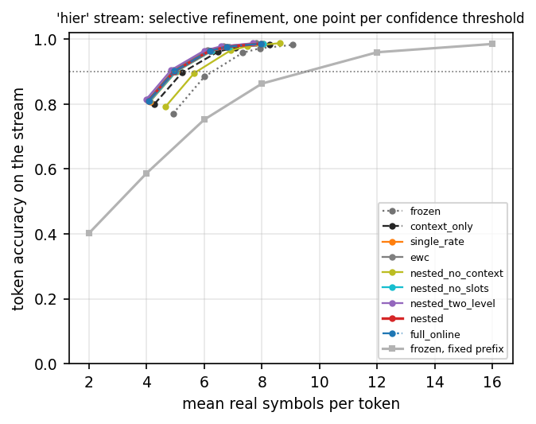
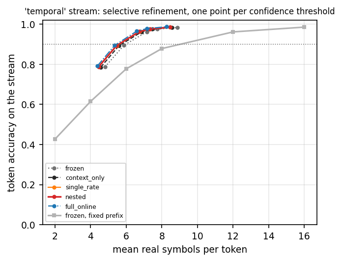
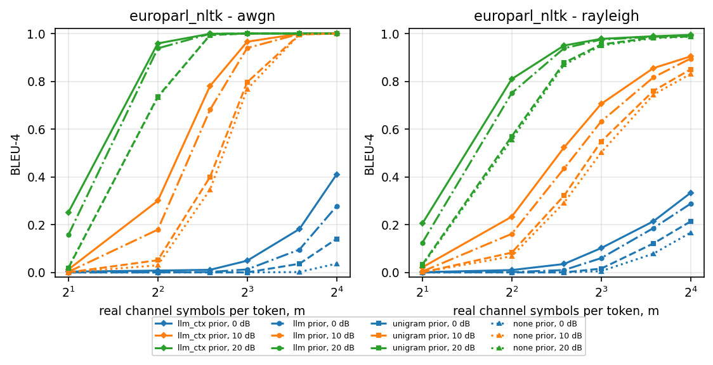
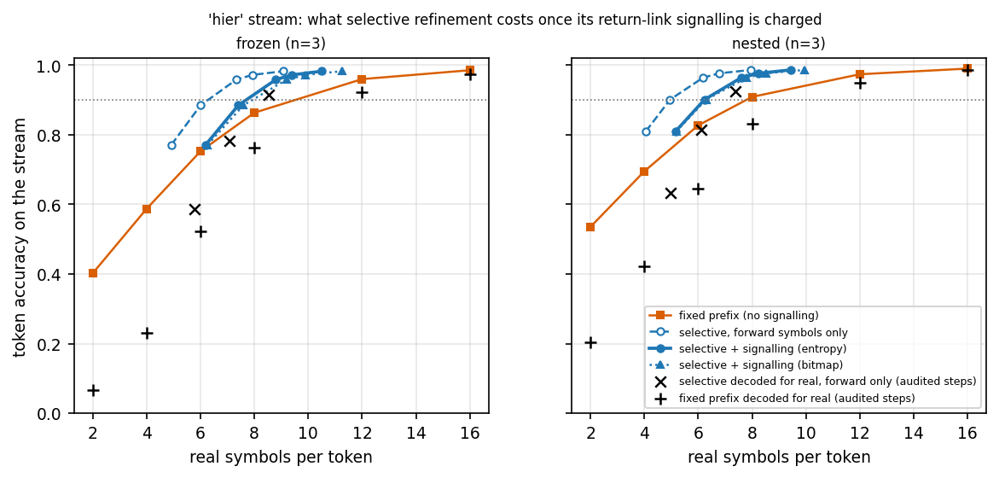
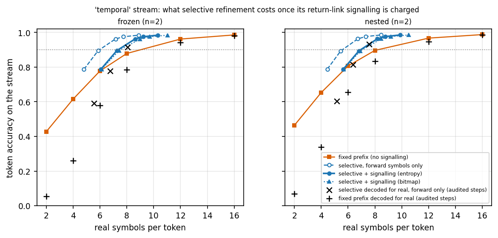
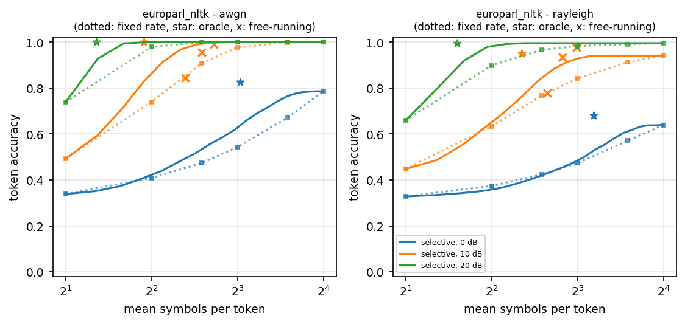
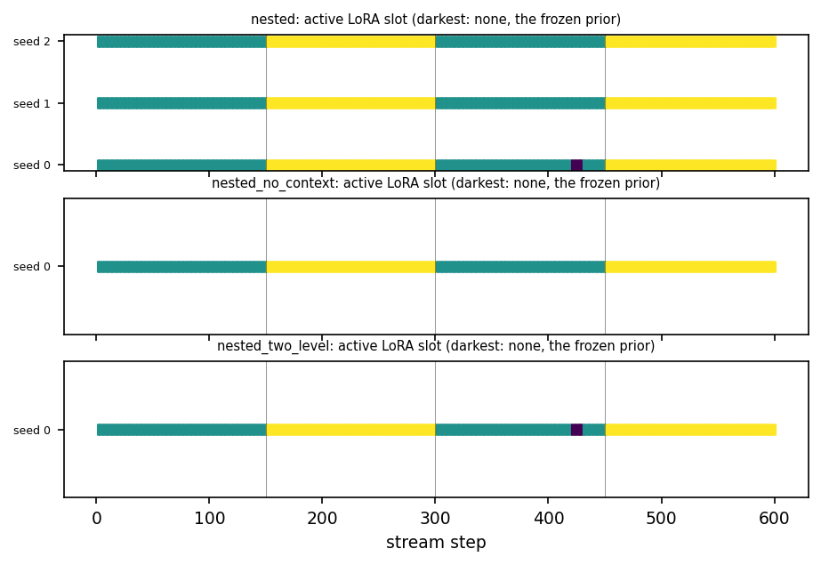
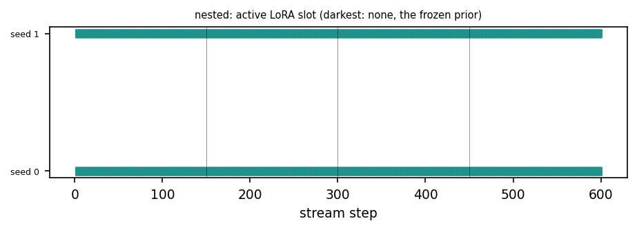
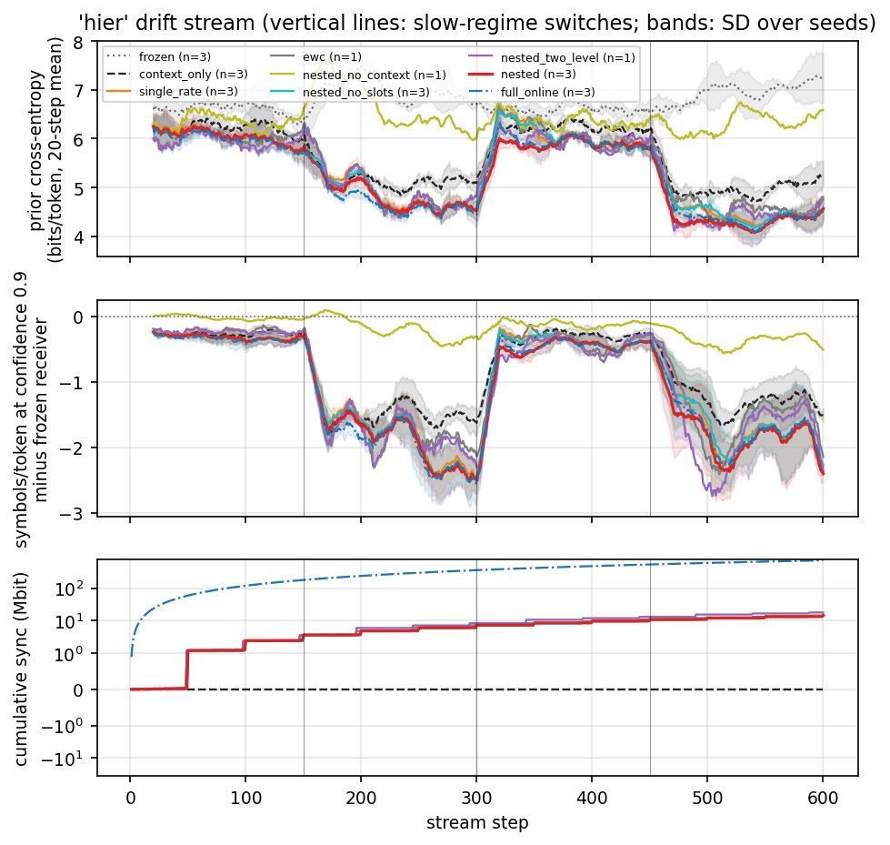
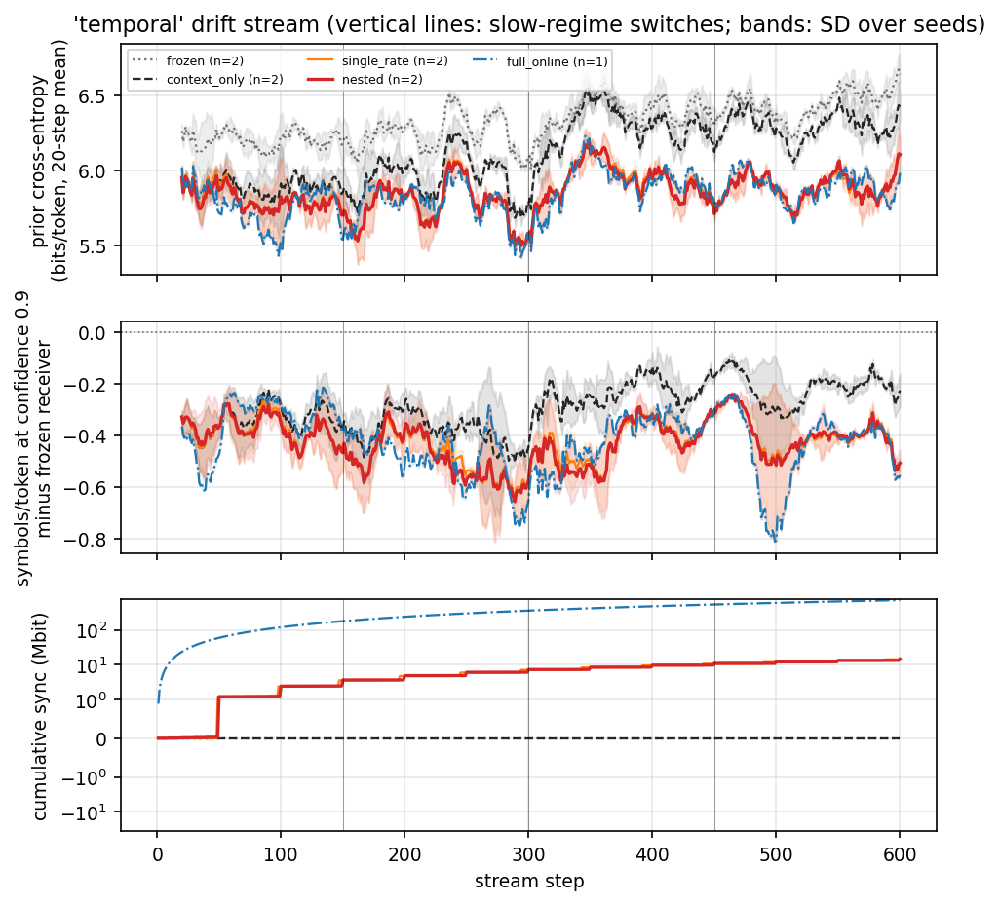

# Tables and figures: gpt2

Generated by `scripts/write_report.py` from the result files; nothing here is typed by hand.

## Headline, hier stream

Real symbols per token needed for 90% token accuracy on the 'hier' stream (mean over seeds; read off each method's measured operating curve).

| Receiver | Seeds | Prior bits/token | Symbols/token | vs. frozen at a fixed rate | vs. frozen with refinement | Sync kbit/step | Symbols/token incl. feedback (entropy) | vs. frozen at a fixed rate, feedback charged |
| --- | --- | --- | --- | --- | --- | --- | --- | --- |
| frozen, fixed prefix length | 3 | 6.793 | 9.490 | — | — | 0 | 9.490 | — |
| frozen, selective refinement | 3 | 6.793 | 6.276 | -33.9% | — | 0.00 | 7.690 | -19.0% |
| context_only, selective refinement | 3 | 5.628 | 5.286 | -44.3% | -15.8% | 0.00 | 6.608 | -30.4% |
| single_rate, selective refinement | 3 | 5.363 | 5.033 | -47.0% | -19.8% | 23.73 | 6.320 | -33.4% |
| ewc, selective refinement | 1 | 5.414 | 4.874 | -48.6% | -22.3% | 23.73 | 6.138 | -35.3% |
| nested_no_context, selective refinement | 1 | 6.435 | 5.723 | -39.7% | -8.8% | 24.23 | 7.095 | -25.2% |
| nested_no_slots, selective refinement | 3 | 5.352 | 5.026 | -47.0% | -19.9% | 24.23 | 6.312 | -33.5% |
| nested_two_level, selective refinement | 1 | 5.312 | 4.794 | -49.5% | -23.6% | 29.63 | 6.046 | -36.3% |
| nested, selective refinement | 3 | 5.256 | 4.956 | -47.8% | -21.0% | 24.23 | 6.232 | -34.3% |
| full_online, selective refinement | 3 | 5.250 | 4.950 | -47.8% | -21.1% | 1185.80 | 6.226 | -34.4% |

"Incl. feedback": forward symbols plus the return-link signalling of the refinement requests, charged at its entropy and at the capacity of the mean SNR (derived; see the refinement-cost table for the bitmap variant and the free-running audit). n/a: not recorded by the code version that produced the run, or the target is not reached.

## Headline, temporal stream

Real symbols per token needed for 90% token accuracy on the 'temporal' stream (mean over seeds; read off each method's measured operating curve).

| Receiver | Seeds | Prior bits/token | Symbols/token | vs. frozen at a fixed rate | vs. frozen with refinement | Sync kbit/step | Symbols/token incl. feedback (entropy) | vs. frozen at a fixed rate, feedback charged |
| --- | --- | --- | --- | --- | --- | --- | --- | --- |
| frozen, fixed prefix length | 2 | 6.331 | 9.004 | — | — | 0 | 9.004 | — |
| frozen, selective refinement | 2 | 6.331 | 5.957 | -33.8% | — | 0.00 | 7.355 | -18.3% |
| context_only, selective refinement | 2 | 6.119 | 5.720 | -36.5% | -4.0% | 0.00 | 7.095 | -21.2% |
| single_rate, selective refinement | 2 | 5.861 | 5.580 | -38.0% | -6.3% | 23.73 | 6.942 | -22.9% |
| nested, selective refinement | 2 | 5.857 | 5.572 | -38.1% | -6.5% | 24.23 | 6.932 | -23.0% |
| full_online, selective refinement | 1 | 5.844 | 5.438 | -39.6% | -8.7% | 1185.80 | 6.784 | -24.7% |

"Incl. feedback": forward symbols plus the return-link signalling of the refinement requests, charged at its entropy and at the capacity of the mean SNR (derived; see the refinement-cost table for the bitmap variant and the free-running audit). n/a: not recorded by the code version that produced the run, or the target is not reached.

## Rate and fidelity on the base corpus

**Semantic codec, bleu4 on europarl_nltk (n=200, 20.4 tokens per sentence) by decoder prior, symbols per token m and SNR**

| channel | prior | m | 0 dB | 10 dB | 20 dB |
| --- | --- | --- | --- | --- | --- |
| awgn | llm | 2 | 0.0 | 0.0023 | 0.1569 |
| awgn | llm | 4 | 0.0 | 0.1789 | 0.9379 |
| awgn | llm | 6 | 0.0017 | 0.681 | 0.999 |
| awgn | llm | 8 | 0.0125 | 0.9393 | 1.0 |
| awgn | llm | 12 | 0.0955 | 0.9984 | 1.0 |
| awgn | llm | 16 | 0.2766 | 1.0 | 1.0 |
| awgn | llm_ctx | 2 | 0.0031 | 0.0121 | 0.2512 |
| awgn | llm_ctx | 4 | 0.0076 | 0.2996 | 0.9587 |
| awgn | llm_ctx | 6 | 0.0108 | 0.7807 | 0.999 |
| awgn | llm_ctx | 8 | 0.0489 | 0.9657 | 1.0 |
| awgn | llm_ctx | 12 | 0.1815 | 0.9991 | 1.0 |
| awgn | llm_ctx | 16 | 0.4097 | 1.0 | 1.0 |
| awgn | none | 2 | 0.0 | 0.0 | 0.0205 |
| awgn | none | 4 | 0.0 | 0.0296 | 0.7325 |
| awgn | none | 6 | 0.0 | 0.3463 | 0.9948 |
| awgn | none | 8 | 0.0 | 0.7667 | 1.0 |
| awgn | none | 12 | 0.0014 | 0.9959 | 1.0 |
| awgn | none | 16 | 0.0366 | 1.0 | 1.0 |
| awgn | unigram | 2 | 0.0 | 0.0 | 0.0183 |
| awgn | unigram | 4 | 0.0 | 0.0509 | 0.7355 |
| awgn | unigram | 6 | 0.0 | 0.3999 | 0.9934 |
| awgn | unigram | 8 | 0.0 | 0.796 | 1.0 |
| awgn | unigram | 12 | 0.0362 | 0.996 | 1.0 |
| awgn | unigram | 16 | 0.1402 | 1.0 | 1.0 |
| rayleigh | llm | 2 | 0.0 | 0.0036 | 0.1242 |
| rayleigh | llm | 4 | 0.0012 | 0.1614 | 0.7507 |
| rayleigh | llm | 6 | 0.0099 | 0.4347 | 0.9381 |
| rayleigh | llm | 8 | 0.0596 | 0.6316 | 0.9746 |
| rayleigh | llm | 12 | 0.1854 | 0.8166 | 0.9865 |
| rayleigh | llm | 16 | 0.2873 | 0.895 | 0.9914 |
| rayleigh | llm_ctx | 2 | 0.0009 | 0.0211 | 0.2045 |
| rayleigh | llm_ctx | 4 | 0.0097 | 0.2332 | 0.8095 |
| rayleigh | llm_ctx | 6 | 0.0351 | 0.523 | 0.9498 |
| rayleigh | llm_ctx | 8 | 0.1016 | 0.7052 | 0.9776 |
| rayleigh | llm_ctx | 12 | 0.2139 | 0.8552 | 0.9887 |
| rayleigh | llm_ctx | 16 | 0.3327 | 0.904 | 0.9944 |
| rayleigh | none | 2 | 0.0 | 0.0006 | 0.0292 |
| rayleigh | none | 4 | 0.0 | 0.0674 | 0.556 |
| rayleigh | none | 6 | 0.0 | 0.2914 | 0.8691 |
| rayleigh | none | 8 | 0.005 | 0.5019 | 0.9496 |
| rayleigh | none | 12 | 0.0783 | 0.7441 | 0.9806 |
| rayleigh | none | 16 | 0.1661 | 0.8306 | 0.9868 |
| rayleigh | unigram | 2 | 0.0 | 0.0 | 0.0328 |
| rayleigh | unigram | 4 | 0.0 | 0.0827 | 0.5695 |
| rayleigh | unigram | 6 | 0.0 | 0.3207 | 0.8775 |
| rayleigh | unigram | 8 | 0.0156 | 0.5478 | 0.9542 |
| rayleigh | unigram | 12 | 0.1211 | 0.7599 | 0.9832 |
| rayleigh | unigram | 16 | 0.2131 | 0.8498 | 0.9875 |

**Semantic codec, chrf on europarl_nltk (n=200, 20.4 tokens per sentence) by decoder prior, symbols per token m and SNR**

| channel | prior | m | 0 dB | 10 dB | 20 dB |
| --- | --- | --- | --- | --- | --- |
| awgn | llm | 2 | 0.1524 | 0.1664 | 0.3206 |
| awgn | llm | 4 | 0.1605 | 0.3602 | 0.9507 |
| awgn | llm | 6 | 0.1683 | 0.7709 | 0.9992 |
| awgn | llm | 8 | 0.184 | 0.9599 | 1.0 |
| awgn | llm | 12 | 0.2886 | 0.999 | 1.0 |
| awgn | llm | 16 | 0.4878 | 1.0 | 1.0 |
| awgn | llm_ctx | 2 | 0.1938 | 0.2093 | 0.4292 |
| awgn | llm_ctx | 4 | 0.2054 | 0.4609 | 0.9635 |
| awgn | llm_ctx | 6 | 0.2101 | 0.8375 | 0.9992 |
| awgn | llm_ctx | 8 | 0.247 | 0.9733 | 1.0 |
| awgn | llm_ctx | 12 | 0.3851 | 0.9988 | 1.0 |
| awgn | llm_ctx | 16 | 0.5989 | 1.0 | 1.0 |
| awgn | none | 2 | 0.2002 | 0.2104 | 0.2735 |
| awgn | none | 4 | 0.2095 | 0.2989 | 0.821 |
| awgn | none | 6 | 0.212 | 0.5693 | 0.9961 |
| awgn | none | 8 | 0.2186 | 0.8633 | 1.0 |
| awgn | none | 12 | 0.2528 | 0.9965 | 1.0 |
| awgn | none | 16 | 0.3575 | 1.0 | 1.0 |
| awgn | unigram | 2 | 0.1063 | 0.1881 | 0.2662 |
| awgn | unigram | 4 | 0.1404 | 0.3138 | 0.8284 |
| awgn | unigram | 6 | 0.1714 | 0.6141 | 0.9952 |
| awgn | unigram | 8 | 0.2058 | 0.8782 | 1.0 |
| awgn | unigram | 12 | 0.3155 | 0.9966 | 1.0 |
| awgn | unigram | 16 | 0.4602 | 1.0 | 1.0 |
| rayleigh | llm | 2 | 0.1513 | 0.1679 | 0.2889 |
| rayleigh | llm | 4 | 0.1653 | 0.3299 | 0.8086 |
| rayleigh | llm | 6 | 0.1769 | 0.5696 | 0.9517 |
| rayleigh | llm | 8 | 0.2227 | 0.7298 | 0.9791 |
| rayleigh | llm | 12 | 0.3481 | 0.8735 | 0.9882 |
| rayleigh | llm | 16 | 0.4492 | 0.9292 | 0.9944 |
| rayleigh | llm_ctx | 2 | 0.1898 | 0.2201 | 0.3813 |
| rayleigh | llm_ctx | 4 | 0.2059 | 0.4036 | 0.8553 |
| rayleigh | llm_ctx | 6 | 0.2309 | 0.6407 | 0.9611 |
| rayleigh | llm_ctx | 8 | 0.2905 | 0.7862 | 0.9807 |
| rayleigh | llm_ctx | 12 | 0.3917 | 0.8955 | 0.989 |
| rayleigh | llm_ctx | 16 | 0.4974 | 0.9363 | 0.9964 |
| rayleigh | none | 2 | 0.201 | 0.2131 | 0.2667 |
| rayleigh | none | 4 | 0.2019 | 0.3015 | 0.6896 |
| rayleigh | none | 6 | 0.2075 | 0.4923 | 0.9131 |
| rayleigh | none | 8 | 0.2312 | 0.6569 | 0.9634 |
| rayleigh | none | 12 | 0.3004 | 0.8252 | 0.9837 |
| rayleigh | none | 16 | 0.3793 | 0.8909 | 0.9898 |
| rayleigh | unigram | 2 | 0.0951 | 0.1709 | 0.2625 |
| rayleigh | unigram | 4 | 0.1263 | 0.3023 | 0.6994 |
| rayleigh | unigram | 6 | 0.1589 | 0.5146 | 0.9171 |
| rayleigh | unigram | 8 | 0.2017 | 0.6858 | 0.9682 |
| rayleigh | unigram | 12 | 0.3205 | 0.8441 | 0.9871 |
| rayleigh | unigram | 16 | 0.4236 | 0.9114 | 0.9923 |

**Semantic codec, wer on europarl_nltk (n=200, 20.4 tokens per sentence) by decoder prior, symbols per token m and SNR**

| channel | prior | m | 0 dB | 10 dB | 20 dB |
| --- | --- | --- | --- | --- | --- |
| awgn | llm | 2 | 1.0124 | 0.9242 | 0.5623 |
| awgn | llm | 4 | 0.9896 | 0.5676 | 0.0294 |
| awgn | llm | 6 | 0.962 | 0.1593 | 0.0005 |
| awgn | llm | 8 | 0.9087 | 0.0254 | 0.0 |
| awgn | llm | 12 | 0.7213 | 0.0008 | 0.0 |
| awgn | llm | 16 | 0.4819 | 0.0 | 0.0 |
| awgn | llm_ctx | 2 | 0.9703 | 0.8892 | 0.4699 |
| awgn | llm_ctx | 4 | 0.9594 | 0.476 | 0.0226 |
| awgn | llm_ctx | 6 | 0.9135 | 0.1088 | 0.0005 |
| awgn | llm_ctx | 8 | 0.8537 | 0.016 | 0.0 |
| awgn | llm_ctx | 12 | 0.6376 | 0.0005 | 0.0 |
| awgn | llm_ctx | 16 | 0.3715 | 0.0 | 0.0 |
| awgn | none | 2 | 0.9954 | 0.8978 | 0.6508 |
| awgn | none | 4 | 0.9632 | 0.6612 | 0.1222 |
| awgn | none | 6 | 0.968 | 0.3322 | 0.0023 |
| awgn | none | 8 | 0.9325 | 0.1002 | 0.0 |
| awgn | none | 12 | 0.8478 | 0.0023 | 0.0 |
| awgn | none | 16 | 0.6929 | 0.0 | 0.0 |
| awgn | unigram | 2 | 0.9559 | 0.8831 | 0.6434 |
| awgn | unigram | 4 | 0.9194 | 0.6201 | 0.1179 |
| awgn | unigram | 6 | 0.8899 | 0.2939 | 0.0025 |
| awgn | unigram | 8 | 0.8283 | 0.0875 | 0.0 |
| awgn | unigram | 12 | 0.6749 | 0.0023 | 0.0 |
| awgn | unigram | 16 | 0.5009 | 0.0 | 0.0 |
| rayleigh | llm | 2 | 0.9982 | 0.9325 | 0.648 |
| rayleigh | llm | 4 | 0.9754 | 0.6746 | 0.1557 |
| rayleigh | llm | 6 | 0.9384 | 0.4185 | 0.0418 |
| rayleigh | llm | 8 | 0.8696 | 0.2605 | 0.02 |
| rayleigh | llm | 12 | 0.7238 | 0.1278 | 0.0124 |
| rayleigh | llm | 16 | 0.6107 | 0.0746 | 0.0043 |
| rayleigh | llm_ctx | 2 | 0.9736 | 0.8861 | 0.5744 |
| rayleigh | llm_ctx | 4 | 0.945 | 0.6056 | 0.1189 |
| rayleigh | llm_ctx | 6 | 0.8894 | 0.3586 | 0.033 |
| rayleigh | llm_ctx | 8 | 0.7994 | 0.2115 | 0.0175 |
| rayleigh | llm_ctx | 12 | 0.6817 | 0.104 | 0.0109 |
| rayleigh | llm_ctx | 16 | 0.5605 | 0.0667 | 0.0033 |
| rayleigh | none | 2 | 0.9759 | 0.9115 | 0.7053 |
| rayleigh | none | 4 | 0.9807 | 0.7147 | 0.2554 |
| rayleigh | none | 6 | 0.9508 | 0.4996 | 0.0751 |
| rayleigh | none | 8 | 0.9303 | 0.3386 | 0.0345 |
| rayleigh | none | 12 | 0.8255 | 0.177 | 0.016 |
| rayleigh | none | 16 | 0.7256 | 0.1144 | 0.0096 |
| rayleigh | unigram | 2 | 0.9442 | 0.8818 | 0.6875 |
| rayleigh | unigram | 4 | 0.915 | 0.6741 | 0.2404 |
| rayleigh | unigram | 6 | 0.8813 | 0.4484 | 0.0692 |
| rayleigh | unigram | 8 | 0.8248 | 0.2873 | 0.0299 |
| rayleigh | unigram | 12 | 0.6893 | 0.1458 | 0.0122 |
| rayleigh | unigram | 16 | 0.5914 | 0.0862 | 0.0076 |

**Semantic codec, gen_tok_acc on europarl_nltk (n=200, 20.4 tokens per sentence) by decoder prior, symbols per token m and SNR**

| channel | prior | m | 0 dB | 10 dB | 20 dB |
| --- | --- | --- | --- | --- | --- |
| awgn | llm | 2 | 0.0245 | 0.1082 | 0.4547 |
| awgn | llm | 4 | 0.0356 | 0.4494 | 0.9706 |
| awgn | llm | 6 | 0.0598 | 0.8447 | 0.9995 |
| awgn | llm | 8 | 0.1099 | 0.9755 | 1.0 |
| awgn | llm | 12 | 0.2948 | 0.9993 | 1.0 |
| awgn | llm | 16 | 0.5369 | 1.0 | 1.0 |
| awgn | llm_ctx | 2 | 0.0389 | 0.1368 | 0.5456 |
| awgn | llm_ctx | 4 | 0.0603 | 0.5358 | 0.9779 |
| awgn | llm_ctx | 6 | 0.1014 | 0.8925 | 0.9995 |
| awgn | llm_ctx | 8 | 0.1678 | 0.9845 | 1.0 |
| awgn | llm_ctx | 12 | 0.3784 | 0.9995 | 1.0 |
| awgn | llm_ctx | 16 | 0.6396 | 1.0 | 1.0 |
| awgn | none | 2 | 0.0324 | 0.1239 | 0.3763 |
| awgn | none | 4 | 0.0481 | 0.3635 | 0.8911 |
| awgn | none | 6 | 0.0579 | 0.6951 | 0.998 |
| awgn | none | 8 | 0.0849 | 0.9154 | 1.0 |
| awgn | none | 12 | 0.1854 | 0.9978 | 1.0 |
| awgn | none | 16 | 0.349 | 1.0 | 1.0 |
| awgn | unigram | 2 | 0.0596 | 0.144 | 0.3841 |
| awgn | unigram | 4 | 0.0991 | 0.4057 | 0.896 |
| awgn | unigram | 6 | 0.1334 | 0.7319 | 0.9975 |
| awgn | unigram | 8 | 0.1974 | 0.9257 | 1.0 |
| awgn | unigram | 12 | 0.3517 | 0.9978 | 1.0 |
| awgn | unigram | 16 | 0.5296 | 1.0 | 1.0 |
| rayleigh | llm | 2 | 0.024 | 0.102 | 0.3726 |
| rayleigh | llm | 4 | 0.0464 | 0.3444 | 0.8487 |
| rayleigh | llm | 6 | 0.0775 | 0.597 | 0.9588 |
| rayleigh | llm | 8 | 0.145 | 0.7444 | 0.9801 |
| rayleigh | llm | 12 | 0.2956 | 0.8764 | 0.9882 |
| rayleigh | llm | 16 | 0.4057 | 0.9294 | 0.9956 |
| rayleigh | llm_ctx | 2 | 0.031 | 0.1338 | 0.4433 |
| rayleigh | llm_ctx | 4 | 0.0667 | 0.4103 | 0.8831 |
| rayleigh | llm_ctx | 6 | 0.12 | 0.6507 | 0.967 |
| rayleigh | llm_ctx | 8 | 0.2057 | 0.7921 | 0.9823 |
| rayleigh | llm_ctx | 12 | 0.325 | 0.8991 | 0.9894 |
| rayleigh | llm_ctx | 16 | 0.4475 | 0.936 | 0.9968 |
| rayleigh | none | 2 | 0.0319 | 0.1131 | 0.3201 |
| rayleigh | none | 4 | 0.0395 | 0.3078 | 0.7631 |
| rayleigh | none | 6 | 0.0616 | 0.5239 | 0.9318 |
| rayleigh | none | 8 | 0.1082 | 0.6875 | 0.9688 |
| rayleigh | none | 12 | 0.2053 | 0.8357 | 0.9843 |
| rayleigh | none | 16 | 0.3054 | 0.8938 | 0.9909 |
| rayleigh | unigram | 2 | 0.0719 | 0.141 | 0.3424 |
| rayleigh | unigram | 4 | 0.1015 | 0.3476 | 0.7766 |
| rayleigh | unigram | 6 | 0.1371 | 0.5735 | 0.9382 |
| rayleigh | unigram | 8 | 0.1962 | 0.7277 | 0.9733 |
| rayleigh | unigram | 12 | 0.3306 | 0.8624 | 0.988 |
| rayleigh | unigram | 16 | 0.4297 | 0.9169 | 0.9931 |

**Semantic codec, tok_acc on europarl_nltk (n=200, 20.4 tokens per sentence) by decoder prior, symbols per token m and SNR**

| channel | prior | m | 0 dB | 10 dB | 20 dB |
| --- | --- | --- | --- | --- | --- |
| awgn | llm | 2 | 0.3308 | 0.4813 | 0.7271 |
| awgn | llm | 4 | 0.3814 | 0.7174 | 0.9781 |
| awgn | llm | 6 | 0.4563 | 0.8965 | 1.0 |
| awgn | llm | 8 | 0.5157 | 0.9818 | 1.0 |
| awgn | llm | 12 | 0.6586 | 0.9994 | 1.0 |
| awgn | llm | 16 | 0.7686 | 1.0 | 1.0 |
| awgn | llm_ctx | 2 | 0.3844 | 0.5458 | 0.7796 |
| awgn | llm_ctx | 4 | 0.4355 | 0.7823 | 0.9849 |
| awgn | llm_ctx | 6 | 0.5108 | 0.9288 | 1.0 |
| awgn | llm_ctx | 8 | 0.5814 | 0.989 | 1.0 |
| awgn | llm_ctx | 12 | 0.7162 | 1.0 | 1.0 |
| awgn | llm_ctx | 16 | 0.8316 | 1.0 | 1.0 |
| awgn | none | 2 | 0.0325 | 0.1328 | 0.3818 |
| awgn | none | 4 | 0.0479 | 0.3719 | 0.8937 |
| awgn | none | 6 | 0.0568 | 0.7011 | 0.9971 |
| awgn | none | 8 | 0.0898 | 0.9178 | 1.0 |
| awgn | none | 12 | 0.1897 | 0.9985 | 1.0 |
| awgn | none | 16 | 0.3686 | 1.0 | 1.0 |
| awgn | unigram | 2 | 0.062 | 0.1485 | 0.3965 |
| awgn | unigram | 4 | 0.1019 | 0.4065 | 0.8989 |
| awgn | unigram | 6 | 0.1335 | 0.7367 | 0.9973 |
| awgn | unigram | 8 | 0.1936 | 0.9374 | 1.0 |
| awgn | unigram | 12 | 0.357 | 0.9986 | 1.0 |
| awgn | unigram | 16 | 0.5345 | 1.0 | 1.0 |
| rayleigh | llm | 2 | 0.3329 | 0.4556 | 0.672 |
| rayleigh | llm | 4 | 0.3784 | 0.6513 | 0.9207 |
| rayleigh | llm | 6 | 0.435 | 0.7988 | 0.9748 |
| rayleigh | llm | 8 | 0.4959 | 0.8738 | 0.9885 |
| rayleigh | llm | 12 | 0.5966 | 0.9345 | 0.9933 |
| rayleigh | llm | 16 | 0.6772 | 0.9539 | 0.9965 |
| rayleigh | llm_ctx | 2 | 0.382 | 0.5096 | 0.7287 |
| rayleigh | llm_ctx | 4 | 0.4354 | 0.7121 | 0.9362 |
| rayleigh | llm_ctx | 6 | 0.4895 | 0.8367 | 0.9782 |
| rayleigh | llm_ctx | 8 | 0.5516 | 0.8963 | 0.9906 |
| rayleigh | llm_ctx | 12 | 0.6543 | 0.9453 | 0.9953 |
| rayleigh | llm_ctx | 16 | 0.7266 | 0.9609 | 0.9965 |
| rayleigh | none | 2 | 0.0292 | 0.1083 | 0.3289 |
| rayleigh | none | 4 | 0.0489 | 0.3218 | 0.7781 |
| rayleigh | none | 6 | 0.0673 | 0.5502 | 0.9274 |
| rayleigh | none | 8 | 0.1063 | 0.7028 | 0.9631 |
| rayleigh | none | 12 | 0.2104 | 0.8421 | 0.9824 |
| rayleigh | none | 16 | 0.3183 | 0.8926 | 0.9919 |
| rayleigh | unigram | 2 | 0.0606 | 0.1374 | 0.3421 |
| rayleigh | unigram | 4 | 0.1029 | 0.3705 | 0.7894 |
| rayleigh | unigram | 6 | 0.1405 | 0.5898 | 0.934 |
| rayleigh | unigram | 8 | 0.2038 | 0.7455 | 0.9687 |
| rayleigh | unigram | 12 | 0.3334 | 0.8679 | 0.9881 |
| rayleigh | unigram | 16 | 0.4453 | 0.9135 | 0.9935 |

**Derived: fraction of messages an ideal separate source-channel design delivers on europarl_nltk at the same symbol budget**

| system | channel | m | 0 dB | 10 dB | 20 dB |
| --- | --- | --- | --- | --- | --- |
| sep_deflate | awgn | 2 | 0.0 | 0.0 | 0.0 |
| sep_deflate | awgn | 4 | 0.0 | 0.0 | 0.0 |
| sep_deflate | awgn | 6 | 0.0 | 0.0 | 0.0 |
| sep_deflate | awgn | 8 | 0.0 | 0.0 | 0.035 |
| sep_deflate | awgn | 12 | 0.0 | 0.0 | 0.89 |
| sep_deflate | awgn | 16 | 0.0 | 0.06 | 0.995 |
| sep_deflate | rayleigh | 2 | 0.0 | 0.0 | 0.0 |
| sep_deflate | rayleigh | 4 | 0.0 | 0.0 | 0.0 |
| sep_deflate | rayleigh | 6 | 0.0 | 0.0 | 0.0 |
| sep_deflate | rayleigh | 8 | 0.0 | 0.0 | 0.085 |
| sep_deflate | rayleigh | 12 | 0.0 | 0.02 | 0.605 |
| sep_deflate | rayleigh | 16 | 0.0 | 0.155 | 0.85 |
| sep_deflate_fbl | awgn | 2 | 0.0 | 0.0 | 0.0 |
| sep_deflate_fbl | awgn | 4 | 0.0 | 0.0 | 0.0 |
| sep_deflate_fbl | awgn | 6 | 0.0 | 0.0 | 0.0 |
| sep_deflate_fbl | awgn | 8 | 0.0 | 0.0 | 0.015 |
| sep_deflate_fbl | awgn | 12 | 0.0 | 0.0 | 0.775 |
| sep_deflate_fbl | awgn | 16 | 0.0 | 0.015 | 0.99 |
| sep_deflate_fbl | rayleigh | 2 | 0.0 | 0.0 | 0.0 |
| sep_deflate_fbl | rayleigh | 4 | 0.0 | 0.0 | 0.0 |
| sep_deflate_fbl | rayleigh | 6 | 0.0 | 0.0 | 0.0 |
| sep_deflate_fbl | rayleigh | 8 | 0.0 | 0.0 | 0.055 |
| sep_deflate_fbl | rayleigh | 12 | 0.0 | 0.0 | 0.475 |
| sep_deflate_fbl | rayleigh | 16 | 0.0 | 0.09 | 0.805 |
| sep_lm | awgn | 2 | 0.0 | 0.0 | 0.82 |
| sep_lm | awgn | 4 | 0.0 | 0.88 | 1.0 |
| sep_lm | awgn | 6 | 0.0 | 1.0 | 1.0 |
| sep_lm | awgn | 8 | 0.03 | 1.0 | 1.0 |
| sep_lm | awgn | 12 | 0.56 | 1.0 | 1.0 |
| sep_lm | awgn | 16 | 0.96 | 1.0 | 1.0 |
| sep_lm | rayleigh | 2 | 0.0 | 0.015 | 0.515 |
| sep_lm | rayleigh | 4 | 0.0 | 0.5 | 0.94 |
| sep_lm | rayleigh | 6 | 0.065 | 0.775 | 0.975 |
| sep_lm | rayleigh | 8 | 0.135 | 0.87 | 0.985 |
| sep_lm | rayleigh | 12 | 0.355 | 0.925 | 0.985 |
| sep_lm | rayleigh | 16 | 0.52 | 0.94 | 0.99 |
| sep_lm_fbl | awgn | 2 | 0.0 | 0.0 | 0.465 |
| sep_lm_fbl | awgn | 4 | 0.0 | 0.42 | 1.0 |
| sep_lm_fbl | awgn | 6 | 0.0 | 0.965 | 1.0 |
| sep_lm_fbl | awgn | 8 | 0.0 | 1.0 | 1.0 |
| sep_lm_fbl | awgn | 12 | 0.025 | 1.0 | 1.0 |
| sep_lm_fbl | awgn | 16 | 0.49 | 1.0 | 1.0 |
| sep_lm_fbl | rayleigh | 2 | 0.0 | 0.0 | 0.32 |
| sep_lm_fbl | rayleigh | 4 | 0.0 | 0.295 | 0.92 |
| sep_lm_fbl | rayleigh | 6 | 0.01 | 0.62 | 0.955 |
| sep_lm_fbl | rayleigh | 8 | 0.07 | 0.78 | 0.97 |
| sep_lm_fbl | rayleigh | 12 | 0.19 | 0.88 | 0.985 |
| sep_lm_fbl | rayleigh | 16 | 0.32 | 0.92 | 0.985 |

**Average codeword power per symbol on europarl_nltk before block power control (the transmitted power is exactly 1)**

| m | codebook_power |
| --- | --- |
| 2 | 0.8267 |
| 4 | 0.8688 |
| 6 | 0.89 |
| 8 | 0.8952 |
| 12 | 0.8851 |
| 16 | 0.8934 |

## Selective refinement on the base corpus

**Selective refinement on europarl_nltk, teacher-forced sweep (token accuracy; ECE of token confidence)**

| channel | snr_db | ECE raw | ECE calibrated | best fixed m | fixed acc | selective sym/token | selective acc | saving | feedback bits/token (bitmap / entropy) | saving, feedback charged (entropy) | max gain vs fixed | oracle sym/token | random control acc |
| --- | --- | --- | --- | --- | --- | --- | --- | --- | --- | --- | --- | --- | --- |
| awgn | 0.0 | 0.019 | 0.008 | 16 | 0.786 | 13.51 | 0.782 | 15.6% | 4.57 / 1.57 | -4.1% | +0.103 @ 9.41 | 8.19 | 0.550 |
| awgn | 10.0 | 0.012 | 0.007 | 16 | 1.000 | 6.42 | 0.998 | 59.9% | 3.09 / 2.17 | 52.0% | +0.142 @ 4.38 | 3.76 | 0.898 |
| awgn | 20.0 | 0.003 | 0.006 | 6 | 1.000 | 3.20 | 0.995 | 46.7% | 1.60 / 1.34 | 40.0% | +0.118 @ 2.59 | 2.56 | 0.957 |
| rayleigh | 0.0 | 0.019 | 0.014 | 16 | 0.639 | 14.06 | 0.638 | 12.1% | 4.66 / 1.31 | -4.3% | +0.044 @ 11.61 | 9.12 | 0.474 |
| rayleigh | 10.0 | 0.014 | 0.006 | 16 | 0.942 | 8.88 | 0.940 | 44.5% | 3.61 / 2.52 | 35.4% | +0.096 @ 7.37 | 5.11 | 0.763 |
| rayleigh | 20.0 | 0.007 | 0.007 | 16 | 0.996 | 4.50 | 0.992 | 71.9% | 2.16 / 1.99 | 68.1% | +0.116 @ 3.20 | 3.02 | 0.918 |

**Selective refinement on europarl_nltk, free-running multi-round decoding**

| channel | snr_db | threshold | sym/token | token acc | BLEU-4 | requests/token | feedback bits/token (bitmap / entropy) | sym/token + feedback (entropy) |
| --- | --- | --- | --- | --- | --- | --- | --- | --- |
| awgn | 10.0 | 0.500 | 5.26 | 0.844 | 0.690 | 1.610 | 4.81 / 3.35 | 7.19 |
| awgn | 10.0 | 0.700 | 6.00 | 0.956 | 0.882 | 1.949 | 4.83 / 3.02 | 7.74 |
| awgn | 10.0 | 0.900 | 6.61 | 0.992 | 0.967 | 2.230 | 4.80 / 2.59 | 8.11 |
| rayleigh | 10.0 | 0.500 | 6.26 | 0.779 | 0.583 | 2.010 | 4.91 / 4.09 | 8.62 |
| rayleigh | 10.0 | 0.700 | 7.09 | 0.935 | 0.810 | 2.346 | 4.84 / 3.80 | 9.29 |
| rayleigh | 10.0 | 0.900 | 7.94 | 0.976 | 0.939 | 2.667 | 4.95 / 3.41 | 9.91 |

## What each memory could buy (diagnostic with oracle inputs)

**Diagnostic: what each memory could buy with oracle inputs, at m=6 symbols/token and 10 dB (150 adaptation steps; negative Δ bits = better)**

| measured on | memory | n | prior bits/token | Δ prior | posterior bits @m=6 | Δ posterior | token acc | Δ acc |
| --- | --- | --- | --- | --- | --- | --- | --- | --- |
| ag_news | frozen | 64 | 6.923 | - | 1.063 | - | 0.797 | - |
| ag_news | context | 64 | 6.600 | -0.323 | 1.006 | -0.056 | 0.811 | +0.014 |
| ag_news | context+bias (adapted on ag_news) | 64 | 6.421 | -0.502 | 0.938 | -0.125 | 0.827 | +0.030 |
| ag_news | context+bias+lora (adapted on ag_news) | 64 | 6.084 | -0.839 | 0.853 | -0.210 | 0.837 | +0.040 |
| ag_news | context+bias (adapted on teleqna) | 64 | 6.760 | -0.163 | 1.069 | +0.006 | 0.801 | +0.004 |
| ag_news | context+bias+lora (adapted on teleqna) | 64 | 6.970 | +0.047 | 1.134 | +0.071 | 0.793 | -0.004 |
| ag_news | context+bias (adapted on huffpost_gh) | 64 | 6.630 | -0.293 | 1.019 | -0.044 | 0.810 | +0.013 |
| ag_news | context+bias+lora (adapted on huffpost_gh) | 64 | 6.645 | -0.278 | 1.024 | -0.039 | 0.808 | +0.011 |
| europarl_nltk | frozen | 64 | 5.791 | - | 0.406 | - | 0.911 | - |
| europarl_nltk | context | 64 | 5.137 | -0.654 | 0.292 | -0.114 | 0.933 | +0.022 |
| europarl_nltk | context+bias (adapted on ag_news) | 64 | 5.211 | -0.580 | 0.296 | -0.109 | 0.936 | +0.025 |
| europarl_nltk | context+bias+lora (adapted on ag_news) | 64 | 5.194 | -0.598 | 0.294 | -0.111 | 0.936 | +0.025 |
| europarl_nltk | context+bias (adapted on teleqna) | 64 | 5.258 | -0.534 | 0.312 | -0.093 | 0.928 | +0.017 |
| europarl_nltk | context+bias+lora (adapted on teleqna) | 64 | 5.306 | -0.485 | 0.315 | -0.091 | 0.932 | +0.021 |
| europarl_nltk | context+bias (adapted on huffpost_gh) | 64 | 5.166 | -0.625 | 0.299 | -0.106 | 0.935 | +0.024 |
| europarl_nltk | context+bias+lora (adapted on huffpost_gh) | 64 | 5.164 | -0.627 | 0.300 | -0.106 | 0.935 | +0.024 |
| huffpost_gh | frozen | 64 | 6.515 | - | 0.980 | - | 0.822 | - |
| huffpost_gh | context | 64 | 6.334 | -0.181 | 0.853 | -0.127 | 0.847 | +0.025 |
| huffpost_gh | context+bias (adapted on ag_news) | 64 | 6.366 | -0.149 | 0.859 | -0.121 | 0.839 | +0.017 |
| huffpost_gh | context+bias+lora (adapted on ag_news) | 64 | 6.376 | -0.139 | 0.849 | -0.132 | 0.848 | +0.026 |
| huffpost_gh | context+bias (adapted on teleqna) | 64 | 6.475 | -0.040 | 0.917 | -0.063 | 0.839 | +0.016 |
| huffpost_gh | context+bias+lora (adapted on teleqna) | 64 | 6.705 | +0.190 | 0.992 | +0.011 | 0.820 | -0.002 |
| huffpost_gh | context+bias (adapted on huffpost_gh) | 64 | 6.216 | -0.299 | 0.818 | -0.162 | 0.859 | +0.037 |
| huffpost_gh | context+bias+lora (adapted on huffpost_gh) | 64 | 5.929 | -0.586 | 0.752 | -0.228 | 0.855 | +0.033 |
| teleqna | frozen | 64 | 7.269 | - | 1.206 | - | 0.768 | - |
| teleqna | context | 64 | 4.843 | -2.426 | 0.650 | -0.557 | 0.873 | +0.105 |
| teleqna | context+bias (adapted on ag_news) | 64 | 4.915 | -2.354 | 0.681 | -0.525 | 0.870 | +0.102 |
| teleqna | context+bias+lora (adapted on ag_news) | 64 | 4.948 | -2.321 | 0.712 | -0.494 | 0.872 | +0.104 |
| teleqna | context+bias (adapted on teleqna) | 64 | 4.571 | -2.698 | 0.548 | -0.659 | 0.892 | +0.124 |
| teleqna | context+bias+lora (adapted on teleqna) | 64 | 4.029 | -3.240 | 0.461 | -0.745 | 0.906 | +0.138 |
| teleqna | context+bias (adapted on huffpost_gh) | 64 | 4.876 | -2.394 | 0.657 | -0.549 | 0.881 | +0.113 |
| teleqna | context+bias+lora (adapted on huffpost_gh) | 64 | 5.053 | -2.216 | 0.719 | -0.487 | 0.870 | +0.102 |

## Hierarchical drift stream

**Online adaptation on the 'hier' drift stream (mean ± SD over seeds; per-step paired differences to 'nested' with a 95% block-bootstrap interval, * = excludes zero; exact seed-level sign-flip permutation test on the prior bits, raw and Holm-corrected, with the smallest p-value that number of seeds can give: a seed-level test cannot be significant at 0.05 with fewer than six seeds)**

| method | seeds | tok-acc @m_op | bits/token @m_op | prior bits/token | selective sym/token | selective tok-acc | ECE | retention tok-acc | retention BLEU-4 | slot switches | codebook power | sync kbit/step | net rate (sym/msg) | Δ prior bits (nested − this) | prior bits: this − nested [95% CI] | selective sym/token: this − nested [95% CI] | selective tok-acc: this − nested [95% CI] | p (seed-level) | p (Holm) | smallest attainable p |
| --- | --- | --- | --- | --- | --- | --- | --- | --- | --- | --- | --- | --- | --- | --- | --- | --- | --- | --- | --- | --- |
| context_only | 3 | 0.8092 ± 0.0121 | 1.1449 ± 0.0818 | 5.6284 ± 0.0227 | 6.4827 ± 0.2057 | 0.9623 ± 0.0024 | 0.0043 ± 0.0006 | 0.8476 ± 0.0000 | 0.4535 ± 0.0000 | 0.0 | 1.282 | 0.00 | 107.60 | -0.3725 | +0.3725 [+0.3221, +0.4198]* | +0.3006 [+0.2323, +0.3704]* | -0.0021 [-0.0031, -0.0011]* | 0.2500 | 1.0000 | 0.2500 |
| ewc | 1 | 0.8331 ± 0.0000 | 0.9951 ± 0.0000 | 5.4135 ± 0.0000 | 6.1007 ± 0.0000 | 0.9663 ± 0.0000 | 0.0047 ± 0.0000 | 0.8515 ± 0.0000 | 0.4668 ± 0.0000 | 0.0 | 1.287 | 23.73 | 121.67 | - | +0.1229 [+0.0730, +0.1825]* | +0.1078 [+0.0643, +0.1568]* | +0.0006 [-0.0005, +0.0017] | - | - | - |
| frozen | 3 | 0.7527 ± 0.0163 | 1.5082 ± 0.1149 | 6.7934 ± 0.0438 | 7.3295 ± 0.2400 | 0.9587 ± 0.0028 | 0.0073 ± 0.0006 | 0.7899 ± 0.0000 | 0.2635 ± 0.0000 | 0.0 | 1.305 | 0.00 | 107.94 | -1.5375 | +1.5375 [+1.3149, +1.7597]* | +1.1474 [+0.9552, +1.3439]* | -0.0057 [-0.0076, -0.0040]* | 0.2500 | 1.0000 | 0.2500 |
| full_online | 3 | 0.8276 ± 0.0104 | 1.0256 ± 0.0645 | 5.2499 ± 0.0308 | 6.1882 ± 0.1706 | 0.9649 ± 0.0022 | 0.0040 ± 0.0008 | 0.8635 ± 0.0063 | 0.4939 ± 0.0166 | 0.0 | 1.282 | 1185.80 | 793.14 | +0.0061 | -0.0061 [-0.0311, +0.0199] | +0.0060 [-0.0150, +0.0252] | +0.0005 [-0.0000, +0.0011] | 0.7500 | 1.0000 | 0.2500 |
| nested | 3 | 0.8272 ± 0.0106 | 1.0279 ± 0.0668 | 5.2559 ± 0.0307 | 6.1822 ± 0.1678 | 0.9643 ± 0.0021 | 0.0047 ± 0.0006 | 0.8753 ± 0.0013 | 0.5464 ± 0.0229 | 3.7 | 1.282 | 24.23 | 121.60 | - | - | - | - | - | - | - |
| nested_no_context | 1 | 0.7904 ± 0.0000 | 1.2352 ± 0.0000 | 6.4351 ± 0.0000 | 6.9124 ± 0.0000 | 0.9660 ± 0.0000 | 0.0021 ± 0.0000 | 0.8190 ± 0.0000 | 0.3376 ± 0.0000 | 3.0 | 1.311 | 24.23 | 122.30 | - | +1.1445 [+0.8287, +1.4435]* | +0.9196 [+0.6482, +1.1930]* | +0.0003 [-0.0020, +0.0028] | - | - | - |
| nested_no_slots | 3 | 0.8224 ± 0.0108 | 1.0617 ± 0.0655 | 5.3522 ± 0.0239 | 6.2529 ± 0.1763 | 0.9641 ± 0.0020 | 0.0046 ± 0.0012 | 0.8635 ± 0.0063 | 0.4939 ± 0.0166 | 0.0 | 1.282 | 24.23 | 121.60 | -0.0963 | +0.0963 [+0.0640, +0.1345]* | +0.0708 [+0.0495, +0.0950]* | -0.0002 [-0.0009, +0.0005] | 0.2500 | 1.0000 | 0.2500 |
| nested_two_level | 1 | 0.8385 ± 0.0000 | 0.9604 ± 0.0000 | 5.3122 ± 0.0000 | 5.9988 ± 0.0000 | 0.9655 ± 0.0000 | 0.0051 ± 0.0000 | 0.8735 ± 0.0000 | 0.5334 ± 0.0000 | 5.0 | 1.287 | 29.63 | 125.08 | - | +0.0216 [+0.0129, +0.0315]* | +0.0060 [-0.0027, +0.0145] | -0.0003 [-0.0008, +0.0002] | - | - | - |
| single_rate | 3 | 0.8218 ± 0.0105 | 1.0673 ± 0.0658 | 5.3626 ± 0.0237 | 6.2592 ± 0.1733 | 0.9640 ± 0.0023 | 0.0045 ± 0.0011 | 0.8646 ± 0.0069 | 0.5046 ± 0.0184 | 0.0 | 1.282 | 23.73 | 121.31 | -0.1067 | +0.1067 [+0.0760, +0.1429]* | +0.0771 [+0.0579, +0.0998]* | -0.0003 [-0.0011, +0.0003] | 0.2500 | 1.0000 | 0.2500 |

**What selective refinement costs on the 'hier' stream: real symbols per token for 90% token accuracy (mean over seeds). 'Feedback' is the return-link signalling of the requests at the operating threshold, converted to symbols at the capacity of the mean SNR (derived, optimistic; bitmap = one bit per open token and round, entropy = ideal coding of those bits). 'Free-running' decodes the same received symbols for real on a subset of the steps - the selective policy and the fixed prefixes alike - and 'emulated' is the teacher-forced figure on exactly those steps; the free-running saving compares like with like. n/a: not recorded by the code version that produced the run; not reached: the measured curve never reaches the target accuracy**

| method | seeds | fixed prefix | selective, forward only | feedback bits/token (bitmap) | feedback bits/token (entropy) | rounds/message | selective + feedback (bitmap) | selective + feedback (entropy) | saving vs fixed, feedback charged (entropy) | free-running: steps audited | free-running fixed prefix | emulated fixed prefix, same steps | free-running, forward only | emulated on the same steps | free-running + feedback (entropy) | free-running + feedback (bitmap) | free-running saving vs free-running fixed, feedback charged (entropy) | free-running tok-acc at the threshold | emulated tok-acc at the threshold |
| --- | --- | --- | --- | --- | --- | --- | --- | --- | --- | --- | --- | --- | --- | --- | --- | --- | --- | --- | --- |
| context_only | 3 | 8.162 | 5.286 | 2.905 | 2.487 | 5.00 | 6.705 | 6.608 | -19.0% | 12 | 10.551 | 9.106 | 7.619 | 5.738 | 9.030 | 9.551 | -14.4% | 0.9168 | 0.9561 |
| ewc | 1 | 7.642 | 4.874 | 2.770 | 2.442 | 4.85 | 6.200 | 6.138 | -19.7% | 12 | 7.577 | 6.990 | 5.995 | 4.700 | 7.302 | 7.658 | -3.6% | 0.9526 | 0.9660 |
| frozen | 3 | 9.490 | 6.276 | 3.224 | 2.535 | 5.19 | 7.921 | 7.690 | -19.0% | 12 | 11.288 | 9.702 | not reached | 6.373 | not reached | not reached | not reached | 0.9159 | 0.9558 |
| full_online | 3 | 7.771 | 4.950 | 2.796 | 2.453 | 4.92 | 6.292 | 6.226 | -19.9% | 12 | 10.016 | 8.514 | not reached | 5.289 | not reached | not reached | not reached | 0.9304 | 0.9616 |
| nested | 3 | 7.774 | 4.956 | 2.794 | 2.452 | 4.92 | 6.299 | 6.232 | -19.8% | 12 | 10.038 | 8.523 | 7.099 | 5.312 | 8.514 | 8.919 | -15.2% | 0.9257 | 0.9622 |
| nested_no_context | 1 | 8.506 | 5.723 | 3.100 | 2.504 | 5.04 | 7.258 | 7.095 | -16.6% | 12 | 7.811 | 7.257 | 6.546 | 5.063 | 7.819 | 8.354 | +0.1% | 0.9547 | 0.9755 |
| nested_no_slots | 3 | 7.851 | 5.026 | 2.820 | 2.461 | 4.94 | 6.385 | 6.312 | -19.6% | 12 | 10.341 | 8.775 | not reached | 5.426 | not reached | not reached | not reached | 0.9174 | 0.9586 |
| nested_two_level | 1 | 7.559 | 4.794 | 2.732 | 2.427 | 4.82 | 6.102 | 6.046 | -20.0% | 12 | 7.566 | 6.827 | 5.977 | 4.530 | 7.288 | 7.636 | -3.7% | 0.9420 | 0.9679 |
| single_rate | 3 | 7.859 | 5.033 | 2.821 | 2.462 | 4.94 | 6.393 | 6.320 | -19.6% | 12 | 10.424 | 8.809 | 7.266 | 5.481 | 8.684 | 9.123 | -16.7% | 0.9243 | 0.9571 |

**Selective refinement on the 'hier' stream by the shell sent in the first round: symbols per token for 90% token accuracy (n/a = the target is not reached on that curve). The paper's policy is the first row of every method; the other rows are a post-hoc exploration, not a tuned result**

| method | seeds | first shell (symbols) | forward only | + feedback (bitmap) | + feedback (entropy) |
| --- | --- | --- | --- | --- | --- |
| context_only | 3 | 2 | 5.286 | 6.705 | 6.608 |
| context_only | 3 | 4 | 5.821 | 6.833 | 6.791 |
| context_only | 3 | 6 | 6.720 | 7.446 | 7.235 |
| context_only | 3 | 8 | 8.393 | 9.019 | 8.658 |
| context_only | 3 | 12 | 12.075 | 12.653 | 12.151 |
| context_only | 3 | 16 | 16.000 | 16.000 | 16.000 |
| ewc | 1 | 2 | 4.874 | 6.200 | 6.138 |
| ewc | 1 | 4 | 5.513 | 6.460 | 6.401 |
| ewc | 1 | 6 | 6.572 | 7.271 | 7.022 |
| ewc | 1 | 8 | 8.320 | 8.938 | 8.550 |
| ewc | 1 | 12 | 12.057 | 12.636 | 12.119 |
| ewc | 1 | 16 | 16.000 | 16.000 | 16.000 |
| frozen | 3 | 2 | 6.276 | 7.921 | 7.690 |
| frozen | 3 | 4 | 6.537 | 7.704 | 7.668 |
| frozen | 3 | 6 | 7.223 | 8.040 | 7.925 |
| frozen | 3 | 8 | 8.546 | 9.189 | 8.881 |
| frozen | 3 | 12 | 12.111 | 12.689 | 12.214 |
| frozen | 3 | 16 | 16.000 | 16.000 | 16.000 |
| full_online | 3 | 2 | 4.950 | 6.292 | 6.226 |
| full_online | 3 | 4 | 5.582 | 6.542 | 6.489 |
| full_online | 3 | 6 | 6.589 | 7.291 | 7.049 |
| full_online | 3 | 8 | 8.332 | 8.951 | 8.568 |
| full_online | 3 | 12 | 12.062 | 12.640 | 12.127 |
| full_online | 3 | 16 | 16.000 | 16.000 | 16.000 |
| nested | 3 | 2 | 4.956 | 6.299 | 6.232 |
| nested | 3 | 4 | 5.583 | 6.544 | 6.490 |
| nested | 3 | 6 | 6.589 | 7.291 | 7.049 |
| nested | 3 | 8 | 8.332 | 8.951 | 8.568 |
| nested | 3 | 12 | 12.062 | 12.640 | 12.127 |
| nested | 3 | 16 | 16.000 | 16.000 | 16.000 |
| nested_no_context | 1 | 2 | 5.723 | 7.258 | 7.095 |
| nested_no_context | 1 | 4 | 6.098 | 7.179 | 7.149 |
| nested_no_context | 1 | 6 | 6.844 | 7.596 | 7.421 |
| nested_no_context | 1 | 8 | 8.419 | 9.049 | 8.699 |
| nested_no_context | 1 | 12 | 12.078 | 12.656 | 12.157 |
| nested_no_context | 1 | 16 | 16.000 | 16.000 | 16.000 |
| nested_no_slots | 3 | 2 | 5.026 | 6.385 | 6.312 |
| nested_no_slots | 3 | 4 | 5.636 | 6.608 | 6.558 |
| nested_no_slots | 3 | 6 | 6.616 | 7.323 | 7.089 |
| nested_no_slots | 3 | 8 | 8.345 | 8.966 | 8.587 |
| nested_no_slots | 3 | 12 | 12.063 | 12.642 | 12.130 |
| nested_no_slots | 3 | 16 | 16.000 | 16.000 | 16.000 |
| nested_two_level | 1 | 2 | 4.794 | 6.102 | 6.046 |
| nested_two_level | 1 | 4 | 5.450 | 6.383 | 6.320 |
| nested_two_level | 1 | 6 | 6.538 | 7.230 | 6.973 |
| nested_two_level | 1 | 8 | 8.297 | 8.912 | 8.515 |
| nested_two_level | 1 | 12 | 12.053 | 12.631 | 12.111 |
| nested_two_level | 1 | 16 | 16.000 | 16.000 | 16.000 |
| single_rate | 3 | 2 | 5.033 | 6.393 | 6.320 |
| single_rate | 3 | 4 | 5.645 | 6.620 | 6.570 |
| single_rate | 3 | 6 | 6.621 | 7.330 | 7.096 |
| single_rate | 3 | 8 | 8.348 | 8.969 | 8.591 |
| single_rate | 3 | 12 | 12.064 | 12.642 | 12.132 |
| single_rate | 3 | 16 | 16.000 | 16.000 | 16.000 |

**Forward symbols per token needed on the 'hier' stream for three target token accuracies (mean over seeds; n/a = not reached within the measured curve, or below its cheapest point for one of the seeds)**

| method | seeds | fixed, 85% | selective, 85% | fixed, 90% | selective, 90% | fixed, 95% | selective, 95% |
| --- | --- | --- | --- | --- | --- | --- | --- |
| context_only | 3 | 6.906 | 4.759 | 8.162 | 5.286 | 10.843 | 6.246 |
| ewc | 1 | 6.415 | 4.395 | 7.642 | 4.874 | 10.285 | 5.783 |
| frozen | 3 | 7.749 | 5.670 | 9.490 | 6.276 | 11.567 | 7.175 |
| full_online | 3 | 6.543 | 4.451 | 7.771 | 4.950 | 10.508 | 5.898 |
| nested | 3 | 6.552 | 4.451 | 7.774 | 4.956 | 10.502 | 5.903 |
| nested_no_context | 1 | 7.199 | 5.207 | 8.506 | 5.723 | 10.984 | 6.624 |
| nested_no_slots | 3 | 6.653 | 4.516 | 7.851 | 5.026 | 10.604 | 5.978 |
| nested_two_level | 1 | 6.291 | 4.317 | 7.559 | 4.794 | 10.166 | 5.701 |
| single_rate | 3 | 6.665 | 4.528 | 7.859 | 5.033 | 10.616 | 5.987 |

**Equivalence tests against 'nested' on the 'hier' stream: two one-sided tests at 5% on the per-step paired differences (90% block-bootstrap interval inside the margin). The margins are fixed in the configuration before the runs; 'no' means equivalence was not shown, not that a difference was shown**

| method | seeds | prior bits/token: this − nested [90% CI] | prior bits/token: equivalent within ±0.05 | selective sym/token: this − nested [90% CI] | selective sym/token: equivalent within ±0.05 |
| --- | --- | --- | --- | --- | --- |
| context_only | 3 | +0.3725 [+0.3302, +0.4123] | no | +0.3006 [+0.2429, +0.3573] | no |
| ewc | 1 | +0.1229 [+0.0811, +0.1708] | no | +0.1078 [+0.0705, +0.1502] | no |
| frozen | 3 | +1.5375 [+1.3514, +1.7233] | no | +1.1474 [+0.9833, +1.3162] | no |
| full_online | 3 | -0.0061 [-0.0276, +0.0151] | yes | +0.0060 [-0.0110, +0.0223] | yes |
| nested_no_context | 1 | +1.1445 [+0.8867, +1.4008] | no | +0.9196 [+0.6950, +1.1488] | no |
| nested_no_slots | 3 | +0.0963 [+0.0677, +0.1294] | no | +0.0708 [+0.0527, +0.0912] | no |
| nested_two_level | 1 | +0.0216 [+0.0143, +0.0296] | yes | +0.0060 [-0.0012, +0.0130] | yes |
| single_rate | 3 | +0.1067 [+0.0803, +0.1372] | no | +0.0771 [+0.0605, +0.0957] | no |

**The 'hier' stream by slow regime: prequential metrics while the regime is active, and held-out probes of it at the end of the stream (mean ± SD over seeds). A probe scores the receiver's copy at that moment: methods are comparable on a probe only at equal staleness (steps since the slowest level was shipped)**

| method | regime | seeds | prior bits/token | tok-acc @m_op | selective sym/token | selective tok-acc | held-out prior bits (end) | held-out tok-acc (end) | receiver staleness at the probe (steps) |
| --- | --- | --- | --- | --- | --- | --- | --- | --- | --- |
| context_only | ag_news | 3 | 6.2151 ± 0.0435 | 0.8070 ± 0.0214 | 6.5066 ± 0.2836 | 0.9645 ± 0.0021 | 6.3421 | 0.8337 | - |
| context_only | teleqna | 3 | 5.0418 ± 0.0752 | 0.8114 ± 0.0246 | 6.4589 ± 0.4269 | 0.9600 ± 0.0055 | 4.8965 | 0.8614 | - |
| ewc | ag_news | 1 | 6.0855 ± 0.0000 | 0.8264 ± 0.0000 | 6.2889 ± 0.0000 | 0.9670 ± 0.0000 | 6.3994 | 0.8135 | 12 |
| ewc | teleqna | 1 | 4.7415 ± 0.0000 | 0.8398 ± 0.0000 | 5.9124 ± 0.0000 | 0.9657 ± 0.0000 | 4.3140 | 0.8895 | 12 |
| frozen | ag_news | 3 | 6.5965 ± 0.0351 | 0.7887 ± 0.0251 | 6.7880 ± 0.2874 | 0.9650 ± 0.0017 | 6.6539 | 0.8150 | - |
| frozen | teleqna | 3 | 6.9904 ± 0.1068 | 0.7166 ± 0.0374 | 7.8710 ± 0.5162 | 0.9523 ± 0.0065 | 7.2270 | 0.7648 | - |
| full_online | ag_news | 3 | 5.9677 ± 0.0347 | 0.8190 ± 0.0206 | 6.4030 ± 0.2782 | 0.9678 ± 0.0010 | 6.1575 | 0.8295 | 0 |
| full_online | teleqna | 3 | 4.5320 ± 0.0668 | 0.8362 ± 0.0200 | 5.9733 ± 0.3419 | 0.9619 ± 0.0049 | 4.1739 | 0.8976 | 0 |
| nested | ag_news | 3 | 5.9684 ± 0.0369 | 0.8193 ± 0.0206 | 6.4052 ± 0.2772 | 0.9681 ± 0.0011 | 5.8342 | 0.8503 | 150 |
| nested | teleqna | 3 | 4.5435 ± 0.0758 | 0.8351 ± 0.0208 | 5.9591 ± 0.3456 | 0.9606 ± 0.0053 | 4.1158 | 0.9004 | 150 |
| nested_no_context | ag_news | 1 | 6.3864 ± 0.0000 | 0.8160 ± 0.0000 | 6.4992 ± 0.0000 | 0.9691 ± 0.0000 | 6.2337 | 0.8201 | 150 |
| nested_no_context | teleqna | 1 | 6.4838 ± 0.0000 | 0.7649 ± 0.0000 | 7.3257 ± 0.0000 | 0.9630 ± 0.0000 | 6.4744 | 0.8180 | 150 |
| nested_no_slots | ag_news | 3 | 6.0580 ± 0.0255 | 0.8139 ± 0.0204 | 6.4460 ± 0.2728 | 0.9669 ± 0.0012 | 6.1574 | 0.8295 | 0 |
| nested_no_slots | teleqna | 3 | 4.6464 ± 0.0636 | 0.8310 ± 0.0211 | 6.0598 ± 0.3614 | 0.9614 ± 0.0049 | 4.1739 | 0.8976 | 0 |
| nested_two_level | ag_news | 1 | 5.9873 ± 0.0000 | 0.8325 ± 0.0000 | 6.2311 ± 0.0000 | 0.9676 ± 0.0000 | 5.8222 | 0.8459 | 110 |
| nested_two_level | teleqna | 1 | 4.6370 ± 0.0000 | 0.8446 ± 0.0000 | 5.7666 ± 0.0000 | 0.9634 ± 0.0000 | 4.1413 | 0.9012 | 110 |
| single_rate | ag_news | 3 | 6.0664 ± 0.0260 | 0.8134 ± 0.0202 | 6.4513 ± 0.2711 | 0.9667 ± 0.0014 | 6.1218 | 0.8331 | 12 |
| single_rate | teleqna | 3 | 4.6589 ± 0.0668 | 0.8302 ± 0.0203 | 6.0671 ± 0.3479 | 0.9612 ± 0.0054 | 4.1731 | 0.8960 | 12 |

**Operating curves on the 'hier' stream: token accuracy at every fixed prefix length, and (symbols per token / token accuracy) under selective refinement at every confidence threshold**

| method | acc m=2 | acc m=4 | acc m=6 | acc m=8 | acc m=12 | acc m=16 | τ=0.5 | τ=0.7 | τ=0.9 | τ=0.95 | τ=0.99 |
| --- | --- | --- | --- | --- | --- | --- | --- | --- | --- | --- | --- |
| context_only | 0.5052 | 0.6712 | 0.8092 | 0.8989 | 0.9703 | 0.9888 | 4.27 sym / 0.8010 | 5.23 sym / 0.8973 | 6.48 sym / 0.9623 | 7.08 sym / 0.9751 | 8.26 sym / 0.9851 |
| ewc | 0.5328 | 0.6982 | 0.8331 | 0.9146 | 0.9766 | 0.9917 | 4.07 sym / 0.8159 | 4.94 sym / 0.9066 | 6.10 sym / 0.9663 | 6.67 sym / 0.9787 | 7.80 sym / 0.9883 |
| frozen | 0.4024 | 0.5876 | 0.7527 | 0.8636 | 0.9602 | 0.9857 | 4.92 sym / 0.7716 | 6.00 sym / 0.8848 | 7.33 sym / 0.9587 | 7.93 sym / 0.9723 | 9.07 sym / 0.9829 |
| full_online | 0.5358 | 0.6956 | 0.8276 | 0.9091 | 0.9740 | 0.9903 | 4.06 sym / 0.8105 | 4.96 sym / 0.9021 | 6.19 sym / 0.9649 | 6.78 sym / 0.9770 | 7.96 sym / 0.9867 |
| nested | 0.5354 | 0.6951 | 0.8272 | 0.9091 | 0.9741 | 0.9904 | 4.06 sym / 0.8102 | 4.96 sym / 0.9013 | 6.18 sym / 0.9643 | 6.78 sym / 0.9768 | 7.96 sym / 0.9865 |
| nested_no_context | 0.4355 | 0.6260 | 0.7904 | 0.8898 | 0.9705 | 0.9904 | 4.65 sym / 0.7920 | 5.65 sym / 0.8958 | 6.91 sym / 0.9660 | 7.50 sym / 0.9787 | 8.63 sym / 0.9882 |
| nested_no_slots | 0.5294 | 0.6893 | 0.8224 | 0.9061 | 0.9732 | 0.9902 | 4.11 sym / 0.8088 | 5.02 sym / 0.9006 | 6.25 sym / 0.9641 | 6.85 sym / 0.9766 | 8.03 sym / 0.9865 |
| nested_two_level | 0.5407 | 0.7044 | 0.8385 | 0.9174 | 0.9776 | 0.9918 | 3.99 sym / 0.8153 | 4.85 sym / 0.9056 | 6.00 sym / 0.9655 | 6.57 sym / 0.9783 | 7.69 sym / 0.9880 |
| single_rate | 0.5292 | 0.6881 | 0.8218 | 0.9057 | 0.9731 | 0.9901 | 4.11 sym / 0.8078 | 5.02 sym / 0.9007 | 6.26 sym / 0.9640 | 6.86 sym / 0.9764 | 8.04 sym / 0.9864 |

**Derived net semantic rate (real symbols per message, payload at equal fidelity plus amortised synchronisation) on the 'hier' stream as a function of messages carried per adaptation step N, at 10 dB**

| method | sym/token for 90% tok-acc | saving vs frozen | payload (sym/msg) | N=1 | N=10 | N=100 | N=1000 | N=10000 | N=100000 | N* (vs frozen) | N* (vs context_only) |
| --- | --- | --- | --- | --- | --- | --- | --- | --- | --- | --- | --- |
| context_only | 5.286 | +15.8% | 94.8 | 94.8 | 94.8 | 94.8 | 94.8 | 94.8 | 94.8 | - | - |
| ewc | 4.874 | +22.3% | 87.7 | 13804.3 | 1459.3 | 224.9 | 101.4 | 89.1 | 87.8 | 544 | 1851 |
| frozen | 6.276 | +0.0% | 112.9 | 112.9 | 112.9 | 112.9 | 112.9 | 112.9 | 112.9 | - | - |
| full_online | 4.950 | +21.1% | 88.8 | 685633.3 | 68643.2 | 6944.2 | 774.3 | 157.3 | 95.6 | 28825 | 113757 |
| nested | 4.956 | +21.0% | 88.9 | 14095.0 | 1489.5 | 228.9 | 102.9 | 90.3 | 89.0 | 591 | 2365 |
| nested_no_context | 5.723 | +8.8% | 103.3 | 14109.4 | 1503.9 | 243.4 | 117.3 | 104.7 | 103.4 | 1404 | never |
| nested_no_slots | 5.026 | +19.9% | 90.1 | 14096.1 | 1490.7 | 230.2 | 104.1 | 91.5 | 90.3 | 625 | 3003 |
| nested_two_level | 4.794 | +23.6% | 86.2 | 17214.0 | 1799.0 | 257.5 | 103.4 | 88.0 | 86.4 | 642 | 1935 |
| single_rate | 5.033 | +19.8% | 90.3 | 13806.8 | 1461.9 | 227.4 | 104.0 | 91.6 | 90.4 | 615 | 3021 |

## Temporal drift stream

**Online adaptation on the 'temporal' drift stream (mean ± SD over seeds; per-step paired differences to 'nested' with a 95% block-bootstrap interval, * = excludes zero; exact seed-level sign-flip permutation test on the prior bits, raw and Holm-corrected, with the smallest p-value that number of seeds can give: a seed-level test cannot be significant at 0.05 with fewer than six seeds)**

| method | seeds | tok-acc @m_op | bits/token @m_op | prior bits/token | selective sym/token | selective tok-acc | ECE | retention tok-acc | retention BLEU-4 | slot switches | codebook power | sync kbit/step | net rate (sym/msg) | Δ prior bits (nested − this) | prior bits: this − nested [95% CI] | selective sym/token: this − nested [95% CI] | selective tok-acc: this − nested [95% CI] | p (seed-level) | p (Holm) | smallest attainable p |
| --- | --- | --- | --- | --- | --- | --- | --- | --- | --- | --- | --- | --- | --- | --- | --- | --- | --- | --- | --- | --- |
| context_only | 2 | 0.7962 ± 0.0106 | 1.2064 ± 0.0779 | 6.1193 ± 0.0082 | 6.8660 ± 0.1754 | 0.9625 ± 0.0032 | 0.0031 ± 0.0001 | 0.8085 ± 0.0000 | 0.3685 ± 0.0000 | 0.0 | 1.374 | 0.00 | 93.22 | -0.2628 | +0.2628 [+0.2226, +0.3007]* | +0.1355 [+0.1114, +0.1581]* | -0.0008 [-0.0017, +0.0000] | 0.5000 | 1.0000 | 0.5000 |
| frozen | 2 | 0.7779 ± 0.0109 | 1.3096 ± 0.0889 | 6.3314 ± 0.0036 | 7.1575 ± 0.1979 | 0.9627 ± 0.0044 | 0.0037 ± 0.0003 | 0.8019 ± 0.0000 | 0.3033 ± 0.0000 | 0.0 | 1.403 | 0.00 | 93.46 | -0.4749 | +0.4749 [+0.4463, +0.5030]* | +0.4270 [+0.3955, +0.4603]* | -0.0006 [-0.0024, +0.0009] | 0.5000 | 1.0000 | 0.5000 |
| full_online | 1 | 0.8145 ± 0.0000 | 1.0623 ± 0.0000 | 5.8437 ± 0.0000 | 6.5890 ± 0.0000 | 0.9657 ± 0.0000 | 0.0030 ± 0.0000 | 0.8290 ± 0.0000 | 0.4321 ± 0.0000 | 0.0 | 1.374 | 1185.80 | 777.67 | - | -0.0139 [-0.0213, -0.0066]* | -0.0046 [-0.0119, +0.0017] | +0.0005 [-0.0000, +0.0010] | - | - | - |
| nested | 2 | 0.8067 ± 0.0100 | 1.1244 ± 0.0827 | 5.8565 ± 0.0015 | 6.7305 ± 0.1936 | 0.9634 ± 0.0026 | 0.0034 ± 0.0002 | 0.8301 ± 0.0012 | 0.4296 ± 0.0035 | 0.0 | 1.374 | 24.23 | 107.22 | - | - | - | - | - | - | - |
| single_rate | 2 | 0.8062 ± 0.0098 | 1.1264 ± 0.0822 | 5.8615 ± 0.0056 | 6.7356 ± 0.1892 | 0.9635 ± 0.0025 | 0.0031 ± 0.0002 | 0.8300 ± 0.0020 | 0.4295 ± 0.0117 | 0.0 | 1.374 | 23.73 | 106.93 | -0.0050 | +0.0050 [+0.0012, +0.0087]* | +0.0052 [-0.0002, +0.0103] | +0.0001 [-0.0003, +0.0005] | 0.5000 | 1.0000 | 0.5000 |

**What selective refinement costs on the 'temporal' stream: real symbols per token for 90% token accuracy (mean over seeds). 'Feedback' is the return-link signalling of the requests at the operating threshold, converted to symbols at the capacity of the mean SNR (derived, optimistic; bitmap = one bit per open token and round, entropy = ideal coding of those bits). 'Free-running' decodes the same received symbols for real on a subset of the steps - the selective policy and the fixed prefixes alike - and 'emulated' is the teacher-forced figure on exactly those steps; the free-running saving compares like with like. n/a: not recorded by the code version that produced the run; not reached: the measured curve never reaches the target accuracy**

| method | seeds | fixed prefix | selective, forward only | feedback bits/token (bitmap) | feedback bits/token (entropy) | rounds/message | selective + feedback (bitmap) | selective + feedback (entropy) | saving vs fixed, feedback charged (entropy) | free-running: steps audited | free-running fixed prefix | emulated fixed prefix, same steps | free-running, forward only | emulated on the same steps | free-running + feedback (entropy) | free-running + feedback (bitmap) | free-running saving vs free-running fixed, feedback charged (entropy) | free-running tok-acc at the threshold | emulated tok-acc at the threshold |
| --- | --- | --- | --- | --- | --- | --- | --- | --- | --- | --- | --- | --- | --- | --- | --- | --- | --- | --- | --- |
| context_only | 2 | 8.543 | 5.720 | 3.054 | 2.517 | 4.98 | 7.239 | 7.095 | -17.0% | 12 | 9.929 | 8.248 | not reached | 5.473 | not reached | not reached | not reached | 0.9142 | 0.9702 |
| frozen | 2 | 9.004 | 5.957 | 3.165 | 2.528 | 5.07 | 7.534 | 7.355 | -18.3% | 12 | 10.225 | 8.792 | not reached | 5.879 | not reached | not reached | not reached | 0.9160 | 0.9683 |
| full_online | 1 | 7.902 | 5.438 | 2.968 | 2.491 | 4.90 | 6.900 | 6.784 | -14.1% | 12 | 7.524 | 6.564 | 6.088 | 4.564 | 7.361 | 7.779 | -2.2% | 0.9529 | 0.9762 |
| nested | 2 | 8.246 | 5.572 | 3.009 | 2.506 | 4.94 | 7.060 | 6.932 | -15.9% | 12 | 9.830 | 8.165 | 7.278 | 5.299 | 8.636 | 9.160 | -12.1% | 0.9329 | 0.9720 |
| single_rate | 2 | 8.246 | 5.580 | 3.011 | 2.506 | 4.94 | 7.069 | 6.942 | -15.8% | 12 | 9.824 | 8.189 | 7.351 | 5.295 | 8.704 | 9.252 | -11.4% | 0.9287 | 0.9720 |

**Selective refinement on the 'temporal' stream by the shell sent in the first round: symbols per token for 90% token accuracy (n/a = the target is not reached on that curve). The paper's policy is the first row of every method; the other rows are a post-hoc exploration, not a tuned result**

| method | seeds | first shell (symbols) | forward only | + feedback (bitmap) | + feedback (entropy) |
| --- | --- | --- | --- | --- | --- |
| context_only | 2 | 2 | 5.720 | 7.239 | 7.095 |
| context_only | 2 | 4 | 6.074 | 7.139 | 7.115 |
| context_only | 2 | 6 | 6.860 | 7.609 | 7.434 |
| context_only | 2 | 8 | 8.461 | 9.094 | 8.759 |
| context_only | 2 | 12 | 12.099 | 12.677 | 12.194 |
| context_only | 2 | 16 | 16.000 | 16.000 | 16.000 |
| frozen | 2 | 2 | 5.957 | 7.534 | 7.355 |
| frozen | 2 | 4 | 6.297 | 7.412 | 7.386 |
| frozen | 2 | 6 | 7.031 | 7.812 | 7.671 |
| frozen | 2 | 8 | 8.509 | 9.148 | 8.830 |
| frozen | 2 | 12 | 12.108 | 12.686 | 12.210 |
| frozen | 2 | 16 | 16.000 | 16.000 | 16.000 |
| full_online | 1 | 2 | 5.438 | 6.900 | 6.784 |
| full_online | 1 | 4 | 5.840 | 6.859 | 6.829 |
| full_online | 1 | 6 | 6.664 | 7.379 | 7.165 |
| full_online | 1 | 8 | 8.374 | 8.998 | 8.632 |
| full_online | 1 | 12 | 12.074 | 12.652 | 12.150 |
| full_online | 1 | 16 | 16.000 | 16.000 | 16.000 |
| nested | 2 | 2 | 5.572 | 7.060 | 6.932 |
| nested | 2 | 4 | 5.953 | 6.993 | 6.967 |
| nested | 2 | 6 | 6.758 | 7.489 | 7.293 |
| nested | 2 | 8 | 8.417 | 9.045 | 8.695 |
| nested | 2 | 12 | 12.089 | 12.667 | 12.176 |
| nested | 2 | 16 | 16.000 | 16.000 | 16.000 |
| single_rate | 2 | 2 | 5.580 | 7.069 | 6.942 |
| single_rate | 2 | 4 | 5.960 | 7.001 | 6.976 |
| single_rate | 2 | 6 | 6.758 | 7.489 | 7.294 |
| single_rate | 2 | 8 | 8.418 | 9.046 | 8.697 |
| single_rate | 2 | 12 | 12.090 | 12.668 | 12.178 |
| single_rate | 2 | 16 | 16.000 | 16.000 | 16.000 |

**Forward symbols per token needed on the 'temporal' stream for three target token accuracies (mean over seeds; n/a = not reached within the measured curve, or below its cheapest point for one of the seeds)**

| method | seeds | fixed, 85% | selective, 85% | fixed, 90% | selective, 90% | fixed, 95% | selective, 95% |
| --- | --- | --- | --- | --- | --- | --- | --- |
| context_only | 2 | 7.150 | 5.177 | 8.543 | 5.720 | 11.194 | 6.637 |
| frozen | 2 | 7.427 | 5.422 | 9.004 | 5.957 | 11.412 | 6.915 |
| full_online | 1 | 6.789 | 4.925 | 7.902 | 5.438 | 10.707 | 6.314 |
| nested | 2 | 6.964 | 5.039 | 8.246 | 5.572 | 11.001 | 6.487 |
| single_rate | 2 | 6.970 | 5.046 | 8.246 | 5.580 | 10.999 | 6.491 |

**Equivalence tests against 'nested' on the 'temporal' stream: two one-sided tests at 5% on the per-step paired differences (90% block-bootstrap interval inside the margin). The margins are fixed in the configuration before the runs; 'no' means equivalence was not shown, not that a difference was shown**

| method | seeds | prior bits/token: this − nested [90% CI] | prior bits/token: equivalent within ±0.05 | selective sym/token: this − nested [90% CI] | selective sym/token: equivalent within ±0.05 |
| --- | --- | --- | --- | --- | --- |
| context_only | 2 | +0.2628 [+0.2293, +0.2951] | no | +0.1355 [+0.1151, +0.1548] | no |
| frozen | 2 | +0.4749 [+0.4510, +0.4979] | no | +0.4270 [+0.4000, +0.4558] | no |
| full_online | 1 | -0.0139 [-0.0203, -0.0079] | yes | -0.0046 [-0.0106, +0.0009] | yes |
| single_rate | 2 | +0.0050 [+0.0019, +0.0081] | yes | +0.0052 [+0.0006, +0.0095] | yes |

**The 'temporal' stream by slow regime: prequential metrics while the regime is active, and held-out probes of it at the end of the stream (mean ± SD over seeds). A probe scores the receiver's copy at that moment: methods are comparable on a probe only at equal staleness (steps since the slowest level was shipped)**

| method | regime | seeds | prior bits/token | tok-acc @m_op | selective sym/token | selective tok-acc | held-out prior bits (end) | held-out tok-acc (end) | receiver staleness at the probe (steps) |
| --- | --- | --- | --- | --- | --- | --- | --- | --- | --- |
| context_only | era0 | 2 | 5.8994 ± 0.0440 | 0.8280 ± 0.0641 | 6.3290 ± 0.9486 | 0.9700 ± 0.0064 | 6.1681 | 0.8046 | - |
| context_only | era1 | 2 | 5.9627 ± 0.0103 | 0.7203 ± 0.0279 | 8.1073 ± 0.4910 | 0.9487 ± 0.0044 | 6.3999 | 0.8123 | - |
| context_only | era2 | 2 | 6.2958 ± 0.0049 | 0.7887 ± 0.0161 | 6.9302 ± 0.3224 | 0.9670 ± 0.0024 | 6.3379 | 0.7923 | - |
| context_only | era3 | 2 | 6.3192 ± 0.0041 | 0.8478 ± 0.0337 | 6.0974 ± 0.4155 | 0.9645 ± 0.0044 | 6.4038 | 0.8248 | - |
| frozen | era0 | 2 | 6.2074 ± 0.0076 | 0.8075 ± 0.0666 | 6.6610 ± 0.9896 | 0.9722 ± 0.0043 | 6.5289 | 0.7781 | - |
| frozen | era1 | 2 | 6.2466 ± 0.0182 | 0.6965 ± 0.0314 | 8.4917 ± 0.5564 | 0.9445 ± 0.0069 | 6.5974 | 0.7959 | - |
| frozen | era2 | 2 | 6.3991 ± 0.0034 | 0.7742 ± 0.0177 | 7.1566 ± 0.2771 | 0.9682 ± 0.0020 | 6.5500 | 0.8173 | - |
| frozen | era3 | 2 | 6.4726 ± 0.0004 | 0.8333 ± 0.0368 | 6.3207 ± 0.4775 | 0.9661 ± 0.0084 | 6.4767 | 0.8160 | - |
| full_online | era0 | 1 | 5.7659 ± 0.0000 | 0.8772 ± 0.0000 | 5.6181 ± 0.0000 | 0.9763 ± 0.0000 | 5.9989 | 0.8151 | 0 |
| full_online | era1 | 1 | 5.7770 ± 0.0000 | 0.7519 ± 0.0000 | 7.5930 ± 0.0000 | 0.9514 ± 0.0000 | 6.1596 | 0.8269 | 0 |
| full_online | era2 | 1 | 5.9264 ± 0.0000 | 0.7897 ± 0.0000 | 6.9542 ± 0.0000 | 0.9646 ± 0.0000 | 5.8400 | 0.8227 | 0 |
| full_online | era3 | 1 | 5.9054 ± 0.0000 | 0.8392 ± 0.0000 | 6.1906 ± 0.0000 | 0.9706 ± 0.0000 | 5.9624 | 0.8513 | 0 |
| nested | era0 | 2 | 5.8116 ± 0.0324 | 0.8332 ± 0.0623 | 6.2880 ± 0.9456 | 0.9710 ± 0.0071 | 5.9853 | 0.8183 | 600 |
| nested | era1 | 2 | 5.7691 ± 0.0244 | 0.7312 ± 0.0283 | 7.9922 ± 0.5387 | 0.9496 ± 0.0013 | 6.1504 | 0.8251 | 600 |
| nested | era2 | 2 | 5.9281 ± 0.0035 | 0.8016 ± 0.0187 | 6.7339 ± 0.3056 | 0.9665 ± 0.0033 | 5.8662 | 0.8227 | 600 |
| nested | era3 | 2 | 5.9172 ± 0.0106 | 0.8607 ± 0.0317 | 5.9077 ± 0.4044 | 0.9663 ± 0.0056 | 5.9805 | 0.8541 | 600 |
| single_rate | era0 | 2 | 5.8232 ± 0.0291 | 0.8329 ± 0.0611 | 6.2909 ± 0.9370 | 0.9707 ± 0.0068 | 5.9699 | 0.8202 | 12 |
| single_rate | era1 | 2 | 5.7719 ± 0.0280 | 0.7303 ± 0.0281 | 7.9988 ± 0.5312 | 0.9499 ± 0.0013 | 6.1448 | 0.8258 | 12 |
| single_rate | era2 | 2 | 5.9397 ± 0.0102 | 0.8011 ± 0.0183 | 6.7449 ± 0.3049 | 0.9662 ± 0.0036 | 5.8591 | 0.8208 | 12 |
| single_rate | era3 | 2 | 5.9110 ± 0.0131 | 0.8605 ± 0.0315 | 5.9079 ± 0.4064 | 0.9670 ± 0.0054 | 5.9805 | 0.8532 | 12 |

**Operating curves on the 'temporal' stream: token accuracy at every fixed prefix length, and (symbols per token / token accuracy) under selective refinement at every confidence threshold**

| method | acc m=2 | acc m=4 | acc m=6 | acc m=8 | acc m=12 | acc m=16 | τ=0.5 | τ=0.7 | τ=0.9 | τ=0.95 | τ=0.99 |
| --- | --- | --- | --- | --- | --- | --- | --- | --- | --- | --- | --- |
| context_only | 0.4519 | 0.6404 | 0.7962 | 0.8896 | 0.9651 | 0.9867 | 4.56 sym / 0.7857 | 5.58 sym / 0.8925 | 6.87 sym / 0.9625 | 7.45 sym / 0.9756 | 8.58 sym / 0.9845 |
| frozen | 0.4273 | 0.6154 | 0.7779 | 0.8790 | 0.9621 | 0.9859 | 4.81 sym / 0.7876 | 5.87 sym / 0.8953 | 7.16 sym / 0.9627 | 7.75 sym / 0.9755 | 8.88 sym / 0.9844 |
| full_online | 0.4671 | 0.6606 | 0.8145 | 0.9044 | 0.9718 | 0.9903 | 4.38 sym / 0.7920 | 5.35 sym / 0.8950 | 6.59 sym / 0.9657 | 7.16 sym / 0.9785 | 8.27 sym / 0.9880 |
| nested | 0.4638 | 0.6532 | 0.8067 | 0.8966 | 0.9675 | 0.9879 | 4.45 sym / 0.7887 | 5.46 sym / 0.8937 | 6.73 sym / 0.9634 | 7.31 sym / 0.9765 | 8.45 sym / 0.9857 |
| single_rate | 0.4635 | 0.6532 | 0.8062 | 0.8965 | 0.9676 | 0.9879 | 4.46 sym / 0.7886 | 5.46 sym / 0.8937 | 6.74 sym / 0.9635 | 7.32 sym / 0.9766 | 8.45 sym / 0.9857 |

**Derived net semantic rate (real symbols per message, payload at equal fidelity plus amortised synchronisation) on the 'temporal' stream as a function of messages carried per adaptation step N, at 10 dB**

| method | sym/token for 90% tok-acc | saving vs frozen | payload (sym/msg) | N=1 | N=10 | N=100 | N=1000 | N=10000 | N=100000 | N* (vs frozen) | N* (vs context_only) |
| --- | --- | --- | --- | --- | --- | --- | --- | --- | --- | --- | --- |
| context_only | 5.720 | +4.0% | 88.9 | 88.9 | 88.9 | 88.9 | 88.9 | 88.9 | 88.9 | - | - |
| frozen | 5.957 | +0.0% | 92.8 | 92.8 | 92.8 | 92.8 | 92.8 | 92.8 | 92.8 | - | - |
| full_online | 5.438 | +8.7% | 83.5 | 685628.0 | 68637.9 | 6938.9 | 769.0 | 152.0 | 90.3 | 85936 | 158383 |
| nested | 5.572 | +6.5% | 86.6 | 14092.6 | 1487.2 | 226.6 | 100.6 | 88.0 | 86.7 | 2338 | 6091 |
| single_rate | 5.580 | +6.3% | 86.7 | 13803.3 | 1458.3 | 223.9 | 100.4 | 88.1 | 86.8 | 2339 | 6318 |

## Variant runs

**Variant runs next to their reference run (same stream kind, method and seed); N* is given only against a context-only run that carried the same messages over the same channel**

| stream | method | seed | variant | changed | prior bits/token | tok-acc @m_op | selective sym/token | selective tok-acc | sym/token for 90% | sync kbit/step | N* (vs context_only) | slot switches |
| --- | --- | --- | --- | --- | --- | --- | --- | --- | --- | --- | --- | --- |
| hier | context_only | 0 | (reference) | - | 5.6538 | 0.8229 | 6.257 | 0.9647 | 5.052 | 0.00 | - | 0 |
| hier | context_only | 0 | rayleigh | channel.type=rayleigh | 5.8394 | 0.7272 | 8.008 | 0.8895 | 8.568 | 0.00 | - | 0 |
| hier | frozen | 0 | (reference) | - | 6.8430 | 0.7685 | 7.093 | 0.9612 | 6.031 | 0.00 | - | 0 |
| hier | frozen | 0 | rayleigh | channel.type=rayleigh | 6.8430 | 0.6736 | 8.746 | 0.8733 | not reached | 0.00 | - | 0 |
| hier | nested | 0 | (reference) | - | 5.2906 | 0.8394 | 5.993 | 0.9658 | 4.782 | 24.23 | 2877 | 5 |
| hier | nested | 0 | biasonly | nested.lrs.slow=0.0 | 5.5501 | 0.8292 | 6.210 | 0.9661 | 4.970 | 0.63 | 245 | 0 |
| hier | nested | 0 | bits4 | nested.sync.bits=4 | 5.2908 | 0.8392 | 5.992 | 0.9657 | 4.782 | 12.12 | 1439 | 5 |
| hier | nested | 0 | lean | nested.periods.slow=100; nested.sync.bits=4; nested.sync.topk=0.1 | 5.4273 | 0.8331 | 6.122 | 0.9662 | 4.886 | 3.31 | 637 | 2 |
| hier | nested | 0 | lr3x | nested.lrs.medium=0.002; nested.lrs.slow=0.0015 | 5.2849 | 0.8390 | 5.964 | 0.9653 | 4.767 | 24.23 | 2732 | 5 |
| hier | nested | 0 | rayleigh | channel.type=rayleigh | 5.4248 | 0.7496 | 7.661 | 0.8963 | 7.879 | 24.23 | 1131 | 3 |

## Measured computational cost

**Measured computational cost (scripts/benchmark_speed.py; wall-clock on the machine named in the first row, not extrapolated to any other device; energy was not measured)**

| quantity | value |
| --- | --- |
| device | cuda (1 CPU threads) |
| receiver, forward only (stream step, it/s) | 56.99 |
| transmitter, bias adaptation (stream step, it/s) | 53.32 |
| transmitter, bias + LoRA adaptation (stream step, it/s) | 22.98 |
| codebook training (it/s) | 26.01 |
| parameters: frozen backbone | 124,439,808 |
| parameters: codebook (trained once) | 213,248 |
| parameters: medium memory (fusion weights and logit bias) | 771 |
| parameters: slow memory (one LoRA slot) | 147,456 |
| peak resident memory of the benchmark process (MB) | 1633 |
| decode latency, one message of 19 tokens, prior 'llm', m=2 (ms) | 198.8 |
| decode latency, one message of 19 tokens, prior 'llm', m=4 (ms) | 193.1 |
| decode latency, one message of 19 tokens, prior 'llm', m=6 (ms) | 197.8 |
| decode latency, one message of 19 tokens, prior 'llm', m=8 (ms) | 193.9 |
| decode latency, one message of 19 tokens, prior 'llm', m=12 (ms) | 197.8 |
| decode latency, one message of 19 tokens, prior 'llm', m=16 (ms) | 195.0 |
| decode latency, one message of 19 tokens, prior 'none', m=2 (ms) | 3.4 |
| decode latency, one message of 19 tokens, prior 'none', m=4 (ms) | 3.4 |
| decode latency, one message of 19 tokens, prior 'none', m=6 (ms) | 3.4 |
| decode latency, one message of 19 tokens, prior 'none', m=8 (ms) | 3.5 |
| decode latency, one message of 19 tokens, prior 'none', m=12 (ms) | 3.7 |
| decode latency, one message of 19 tokens, prior 'none', m=16 (ms) | 3.7 |

## Figures

### curves_hier

### curves_temporal

### rate_europarl_nltk

### refine_cost_hier

### refine_cost_temporal

### refine_europarl_nltk

### slots_hier

### slots_temporal

### stream_hier

### stream_temporal

