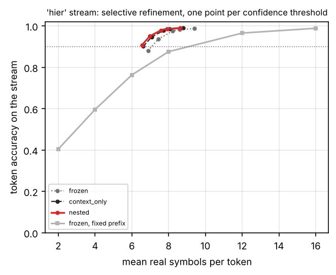
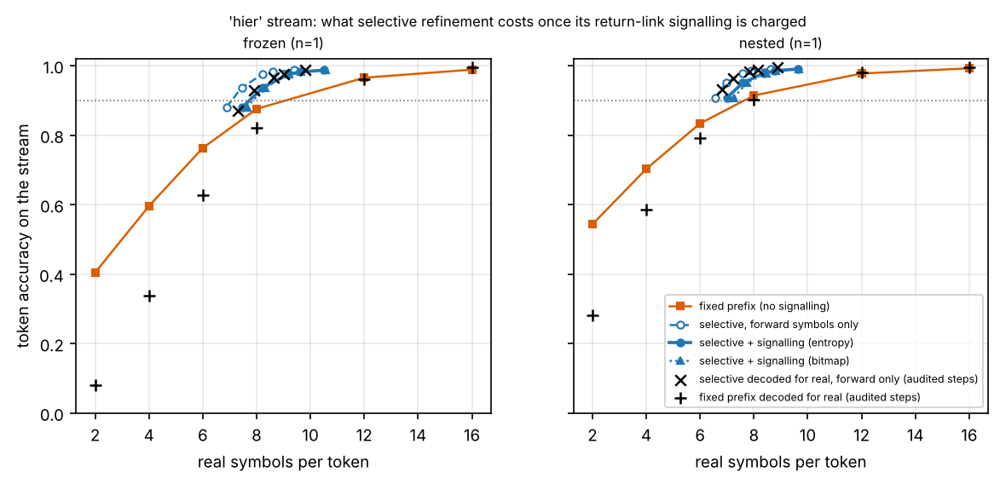
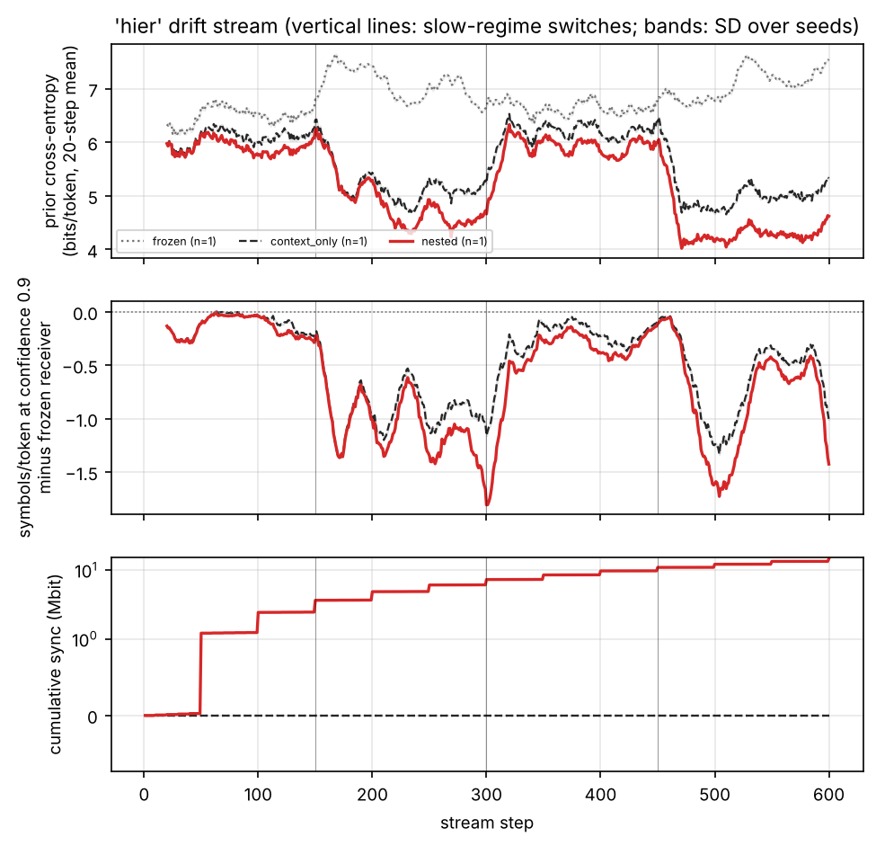

# Tables and figures: gpt2

Generated by `scripts/write_report.py` from the result files; nothing here is typed by hand.

## Headline, hier stream

Real channel symbols per token needed for 90% token accuracy on the 'hier' stream, teacher-forced on every step (mean over seeds; read off each method's measured operating curve). Every receiver is compared with the frozen receiver on the same seeds.

| Receiver | Seeds | Prior bits/token | Symbols/token | vs. frozen at a fixed rate | vs. frozen with refinement | Sync kbit/step | Symbols/token incl. feedback (entropy) | vs. frozen at a fixed rate, feedback charged |
| --- | --- | --- | --- | --- | --- | --- | --- | --- |
| frozen, fixed prefix length | 1 | 6.843 | 9.089 | — | — | 0 | 9.089 | — |
| frozen, selective refinement | 1 | 6.843 | 7.075 | -22.2% | — | 0.00 | 7.734 | -14.9% |
| context_only, selective refinement | 1 | 5.619 | 6.624 | -27.1% | -6.4% | 0.00 | 7.100 | -21.9% |
| nested, selective refinement | 1 | 5.247 | 6.555 | -27.9% | -7.4% | 24.23 | 6.998 | -23.0% |

"Incl. feedback": forward symbols plus the return-link signalling of the refinement requests, charged at its entropy and at the capacity of the mean SNR (derived; see the refinement-cost table for the bitmap variant and the free-running audit). n/a: not recorded by the code version that produced the run, or the target is not reached.

**Decoded for real.** The same symbols decoded free-running on the audited steps (every 23rd step of every run, pooled over the seeds of a method) with the decoder of the run (beam 4, first shell 6 symbols, reopening off), for selective refinement and the fixed-prefix reference alike; selective refinement is charged its signalling. Every receiver is compared with the frozen receiver's fixed prefix on the same seeds.

| Receiver | Seeds | Audited steps | Fixed prefix | vs. frozen fixed prefix | Selective + signalling (entropy) | vs. frozen fixed prefix | Selective + signalling (bitmap) | vs. frozen fixed prefix |
| --- | --- | --- | --- | --- | --- | --- | --- | --- |
| frozen | 1 | 26 | 10.253 | — | 8.430 | -17.8% | 8.498 | -17.1% |
| context_only | 1 | 26 | 8.763 | -14.5% | 7.502 | -26.8% | 7.674 | -25.2% |
| nested | 1 | 26 | 7.979 | -22.2% | 7.392 | -27.9% | 7.582 | -26.1% |

## Hierarchical drift stream

**Online adaptation on the 'hier' drift stream (mean ± SD over seeds; per-step paired differences to 'nested' with a 95% block-bootstrap interval, * = excludes zero; exact seed-level sign-flip permutation test on the prior bits, raw and Holm-corrected, with the smallest p-value that number of seeds can give: a seed-level test cannot be significant at 0.05 with fewer than six seeds)**

| method | seeds | tok-acc @m_op | bits/token @m_op | prior bits/token | selective sym/token | selective tok-acc | ECE | retention tok-acc | retention BLEU-4 | slot switches | codebook power | sync kbit/step | net rate (sym/msg) | prior bits: this − nested [95% CI] | selective sym/token: this − nested [95% CI] | selective tok-acc: this − nested [95% CI] |
| --- | --- | --- | --- | --- | --- | --- | --- | --- | --- | --- | --- | --- | --- | --- | --- | --- |
| context_only | 1 | 0.8188 ± 0.0000 | 1.0737 ± 0.0000 | 5.6192 ± 0.0000 | 7.7239 ± 0.0000 | 0.9779 ± 0.0000 | 0.0053 ± 0.0000 | 0.8549 ± 0.0000 | 0.4995 ± 0.0000 | 0.0 | 1.290 | 0.00 | 107.95 | +0.3717 [+0.2832, +0.4602]* | +0.1470 [+0.0950, +0.2097]* | -0.0011 [-0.0021, -0.0003]* |
| frozen | 1 | 0.7630 ± 0.0000 | 1.4283 ± 0.0000 | 6.8430 ± 0.0000 | 8.2138 ± 0.0000 | 0.9750 ± 0.0000 | 0.0055 ± 0.0000 | 0.7998 ± 0.0000 | 0.3508 ± 0.0000 | 0.0 | 1.310 | 0.00 | 108.30 | +1.5956 [+1.1834, +1.9990]* | +0.6368 [+0.4516, +0.8425]* | -0.0041 [-0.0071, -0.0017]* |
| nested | 1 | 0.8338 ± 0.0000 | 0.9715 ± 0.0000 | 5.2475 ± 0.0000 | 7.5770 ± 0.0000 | 0.9790 ± 0.0000 | 0.0048 ± 0.0000 | 0.8720 ± 0.0000 | 0.6053 ± 0.0000 | 5.0 | 1.290 | 24.23 | 121.96 | - | - | - |

**Primary endpoint decoded for real on the 'hier' stream: real symbols per token for 90% token accuracy on the audited steps, every receiver and the frozen receiver decoded free-running from the same received symbols, operating curves pooled over the seeds, selective refinement charged its return-link signalling. Relative changes with a 95% percentile interval from 2000 paired bootstrap draws of the audited steps within each seed; a draw in which a receiver's curve misses the target counts as an infinite cost ('unbounded' if that happens in more than 2.5% of the draws). Seed-level test: exact sign-flip permutation test of the per-seed selective cost with signalling (entropy) against the frozen fixed prefix of the same seed, Holm-corrected over the receivers, possible only if every seed reaches the target. Runs made before version 0.4 kept no per-step request decisions; for them the entropy of the signalling is held at each run's own value in the bootstrap (the bitmap figures are exact)**

| method | seeds | audited steps | fixed prefix | fixed prefix vs frozen fixed | selective + feedback (entropy) | vs frozen fixed [95% CI] | vs own fixed (what refinement adds) | selective + feedback (bitmap) | bitmap vs frozen fixed | draws missing the target | per-seed saving vs frozen fixed (entropy) | p (seed-level) | p (Holm) | smallest attainable p |
| --- | --- | --- | --- | --- | --- | --- | --- | --- | --- | --- | --- | --- | --- | --- |
| frozen | 1 | 26 | 10.253 | — | 8.430 | -17.8% [-21.5%, -5.7%] | -17.8% [-21.5%, -5.7%] | 8.498 | -17.1% [-20.9%, -3.8%] | 0.0% | -17.8% | - | - | 1.0000 |
| context_only | 1 | 26 | 8.763 | -14.5% [-20.9%, -7.5%] | 7.502 | -26.8% [-31.8%, -11.4%] | -14.4% [-20.8%, -2.5%] | 7.674 | -25.2% [-30.5%, -8.5%] | 0.0% | -26.8% | - | - | 1.0000 |
| nested | 1 | 26 | 7.979 | -22.2% [-26.9%, -10.8%] | 7.392 | -27.9% [-33.7%, -12.5%] | -7.4% [-19.2%, +0.3%] | 7.582 | -26.1% [-32.3%, -9.2%] | 0.0% | -27.9% | - | - | 1.0000 |

**Emulation check on the 'hier' stream (docs/METHOD.md, section 9): free-running against teacher-forced forward symbols per token for 90% token accuracy on exactly the audited steps, curves pooled over the seeds. Verdict: every method within 5% - the teacher-forced curves stand as the measurement, the free-running ones are reported next to them**

| method | seeds | free-running, forward | emulated on the same steps | gap | within 5% |
| --- | --- | --- | --- | --- | --- |
| context_only | 1 | 6.906 | 6.670 | +3.5% | yes |
| frozen | 1 | 7.604 | 7.289 | +4.3% | yes |
| nested | 1 | 6.831 | 6.609 | +3.4% | yes |

**What selective refinement costs on the 'hier' stream: real symbols per token for 90% token accuracy. 'Feedback' is the return-link signalling of the requests at the operating threshold, converted to symbols at the capacity of the mean SNR (derived, optimistic; bitmap = one bit per open token and round, entropy = ideal coding of those bits). Teacher-forced columns: mean over seeds of each run's reading. 'Free-running' decodes the same received symbols for real on a subset of the steps - the selective policy and the fixed prefixes alike - and 'emulated' is the teacher-forced figure on exactly those steps; these columns are read off the operating curves pooled over the seeds (all audited steps), and the free-running saving compares like with like. n/a: not recorded by the code version that produced the run; not reached: the measured curve never reaches the target accuracy**

| method | seeds | fixed prefix | selective, forward only | feedback bits/token (bitmap) | feedback bits/token (entropy) | rounds/message | selective + feedback (bitmap) | selective + feedback (entropy) | saving vs fixed, feedback charged (entropy) | free-running: steps audited | free-running fixed prefix | emulated fixed prefix, same steps | free-running, forward only | emulated on the same steps | free-running + feedback (entropy) | free-running + feedback (bitmap) | free-running saving vs free-running fixed, feedback charged (entropy) | free-running tok-acc at the threshold | emulated tok-acc at the threshold |
| --- | --- | --- | --- | --- | --- | --- | --- | --- | --- | --- | --- | --- | --- | --- | --- | --- | --- | --- | --- |
| context_only | 1 | 7.858 | 6.624 | 1.553 | 1.446 | 2.95 | 7.332 | 7.100 | -9.6% | 26 | 8.763 | 8.487 | 6.906 | 6.670 | 7.502 | 7.674 | -14.4% | 0.9746 | 0.9759 |
| frozen | 1 | 9.089 | 7.075 | 1.702 | 1.639 | 3.12 | 7.870 | 7.734 | -14.9% | 26 | 10.253 | 9.571 | 7.604 | 7.289 | 8.430 | 8.498 | -17.8% | 0.9658 | 0.9714 |
| nested | 1 | 7.648 | 6.555 | 1.511 | 1.383 | 2.88 | 7.250 | 6.998 | -8.5% | 26 | 7.979 | 7.937 | 6.831 | 6.609 | 7.392 | 7.582 | -7.4% | 0.9829 | 0.9755 |

**Selective refinement on the 'hier' stream by the shell sent in the first round: symbols per token for 90% token accuracy (n/a = the target is not reached on that curve). The paper's policy is the first row of every method; the other rows are a post-hoc exploration, not a tuned result**

| method | seeds | first shell (symbols) | forward only | + feedback (bitmap) | + feedback (entropy) |
| --- | --- | --- | --- | --- | --- |
| context_only | 1 | 2 | 5.088 | 6.466 | 6.388 |
| context_only | 1 | 4 | 5.661 | 6.640 | 6.591 |
| context_only | 1 | 6 | 6.624 | 7.332 | 7.100 |
| context_only | 1 | 8 | 8.351 | 8.972 | 8.596 |
| context_only | 1 | 12 | 12.064 | 12.642 | 12.132 |
| context_only | 1 | 16 | 16.000 | 16.000 | 16.000 |
| frozen | 1 | 2 | 6.038 | 7.639 | 7.435 |
| frozen | 1 | 4 | 6.331 | 7.460 | 7.424 |
| frozen | 1 | 6 | 7.075 | 7.870 | 7.734 |
| frozen | 1 | 8 | 8.492 | 9.130 | 8.804 |
| frozen | 1 | 12 | 12.092 | 12.670 | 12.182 |
| frozen | 1 | 16 | 16.000 | 16.000 | 16.000 |
| nested | 1 | 2 | 4.807 | 6.116 | 6.061 |
| nested | 1 | 4 | 5.448 | 6.379 | 6.316 |
| nested | 1 | 6 | 6.555 | 7.250 | 6.998 |
| nested | 1 | 8 | 8.308 | 8.925 | 8.531 |
| nested | 1 | 12 | 12.056 | 12.634 | 12.117 |
| nested | 1 | 16 | 16.000 | 16.000 | 16.000 |

**Forward symbols per token needed on the 'hier' stream for three target token accuracies (mean over seeds; n/a = not reached within the measured curve, or below its cheapest point for one of the seeds)**

| method | seeds | fixed, 85% | selective, 85% | fixed, 90% | selective, 90% | fixed, 95% | selective, 95% |
| --- | --- | --- | --- | --- | --- | --- | --- |
| context_only | 1 | 6.714 | 6.624 | 7.858 | 6.624 | 10.562 | 7.151 |
| frozen | 1 | 7.546 | 6.879 | 9.089 | 7.075 | 11.315 | 7.710 |
| nested | 1 | 6.404 | 6.555 | 7.648 | 6.555 | 10.262 | 6.967 |

**Equivalence tests against 'nested' on the 'hier' stream: two one-sided tests at 5% on the per-step paired differences (90% block-bootstrap interval inside the margin). The margins are fixed in the configuration before the runs; 'no' means equivalence was not shown, not that a difference was shown**

| method | seeds | prior bits/token: this − nested [90% CI] | prior bits/token: equivalent within ±0.05 | selective sym/token: this − nested [90% CI] | selective sym/token: equivalent within ±0.05 |
| --- | --- | --- | --- | --- | --- |
| context_only | 1 | +0.3717 [+0.2979, +0.4468] | no | +0.1470 [+0.1032, +0.1973] | no |
| frozen | 1 | +1.5956 [+1.2517, +1.9380] | no | +0.6368 [+0.4763, +0.8021] | no |

**The 'hier' stream by slow regime: prequential metrics while the regime is active, and held-out probes of it at the end of the stream (mean ± SD over seeds). A probe scores the receiver's copy at that moment: methods are comparable on a probe only at equal staleness (steps since the slowest level was shipped)**

| method | regime | seeds | prior bits/token | tok-acc @m_op | selective sym/token | selective tok-acc | held-out prior bits (end) | held-out tok-acc (end) | receiver staleness at the probe (steps) |
| --- | --- | --- | --- | --- | --- | --- | --- | --- | --- |
| context_only | ag_news | 1 | 6.1867 ± 0.0000 | 0.8167 ± 0.0000 | 7.6675 ± 0.0000 | 0.9804 ± 0.0000 | 6.3420 | 0.8316 | - |
| context_only | teleqna | 1 | 5.0517 ± 0.0000 | 0.8209 ± 0.0000 | 7.7804 ± 0.0000 | 0.9753 ± 0.0000 | 4.8965 | 0.8782 | - |
| frozen | ag_news | 1 | 6.5875 ± 0.0000 | 0.7992 ± 0.0000 | 7.8235 ± 0.0000 | 0.9809 ± 0.0000 | 6.6539 | 0.8081 | - |
| frozen | teleqna | 1 | 7.0986 ± 0.0000 | 0.7269 ± 0.0000 | 8.6042 ± 0.0000 | 0.9690 ± 0.0000 | 7.2270 | 0.7915 | - |
| nested | ag_news | 1 | 5.9627 ± 0.0000 | 0.8244 ± 0.0000 | 7.5944 ± 0.0000 | 0.9815 ± 0.0000 | 5.8482 | 0.8349 | 150 |
| nested | teleqna | 1 | 4.5322 ± 0.0000 | 0.8431 ± 0.0000 | 7.5596 ± 0.0000 | 0.9766 ± 0.0000 | 4.1277 | 0.9091 | 150 |

**Operating curves on the 'hier' stream: token accuracy at every fixed prefix length, and (symbols per token / token accuracy) under selective refinement at every confidence threshold**

| method | acc m=2 | acc m=4 | acc m=6 | acc m=8 | acc m=12 | acc m=16 | τ=0.5 | τ=0.7 | τ=0.9 | τ=0.95 | τ=0.99 |
| --- | --- | --- | --- | --- | --- | --- | --- | --- | --- | --- | --- |
| context_only | 0.5111 | 0.6799 | 0.8188 | 0.9062 | 0.9746 | 0.9914 | 6.62 sym / 0.9014 | 7.07 sym / 0.9462 | 7.72 sym / 0.9779 | 8.06 sym / 0.9845 | 8.80 sym / 0.9896 |
| frozen | 0.4043 | 0.5958 | 0.7630 | 0.8755 | 0.9654 | 0.9885 | 6.88 sym / 0.8805 | 7.45 sym / 0.9370 | 8.21 sym / 0.9750 | 8.60 sym / 0.9820 | 9.40 sym / 0.9871 |
| nested | 0.5434 | 0.7027 | 0.8338 | 0.9141 | 0.9775 | 0.9924 | 6.56 sym / 0.9080 | 6.97 sym / 0.9505 | 7.58 sym / 0.9790 | 7.90 sym / 0.9853 | 8.63 sym / 0.9904 |

**Derived net semantic rate (real symbols per message, payload at equal fidelity plus amortised synchronisation) on the 'hier' stream as a function of messages carried per adaptation step N, at 10 dB**

| method | sym/token for 90% tok-acc | saving vs frozen | payload (sym/msg) | N=1 | N=10 | N=100 | N=1000 | N=10000 | N=100000 | N* (vs frozen) | N* (vs context_only) |
| --- | --- | --- | --- | --- | --- | --- | --- | --- | --- | --- | --- |
| context_only | 6.624 | +6.4% | 119.2 | 119.2 | 119.2 | 119.2 | 119.2 | 119.2 | 119.2 | - | - |
| frozen | 7.075 | +0.0% | 127.7 | 127.7 | 127.7 | 127.7 | 127.7 | 127.7 | 127.7 | - | - |
| nested | 6.555 | +7.4% | 117.9 | 14124.0 | 1518.5 | 258.0 | 131.9 | 119.3 | 118.1 | 1497 | 11369 |

## Figures

### curves_hier

### refine_cost_hier

### slots_hier

### stream_hier

