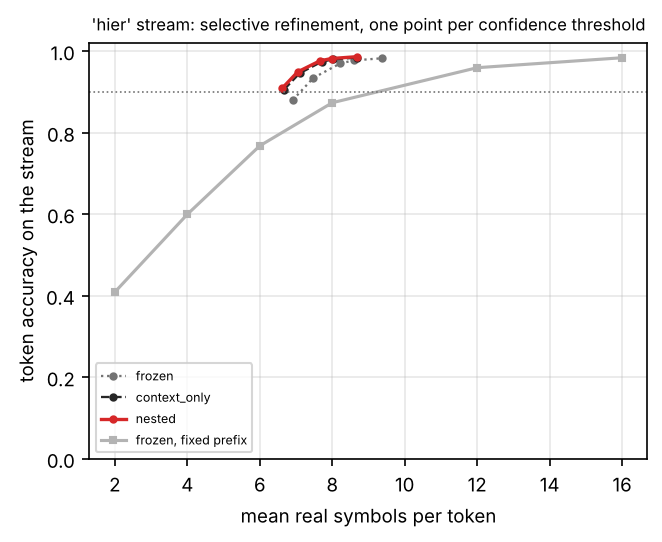
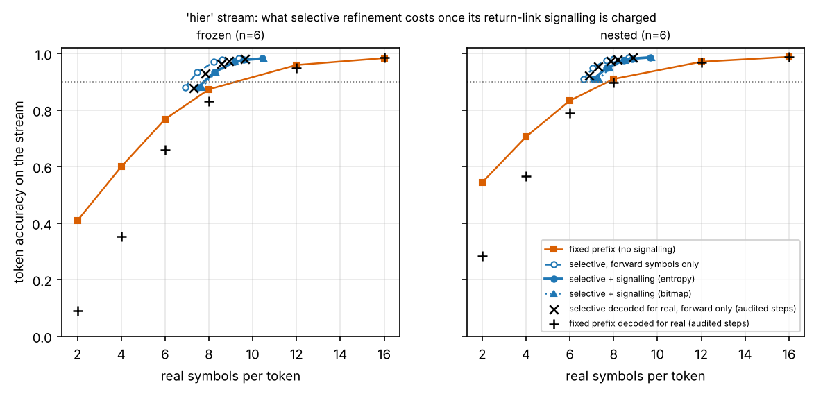
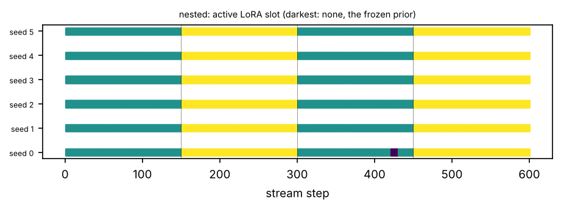
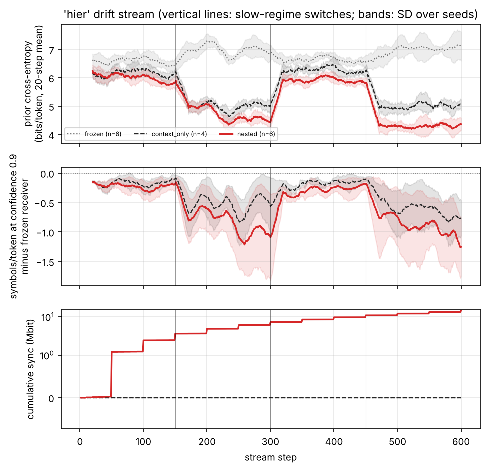

# Tables and figures: gpt2

Generated by `scripts/write_report.py` from the result files; nothing here is typed by hand.

## Headline, hier stream

Real channel symbols per token needed for 90% token accuracy on the 'hier' stream, teacher-forced on every step (mean over seeds; read off each method's measured operating curve). Every receiver is compared with the frozen receiver on the same seeds.

| Receiver | Seeds | Prior bits/token | Symbols/token | vs. frozen at a fixed rate | vs. frozen with refinement | Sync kbit/step | Symbols/token incl. feedback (entropy) | vs. frozen at a fixed rate, feedback charged |
| --- | --- | --- | --- | --- | --- | --- | --- | --- |
| frozen, fixed prefix length | 6 | 6.794 | 9.227 | — | — | 0 | 9.227 | — |
| frozen, selective refinement | 6 | 6.794 | 7.143 | -22.6% | — | 0.00 | 7.805 | -15.4% |
| context_only, selective refinement | 4 | 5.609 | 6.696 | -25.2% | -4.7% | 0.00 | 7.178 | -19.8% |
| nested, selective refinement | 6 | 5.232 | 6.618 | -28.3% | -7.4% | 24.23 | 7.075 | -23.3% |

"Incl. feedback": forward symbols plus the return-link signalling of the refinement requests, charged at its entropy and at the capacity of the mean SNR (derived; see the refinement-cost table for the bitmap variant and the free-running audit). n/a: not recorded by the code version that produced the run, or the target is not reached.

**Decoded for real.** The same symbols decoded free-running on the audited steps (every 23rd step of every run, pooled over the seeds of a method) with the decoder of the run (beam 4, first shell 6 symbols, reopening off), for selective refinement and the fixed-prefix reference alike; selective refinement is charged its signalling. Every receiver is compared with the frozen receiver's fixed prefix on the same seeds.

| Receiver | Seeds | Audited steps | Fixed prefix | vs. frozen fixed prefix | Selective + signalling (entropy) | vs. frozen fixed prefix | Selective + signalling (bitmap) | vs. frozen fixed prefix |
| --- | --- | --- | --- | --- | --- | --- | --- | --- |
| frozen | 6 | 156 | 10.366 | — | 8.356 | -19.4% | 8.426 | -18.7% |
| context_only | 4 | 104 | 9.052 | -10.6% | 7.541 | -25.5% | 7.703 | -23.9% |
| nested | 6 | 156 | 8.168 | -21.2% | 7.472 | -27.9% | 7.644 | -26.3% |

## Hierarchical drift stream

**Online adaptation on the 'hier' drift stream (mean ± SD over seeds; per-step paired differences to 'nested' with a 95% block-bootstrap interval, * = excludes zero; exact seed-level sign-flip permutation test on the prior bits, raw and Holm-corrected, with the smallest p-value that number of seeds can give: a seed-level test cannot be significant at 0.05 with fewer than six seeds)**

| method | seeds | tok-acc @m_op | bits/token @m_op | prior bits/token | selective sym/token | selective tok-acc | ECE | retention tok-acc | retention BLEU-4 | slot switches | codebook power | sync kbit/step | net rate (sym/msg) | Δ prior bits (nested − this) | prior bits: this − nested [95% CI] | selective sym/token: this − nested [95% CI] | selective tok-acc: this − nested [95% CI] | p (seed-level) | p (Holm) | smallest attainable p |
| --- | --- | --- | --- | --- | --- | --- | --- | --- | --- | --- | --- | --- | --- | --- | --- | --- | --- | --- | --- | --- |
| context_only | 4 | 0.8263 ± 0.0301 | 1.0546 ± 0.2139 | 5.6092 ± 0.0207 | 7.7047 ± 0.3953 | 0.9736 ± 0.0103 | 0.0047 ± 0.0012 | 0.8549 ± 0.0000 | 0.4995 ± 0.0000 | 0.0 | 1.286 | 0.00 | 107.70 | -0.3680 | +0.3680 [+0.3248, +0.4117]* | +0.1214 [+0.0958, +0.1504]* | -0.0023 [-0.0032, -0.0015]* | 0.1250 | 0.1250 | 0.1250 |
| frozen | 6 | 0.7676 ± 0.0372 | 1.4144 ± 0.2524 | 6.7941 ± 0.0389 | 8.2241 ± 0.4249 | 0.9699 ± 0.0086 | 0.0068 ± 0.0020 | 0.7998 ± 0.0000 | 0.3508 ± 0.0000 | 0.0 | 1.306 | 0.00 | 107.96 | -1.5624 | +1.5624 [+1.4107, +1.7225]* | +0.5652 [+0.4884, +0.6501]* | -0.0061 [-0.0076, -0.0048]* | 0.0312 | 0.0625 | 0.0312 |
| nested | 6 | 0.8334 ± 0.0242 | 0.9968 ± 0.1632 | 5.2317 ± 0.0178 | 7.6588 ± 0.3054 | 0.9760 ± 0.0072 | 0.0032 ± 0.0009 | 0.8743 ± 0.0040 | 0.6062 ± 0.0194 | 3.3 | 1.286 | 24.23 | 121.62 | - | - | - | - | - | - | - |

**Primary endpoint decoded for real on the 'hier' stream: real symbols per token for 90% token accuracy on the audited steps, every receiver and the frozen receiver decoded free-running from the same received symbols, operating curves pooled over the seeds, selective refinement charged its return-link signalling. Relative changes with a 95% percentile interval from 2000 paired bootstrap draws of the audited steps within each seed; a draw in which a receiver's curve misses the target counts as an infinite cost ('unbounded' if that happens in more than 2.5% of the draws). Seed-level test: exact sign-flip permutation test of the per-seed selective cost with signalling (entropy) against the frozen fixed prefix of the same seed, Holm-corrected over the receivers, possible only if every seed reaches the target. Runs made before version 0.4 kept no per-step request decisions; for them the entropy of the signalling is held at each run's own value in the bootstrap (the bitmap figures are exact)**

| method | seeds | audited steps | fixed prefix | fixed prefix vs frozen fixed | selective + feedback (entropy) | vs frozen fixed [95% CI] | vs own fixed (what refinement adds) | selective + feedback (bitmap) | bitmap vs frozen fixed | draws missing the target | per-seed saving vs frozen fixed (entropy) | p (seed-level) | p (Holm) | smallest attainable p |
| --- | --- | --- | --- | --- | --- | --- | --- | --- | --- | --- | --- | --- | --- | --- |
| frozen | 6 | 156 | 10.366 | — | 8.363 | -19.3% [-21.4%, -15.6%] | -19.3% [-21.4%, -15.6%] | 8.426 | -18.7% [-21.0%, -14.5%] | 0.0% | -17.8% / -19.9% / -17.9% / -3.6% / -22.1% / -21.1% | 0.0312 | 0.0938 | 0.0312 |
| context_only | 4 | 104 | 9.052 | -10.6% [-16.1%, -5.3%] | 7.547 | -25.4% [-29.0%, -15.6%] | -16.6% [-23.2%, -5.0%] | 7.703 | -23.9% [-27.9%, -13.2%] | 0.0% | -26.8% / -7.5% / -26.1% / -26.8% | 0.1250 | 0.1250 | 0.1250 |
| nested | 6 | 156 | 8.168 | -21.2% [-23.9%, -14.9%] | 7.478 | -27.9% [-31.7%, -21.6%] | -8.4% [-18.3%, -3.9%] | 7.644 | -26.3% [-30.3%, -19.5%] | 0.0% | -27.9% / -30.4% / -28.9% / -9.1% / -29.2% / -31.2% | 0.0312 | 0.0938 | 0.0312 |

**Emulation check on the 'hier' stream (docs/METHOD.md, section 9): free-running against teacher-forced forward symbols per token for 90% token accuracy on exactly the audited steps, curves pooled over the seeds. Verdict: every method within 5% - the teacher-forced curves stand as the measurement, the free-running ones are reported next to them**

| method | seeds | free-running, forward | emulated on the same steps | gap | within 5% |
| --- | --- | --- | --- | --- | --- |
| context_only | 4 | 6.938 | 6.710 | +3.4% | yes |
| frozen | 6 | 7.548 | 7.191 | +5.0% | yes |
| nested | 6 | 6.888 | 6.650 | +3.6% | yes |

**What selective refinement costs on the 'hier' stream: real symbols per token for 90% token accuracy. 'Feedback' is the return-link signalling of the requests at the operating threshold, converted to symbols at the capacity of the mean SNR (derived, optimistic; bitmap = one bit per open token and round, entropy = ideal coding of those bits). Teacher-forced columns: mean over seeds of each run's reading. 'Free-running' decodes the same received symbols for real on a subset of the steps - the selective policy and the fixed prefixes alike - and 'emulated' is the teacher-forced figure on exactly those steps; these columns are read off the operating curves pooled over the seeds (all audited steps), and the free-running saving compares like with like. n/a: not recorded by the code version that produced the run; not reached: the measured curve never reaches the target accuracy**

| method | seeds | fixed prefix | selective, forward only | feedback bits/token (bitmap) | feedback bits/token (entropy) | rounds/message | selective + feedback (bitmap) | selective + feedback (entropy) | saving vs fixed, feedback charged (entropy) | free-running: steps audited | free-running fixed prefix | emulated fixed prefix, same steps | free-running, forward only | emulated on the same steps | free-running + feedback (entropy) | free-running + feedback (bitmap) | free-running saving vs free-running fixed, feedback charged (entropy) | free-running tok-acc at the threshold | emulated tok-acc at the threshold |
| --- | --- | --- | --- | --- | --- | --- | --- | --- | --- | --- | --- | --- | --- | --- | --- | --- | --- | --- | --- |
| context_only | 4 | 8.044 | 6.696 | 1.525 | 1.403 | 2.81 | 7.410 | 7.178 | -10.8% | 104 | 9.052 | 8.162 | 6.938 | 6.710 | 7.541 | 7.703 | -16.7% | 0.9639 | 0.9686 |
| frozen | 6 | 9.227 | 7.143 | 1.687 | 1.622 | 3.07 | 7.941 | 7.805 | -15.4% | 156 | 10.366 | 9.450 | 7.548 | 7.191 | 8.356 | 8.426 | -19.4% | 0.9634 | 0.9688 |
| nested | 6 | 7.797 | 6.618 | 1.518 | 1.394 | 2.84 | 7.320 | 7.075 | -9.3% | 156 | 8.168 | 7.865 | 6.888 | 6.650 | 7.472 | 7.644 | -8.5% | 0.9725 | 0.9741 |

**Selective refinement on the 'hier' stream by the shell sent in the first round: symbols per token for 90% token accuracy (n/a = the target is not reached on that curve). The paper's policy is the first row of every method; the other rows are a post-hoc exploration, not a tuned result**

| method | seeds | first shell (symbols) | forward only | + feedback (bitmap) | + feedback (entropy) |
| --- | --- | --- | --- | --- | --- |
| context_only | 4 | 2 | 5.099 | 6.464 | 6.391 |
| context_only | 4 | 4 | 5.660 | 6.625 | 6.570 |
| context_only | 4 | 6 | 6.696 | 7.410 | 7.178 |
| context_only | 4 | 8 | 8.404 | 9.029 | 8.664 |
| context_only | 4 | 12 | 12.100 | 12.678 | 12.191 |
| context_only | 4 | 16 | 16.000 | 16.000 | 16.000 |
| frozen | 6 | 2 | 6.112 | 7.716 | 7.511 |
| frozen | 6 | 4 | 6.386 | 7.515 | 7.482 |
| frozen | 6 | 6 | 7.143 | 7.941 | 7.805 |
| frozen | 6 | 8 | 8.537 | 9.177 | 8.861 |
| frozen | 6 | 12 | 12.123 | 12.701 | 12.232 |
| frozen | 6 | 16 | 16.000 | 16.000 | 16.000 |
| nested | 6 | 2 | 4.897 | 6.217 | 6.160 |
| nested | 6 | 4 | 5.527 | 6.467 | 6.405 |
| nested | 6 | 6 | 6.618 | 7.320 | 7.075 |
| nested | 6 | 8 | 8.363 | 8.983 | 8.606 |
| nested | 6 | 12 | 12.084 | 12.662 | 12.164 |
| nested | 6 | 16 | 16.000 | 16.000 | 16.000 |

**Forward symbols per token needed on the 'hier' stream for three target token accuracies (mean over seeds; n/a = not reached within the measured curve, or below its cheapest point for one of the seeds)**

| method | seeds | fixed, 85% | selective, 85% | fixed, 90% | selective, 90% | fixed, 95% | selective, 95% |
| --- | --- | --- | --- | --- | --- | --- | --- |
| context_only | 4 | 6.631 | 6.669 | 8.044 | 6.696 | 10.795 | 7.240 |
| frozen | 6 | 7.534 | 6.913 | 9.227 | 7.143 | 11.604 | 7.827 |
| nested | 6 | 6.467 | 6.614 | 7.797 | 6.618 | 10.535 | 7.108 |

**Equivalence tests against 'nested' on the 'hier' stream: two one-sided tests at 5% on the per-step paired differences (90% block-bootstrap interval inside the margin). The margins are fixed in the configuration before the runs; 'no' means equivalence was not shown, not that a difference was shown**

| method | seeds | prior bits/token: this − nested [90% CI] | prior bits/token: equivalent within ±0.05 | selective sym/token: this − nested [90% CI] | selective sym/token: equivalent within ±0.05 |
| --- | --- | --- | --- | --- | --- |
| context_only | 4 | +0.3680 [+0.3314, +0.4052] | no | +0.1214 [+0.0992, +0.1450] | no |
| frozen | 6 | +1.5624 [+1.4308, +1.7012] | no | +0.5652 [+0.4987, +0.6341] | no |

**The 'hier' stream by slow regime: prequential metrics while the regime is active, and held-out probes of it at the end of the stream (mean ± SD over seeds). A probe scores the receiver's copy at that moment: methods are comparable on a probe only at equal staleness (steps since the slowest level was shipped)**

| method | regime | seeds | prior bits/token | tok-acc @m_op | selective sym/token | selective tok-acc | held-out prior bits (end) | held-out tok-acc (end) | receiver staleness at the probe (steps) |
| --- | --- | --- | --- | --- | --- | --- | --- | --- | --- |
| context_only | ag_news | 4 | 6.2226 ± 0.0382 | 0.7830 ± 0.0444 | 8.1324 ± 0.6196 | 0.9666 ± 0.0172 | 6.3420 | 0.8316 | - |
| context_only | teleqna | 4 | 4.9957 ± 0.0741 | 0.8696 ± 0.0395 | 7.2769 ± 0.4264 | 0.9806 ± 0.0063 | 4.8965 | 0.8782 | - |
| frozen | ag_news | 6 | 6.6048 ± 0.0366 | 0.7659 ± 0.0368 | 8.2075 ± 0.5216 | 0.9703 ± 0.0156 | 6.6539 | 0.8081 | - |
| frozen | teleqna | 6 | 6.9834 ± 0.1033 | 0.7692 ± 0.0697 | 8.2407 ± 0.7952 | 0.9695 ± 0.0110 | 7.2270 | 0.7915 | - |
| nested | ag_news | 6 | 5.9628 ± 0.0418 | 0.7991 ± 0.0340 | 7.9595 ± 0.5023 | 0.9737 ± 0.0137 | 5.8398 | 0.8389 | 150 |
| nested | teleqna | 6 | 4.5006 ± 0.0630 | 0.8677 ± 0.0421 | 7.3582 ± 0.4874 | 0.9783 ± 0.0080 | 4.1403 | 0.9098 | 150 |

**Operating curves on the 'hier' stream: token accuracy at every fixed prefix length, and (symbols per token / token accuracy) under selective refinement at every confidence threshold**

| method | acc m=2 | acc m=4 | acc m=6 | acc m=8 | acc m=12 | acc m=16 | τ=0.5 | τ=0.7 | τ=0.9 | τ=0.95 | τ=0.99 |
| --- | --- | --- | --- | --- | --- | --- | --- | --- | --- | --- | --- |
| context_only | 0.5184 | 0.6920 | 0.8263 | 0.9046 | 0.9670 | 0.9854 | 6.67 sym / 0.9055 | 7.10 sym / 0.9456 | 7.70 sym / 0.9736 | 8.01 sym / 0.9794 | 8.68 sym / 0.9839 |
| frozen | 0.4088 | 0.5995 | 0.7676 | 0.8733 | 0.9592 | 0.9836 | 6.91 sym / 0.8803 | 7.48 sym / 0.9340 | 8.22 sym / 0.9699 | 8.60 sym / 0.9770 | 9.36 sym / 0.9823 |
| nested | 0.5440 | 0.7055 | 0.8334 | 0.9097 | 0.9707 | 0.9880 | 6.61 sym / 0.9084 | 7.04 sym / 0.9489 | 7.66 sym / 0.9760 | 7.98 sym / 0.9817 | 8.68 sym / 0.9862 |

**Derived net semantic rate (real symbols per message, payload at equal fidelity plus amortised synchronisation) on the 'hier' stream as a function of messages carried per adaptation step N, at 10 dB**

| method | sym/token for 90% tok-acc | saving vs frozen | payload (sym/msg) | N=1 | N=10 | N=100 | N=1000 | N=10000 | N=100000 | N* (vs frozen) |
| --- | --- | --- | --- | --- | --- | --- | --- | --- | --- | --- |
| context_only | 6.696 | +4.7% | 120.2 | 120.2 | 120.2 | 120.2 | 120.2 | 120.2 | 120.2 | - |
| frozen | 7.143 | +0.0% | 128.5 | 128.5 | 128.5 | 128.5 | 128.5 | 128.5 | 128.5 | - |
| nested | 6.618 | +7.4% | 118.7 | 14124.8 | 1519.3 | 258.8 | 132.7 | 120.1 | 118.8 | 1487 |

## Figures

### curves_hier

### refine_cost_hier

### slots_hier

### stream_hier

